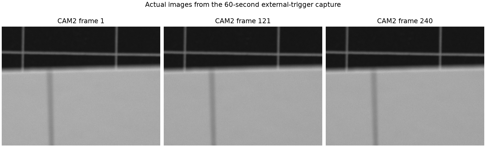
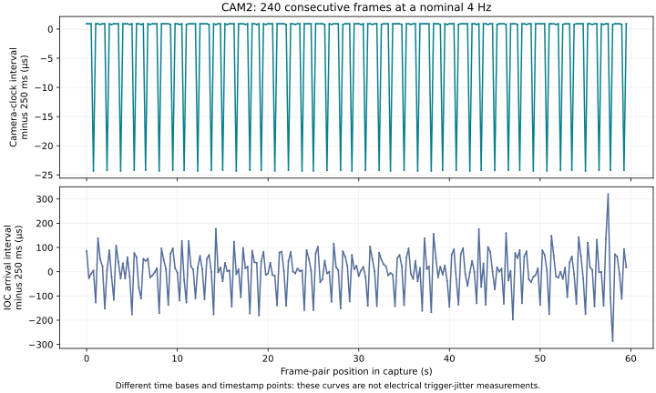

:orphan:

.. _earlier-camera-response:

Earlier target-grid capture
============================

.. note::

   This appendix describes the **earlier 12:33–12:34 Phoenix target-grid run**.
   It is not the later LED-view recording. See :doc:`index` for the current results.

The experiment follows the chain from **EVG event generation**, through **EVR
reception and output configuration**, to **CAM2 responding to external triggers**.
The camera is the downstream diagnostic.

**Observed at the tested low rates:** a controlled EVG event reached two receivers
with identical reported timestamps, and CAM2 recorded **240 consecutive frames in
a one-minute capture** using its existing external-Line1 trigger settings.
Electrical output delay, pulse width and exposure-edge jitter have not yet been
measured, so this is not a qualification against an unspecified timing tolerance.

.. raw:: html

   

     
Existing event 101<strong>4 Hz</strong>

     
CAM2 frames saved<strong>240</strong>

     
Camera frame-ID gaps<strong>0</strong>

     
EVR timestamp tick<strong>8 ns</strong>

   

What each part of the experiment established
--------------------------------------------

.. list-table:: Trigger chain and present evidence
   :header-rows: 1
   :widths: 22 48 30

   * - Stage
     - Evidence
     - Conclusion
   * - EVG sends an event
     - Approved event 42 was emitted at 10 Hz by EVG 20 and observed by EVRs 10 and 40.
     - Controlled event transmission was observed.
   * - EVRs receive and timestamp it
     - 2,990 complete-second pairs had mean offset 0 ns, standard deviation 0 ns and no measured drift.
     - Reported times agreed at the 8 ns tick resolution during that run.
   * - Hardware trigger output
     - EVR 20 output 1 is configured for event 101, zero programmed delay and a 100 µs pulse.
     - Configuration is known; the electrical waveform has not been scoped.
   * - Camera responds
     - CAM2 used TriggerMode=On, Source=Line1, FrameStart, 1 ms exposure. IDs 1–240 were saved with no ID gaps or recorder overruns.
     - Continuous camera response consistent with the existing 4 Hz trigger stream.
   * - Timing and rate requirements
     - No numerical delay/jitter acceptance limit has been specified. The 1 kHz test has not run.
     - End-to-end latency, jitter and high-rate operation remain to be qualified.

CAM2: actual captured output
----------------------------

This is the **new one-minute capture**, not the older cached image. The view
contains the target grid. Other cameras were intentionally closed and were not
part of this experiment.

.. raw:: html

   

     <video id="cam2-video" poster="../_static/timing-check/evidence/cam2-poster.png" controls preload="metadata" playsinline width="600" height="450">
       <source src="../_static/timing-check/evidence/cam2-capture.mp4" type="video/mp4">
       Your browser cannot play this video. Use the MP4 download below.
     </video>
     

       <button type="button" id="cam2-previous">Previous frame</button>
       <button type="button" id="cam2-next">Next frame</button>
       <output id="cam2-frame-readout" aria-live="polite"></output>
     

     
Saved replay at 4 frames/s. Pixel values use a constant display scale and are resized for review. Original arrays remain in the local capture folder. Replay timing is not a latency measurement.

   

   

:download:`Download the CAM2 replay (MP4) <../_static/timing-check/evidence/cam2-capture.mp4>`
or :download:`inspect every frame's metadata (CSV) <../_static/timing-check/evidence/cam2-frames.csv>`.

   Frames 1, 121 and 240 from the saved capture. No optical LED-pulse identity is assigned.

Conditions and counting
-----------------------

* Camera: ``CAM:DEV2:20:`` (CAM2); image size 1200 × 900 pixels.
* Trigger configuration: external Line1, FrameStart, rising edge; exposure 1 ms.
* Existing event 101: **250,000,000 ns** between every adjacent logged occurrence
  in both monitored EVR logs.
* Camera: **240 saved frames**, camera-provided IDs **1–240**, with all 239 ID
  increments exactly +1.
* All **240** frame/metadata associations passed the recorder's consistency checks;
  its bounded processing queue reported **zero overruns**.

The event logger includes initial cached and pre/post-capture data, so its totals
cover a wider window than the camera acquisition. We have not assigned each frame
a unique event ID; no gaps in camera IDs and agreement in aggregate rate do not
alone prove that every emitted hardware pulse produced exactly one frame.

What the timing numbers mean
-----------------------------

There are three different timing observations here. They should not be combined
into one claimed trigger-jitter number.

.. list-table:: Measured frame/event cadence
   :header-rows: 1
   :widths: 33 22 22 23

   * - Timestamp source
     - Mean interval
     - Interval standard deviation
     - What it describes
   * - EVR event 101
     - 250.000000 ms
     - 0 ns in the logged intervals
     - Electronic event cadence on the receivers' time base
   * - Camera-provided frame clock
     - 249.996466 ms
     - 9.560 µs
     - Differences between the camera's reported frame timestamps
   * - IOC image timestamp
     - 250.000197 ms
     - 87.250 µs
     - Image-arrival/processing cadence, including transport effects

   The camera clock shows small steps; IOC arrival times include network and
   processing variability. Neither curve measures the physical trigger edge.

The camera timestamps have no verified mapping to EVR POSIX seconds. Therefore
we cannot yet give an absolute EVG-to-exposure delay by subtracting them. The
receiver-only result is documented in :doc:`receiver_test`.

What would qualify the trigger timeframes?
------------------------------------------

The next timing measurement should compare the **physical trigger edge** with a
reference and the camera's **exposure-active edge**, using a scope or equivalent
hardware timestamp measurement. That determines whether programmed delay and
pulse width appear on the wire and whether exposure occurs at the intended time.
A photodiode/LED measurement can then extend the check to optical timing.

A numerical allowable delay/jitter and the intended operating rate are needed
before calling that measurement a timing pass or fail. The planned 100, 500 and
1000 Hz logging sweep remains separately unapproved. The other cameras can remain
closed; CAM2 is sufficient for this downstream response experiment.

Changes, restoration and evidence
---------------------------------

For the bounded CAM2 run, the only camera write was
``CAM:DEV2:20:cam1:Acquire``: **0 → 1 → 0**. Idle restoration was verified at the end
of the run (12:34:30 Phoenix time). A later read shows acquisition started again at
12:42:56; that later state was left unchanged during this analysis.

The four earlier event-42 settings and all eight EVR maps were restored and
verified. No trigger source, exposure setting, output delay/width, firmware,
IOC lifecycle or protection/MPS setting was changed for the camera capture.

Download the :download:`experiment summary <../_static/timing-check/evidence/report.txt>`,
:download:`CAM2 analysis <../_static/timing-check/evidence/cam2-analysis.json>`,
:download:`capture result <../_static/timing-check/evidence/cam2-capture-summary.json>`
and :download:`acquisition write journal <../_static/timing-check/evidence/cam2-acquisition-journal.jsonl>`.
The :download:`evidence manifest <../_static/timing-check/evidence/manifest.json>`
provides file checksums. The raw 240 pixel arrays and simultaneous event logs
remain under ``~/Desktop/dario/timing-check/camera-capture-20261023T193329Z/``.

This is a saved experiment report with an offline replay. It does not control the rack.

.. toctree::
   :hidden:

   receiver_test
