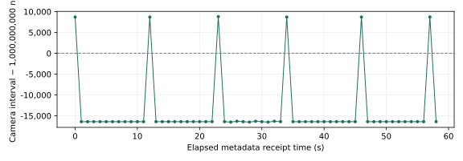

Camera response to event rate
=============================

:doc:`All experiments <scenario_results>`.

Objective
---------

Check whether CAM2 receives frames when event 101 changes to 1 Hz, and determine whether those frames contain the flashing LED.

Setup
-----

The generator at 10.139.5.196 sent event 101. Output 1 on receiver 10.139.5.197 selected that code, with a configured delay of 0 ns and width of 100,000 ns.
CAM2 at 192.168.2.1 used an external Line1 rising-edge trigger, a 1 ms exposure and 1200 × 900 Mono12 images. The trigger cable and DG645 output were not identified.
This completed trial used the previous camera-rate configuration 5. It did not generate an event after LED detection.

Procedure
---------

1. Save the timer and output settings. Keep camera acquisition and DG645 settings unchanged.
2. Set event 101 to 1 Hz with the configured output delay and width listed above.
3. Record receiver logs and camera metadata for 60 seconds. Save the original image arrays.
4. Check frame-ID order, saved image counts and consecutive camera-clock intervals.
5. Check the LED region in all saved images, then restore and verify the starting settings.

Results
-------

The recording contains 60 camera timestamps and 60 saved images, with no frame-ID gaps or image-writer overruns. The mean camera interval was 999,986,154.232 ns; its standard deviation was 7,591.680 ns.
None of the 60 images exceeded the 1,000-count LED threshold in columns 300–699 and rows 550–849. The region peak ranged from 172 to 191 counts.

   Recorded camera-clock intervals relative to the configured one-second period. These are not electrical trigger timestamps.

.. container:: experiment-image-pair

   .. figure:: ../_static/timing-check/scenarios/stage-101-led-bright.png
      :alt: Actual bright LED frame from the separate 10 Hz baseline.

      Separate 10 Hz baseline: LED bright.

   .. figure:: ../_static/timing-check/scenarios/stage-105-led-dim.png
      :alt: Actual dim LED frame from the 1 Hz trial.

      This 1 Hz trial: no bright LED detected.

Recording: ``20261104T013636Z-7f8d4f``. The bright image is a separate reference, not a successful exposure from this trial.

:download:`Frame metadata <../_static/timing-check/scenarios/scenario-5-frames.csv>` lists the recorded camera IDs and clock values.

.. list-table::
   :header-rows: 1

   * - Camera frame ID
     - Reported camera clock (s)
     - LED-region peak (counts)
   * - 1547826
     - 12035914.8220779
     - 182
   * - 1547827
     - 12035915.8220866
     - 179
   * - 1547828
     - 12035916.8220702
     - 176
   * - 1547829
     - 12035917.8220538
     - 178
   * - 1547830
     - 12035918.8220374
     - 187
   * - 1547831
     - 12035919.822021
     - 178
   * - 1547832
     - 12035920.8220046
     - 180
   * - 1547833
     - 12035921.8219882
     - 186
   * - 1547834
     - 12035922.8219718
     - 190
   * - 1547835
     - 12035923.8219554
     - 180
   * - 1547836
     - 12035924.821939
     - 174
   * - 1547837
     - 12035925.8219226
     - 176
   * - 1547838
     - 12035926.8219062
     - 188
   * - 1547839
     - 12035927.8219149
     - 179
   * - 1547840
     - 12035928.8218985
     - 177
   * - 1547841
     - 12035929.8218821
     - 179
   * - 1547842
     - 12035930.8218657
     - 191
   * - 1547843
     - 12035931.8218493
     - 185
   * - 1547844
     - 12035932.8218329
     - 176
   * - 1547845
     - 12035933.8218165
     - 172
   * - 1547846
     - 12035934.8218001
     - 185
   * - 1547847
     - 12035935.8217837
     - 185
   * - 1547848
     - 12035936.8217673
     - 175
   * - 1547849
     - 12035937.8217509
     - 176
   * - 1547850
     - 12035938.8217597
     - 184
   * - 1547851
     - 12035939.8217433
     - 185
   * - 1547852
     - 12035940.8217268
     - 174
   * - 1547853
     - 12035941.8217105
     - 174
   * - 1547854
     - 12035942.8216941
     - 183
   * - 1547855
     - 12035943.8216776
     - 185
   * - 1547856
     - 12035944.8216613
     - 183
   * - 1547857
     - 12035945.8216449
     - 178
   * - 1547858
     - 12035946.8216284
     - 179
   * - 1547859
     - 12035947.8216121
     - 185
   * - 1547860
     - 12035948.8215957
     - 176
   * - 1547861
     - 12035949.8216044
     - 182
   * - 1547862
     - 12035950.821588
     - 180
   * - 1547863
     - 12035951.8215716
     - 187
   * - 1547864
     - 12035952.8215552
     - 178
   * - 1547865
     - 12035953.8215388
     - 175
   * - 1547866
     - 12035954.8215224
     - 178
   * - 1547867
     - 12035955.821506
     - 186
   * - 1547868
     - 12035956.8214896
     - 174
   * - 1547869
     - 12035957.8214732
     - 177
   * - 1547870
     - 12035958.8214568
     - 176
   * - 1547871
     - 12035959.8214404
     - 184
   * - 1547872
     - 12035960.821424
     - 176
   * - 1547873
     - 12035961.8214327
     - 174
   * - 1547874
     - 12035962.8214163
     - 176
   * - 1547875
     - 12035963.8213999
     - 188
   * - 1547876
     - 12035964.8213835
     - 176
   * - 1547877
     - 12035965.8213671
     - 173
   * - 1547878
     - 12035966.8213507
     - 174
   * - 1547879
     - 12035967.8213343
     - 187
   * - 1547880
     - 12035968.8213179
     - 181
   * - 1547881
     - 12035969.8213015
     - 173
   * - 1547882
     - 12035970.8212851
     - 175
   * - 1547883
     - 12035971.8212687
     - 190
   * - 1547884
     - 12035972.8212774
     - 179
   * - 1547885
     - 12035973.821261
     - 174

Findings
--------

CAM2 delivered frames at approximately 1 Hz, but this trial did not establish LED-flash capture. Camera-clock intervals do not measure event transmission, reception-to-exposure latency or the optical edge.
The camera clock resolution was not verified. Nanosecond units do not establish nanosecond accuracy.
