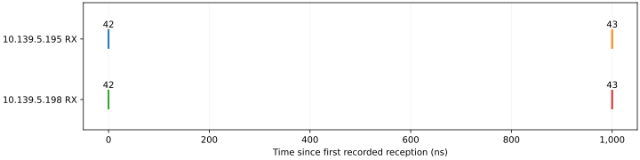

Two-event spacing
=================

:doc:`All experiments <scenario_results>`.

Objective
---------

Check that both receivers record two events with the configured 1,000 ns gap.

Setup
-----

.. list-table::
   :header-rows: 1

   * - Device
     - IP address
     - PV prefix
   * - Generator
     - 10.139.5.196
     - EVT:DEV2:20:
   * - Receiver A
     - 10.139.5.195
     - EVT:DEV2:10:
   * - Receiver B
     - 10.139.5.198
     - EVT:DEV2:40:

.. list-table::
   :header-rows: 1

   * - Setting
     - Value
     - Measurement scope
   * - Firmware / IOC
     - 20261017
     - The same release was used on the participating chassis.
   * - Reference clock
     - 125 MHz
     - Receiver timestamp resolution is 8 ns; absolute UTC accuracy was not checked.
   * - Test-event actions
     - Logging only
     - Codes 42 and 43 were not assigned to pulse outputs.

.. list-table::
   :header-rows: 1

   * - Table entry
     - Configured offset (ns)
   * - 42
     - 0
   * - 43
     - 1,000
   * - 255 (stop; not transmitted)
     - 2,000

Procedure
---------

.. list-table::
   :header-rows: 1

   * - Stage
     - Method
     - Verification
   * - 1. Establish initial conditions
     - Read receiver status and save the sequencer controls and complete event maps before applying the reviewed commands.
     - Both links and timestamps must be valid, and the FIFO-overflow bit must be clear.
   * - 2. Select event logging
     - Check that the test codes are unused, then select them in spare logging slots 3 and 4 on both receivers.
     - The test codes must remain logging-only; no output action is added.
   * - 3. Load the sequence
     - Load the table listed above into bank 1 while keeping timer and electrical-input trigger masks disabled.
     - Read the table and mode back before execution.
   * - 4. Execute the trial
     - Select Single mode, arm the bank and issue one software trigger.
     - Verify that the hardware run counter advances and the bank returns to idle.
   * - 5. Acquire the evidence
     - Record the receiver logs for 60 seconds and match the complete event code, count and order on both receivers.
     - Calculate the event gaps from hardware reception timestamps, independently for each receiver.
   * - 6. Restore the rack
     - Disarm the bank and restore the saved controls and logging selections.
     - Read the controls and full event maps again to confirm that they match the initial snapshot.

Results
-------

Both receivers recorded 2 of 2 expected events. The code order matched the table. The starting settings were restored and verified.

.. list-table::
   :header-rows: 1

   * - Measurement
     - Recorded result
   * - Measured event gaps, A / B
     - 1,000 ns / 1,000 ns
   * - Receiver difference, B minus A
     - mean 0 ns; standard deviation 0 ns; range 0 to 0 ns
   * - Hardware transmit time
     - Not measured
   * - Transmit-to-receive delay
     - Not measured
   * - Physical output response
     - Not measured; test codes selected logging only

   Each mark is a hardware reception timestamp. Zero is the first recorded reception, not the transmit time.

.. list-table::
   :header-rows: 1

   * - Cycle
     - Event
     - 10.139.5.195 receipt (UTC)
     - 10.139.5.198 receipt (UTC)
     - B − A (ns)
   * - 1
     - 42
     - 2026-11-04 00:28:34.494070584
     - 2026-11-04 00:28:34.494070584
     - 0
   * - 1
     - 43
     - 2026-11-04 00:28:34.494071584
     - 2026-11-04 00:28:34.494071584
     - 0

Recording: ``20261104T002834Z-e2c3c2``. The table was recalculated from the saved receiver rows.
:download:`Event CSV <../_static/timing-check/scenarios/scenario-2-events.csv>` contains the same timestamps.

.. raw:: html

   

Command log

Apply

.. code-block:: bash

   pvput -w 3 EVT:DEV2:10:EVR:LOG:evt3 42
   pvput -w 3 EVT:DEV2:10:EVR:LOG:evt4 43
   pvput -w 3 EVT:DEV2:40:EVR:LOG:evt3 42
   pvput -w 3 EVT:DEV2:40:EVR:LOG:evt4 43
   pvput -w 3 EVT:DEV2:20:EVG:SEQ:1:disarm 1
   pvput -w 3 EVT:DEV2:20:EVG:SEQ:1:HWrise 0
   pvput -w 3 EVT:DEV2:20:EVG:SEQ:1:HWfall 0
   pvput -w 3 EVT:DEV2:20:EVG:SEQ:1:Tmr 0
   pvput -w 3 EVT:DEV2:20:EVG:SEQ:1:tMode 0
   pvput -w 3 EVT:DEV2:20:EVG:SEQ:1:slo 1000000000
   pvput -w 3 EVT:DEV2:20:EVG:SEQ:1:codes '[42,43,255]'
   pvput -w 3 EVT:DEV2:20:EVG:SEQ:1:times '[0.0,1000.0,2000.0]'
   pvput -w 3 EVT:DEV2:20:EVG:SEQ:1:store 1

Trigger

.. code-block:: bash

   pvput -w 3 EVT:DEV2:20:EVG:SEQ:1:arm 1
   pvput -w 3 EVT:DEV2:20:EVG:SEQ:1:trig 1

Disarm

.. code-block:: bash

   pvput -w 3 EVT:DEV2:20:EVG:SEQ:1:disarm 1

Restore

.. code-block:: bash

   pvput -w 3 EVT:DEV2:20:EVG:SEQ:1:disarm 1
   pvput -w 3 EVT:DEV2:20:EVG:SEQ:1:HWrise 0
   pvput -w 3 EVT:DEV2:20:EVG:SEQ:1:HWfall 0
   pvput -w 3 EVT:DEV2:20:EVG:SEQ:1:Tmr 0
   pvput -w 3 EVT:DEV2:20:EVG:SEQ:1:tMode 0
   pvput -w 3 EVT:DEV2:20:EVG:SEQ:1:slo 1000000000.0
   pvput -w 3 EVT:DEV2:20:EVG:SEQ:1:codes '[0]'
   pvput -w 3 EVT:DEV2:20:EVG:SEQ:1:times '[0.0]'
   pvput -w 3 EVT:DEV2:20:EVG:SEQ:1:store 1
   pvput -w 3 EVT:DEV2:10:EVR:LOG:evt3 0
   pvput -w 3 EVT:DEV2:10:EVR:LOG:evt4 0
   pvput -w 3 EVT:DEV2:40:EVR:LOG:evt3 0
   pvput -w 3 EVT:DEV2:40:EVR:LOG:evt4 0

.. raw:: html

   

Findings
--------

Both receivers retained the configured gaps and code order. Their reported timestamp differences were 0 ns.
These results support timestamp agreement at 8 ns resolution. They do not establish the physical send-to-receive delay.
