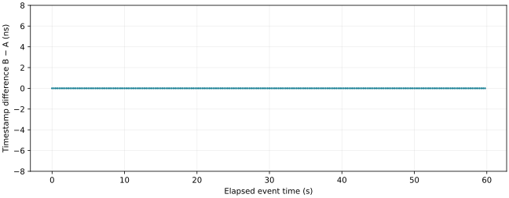
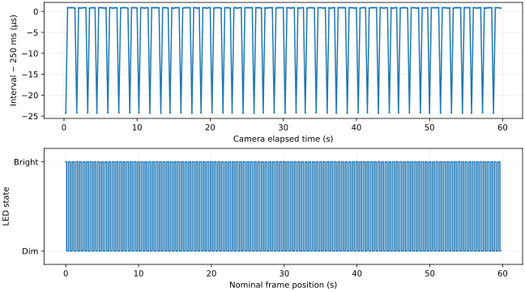
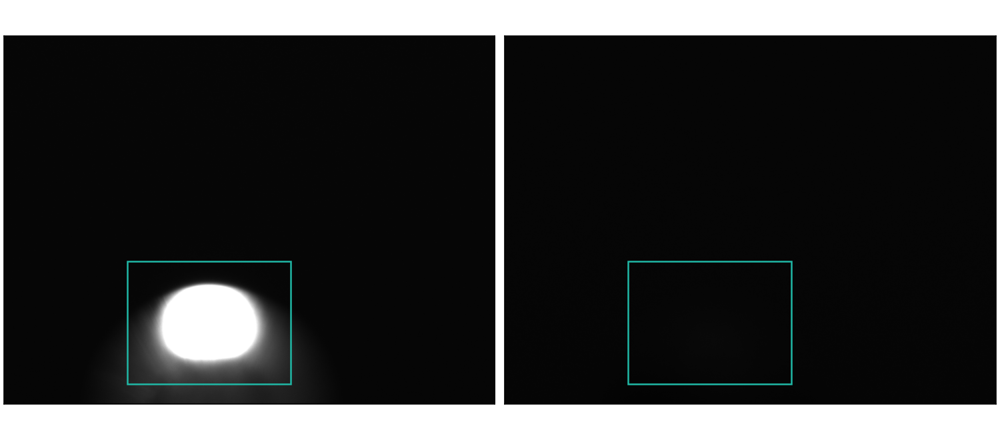

:orphan:

.. _timing-timestamp-check:

Timestamp consistency experiment
================================

The current five-scenario report is :doc:`scenario_results`.

Objective
---------

Measure timestamp agreement between receivers at ``10.139.5.195`` and
``10.139.5.198``. Check camera timestamp consistency and the recorded LED states.
Use these results to assess data correlation for CXFEL.

Setup
-----

The observation lasted 60 seconds on October 23, 2026.
Camera recording started at 23:13:35.288589 UTC (16:13:35 Phoenix time).
The generator sent event 101 at 4 Hz. No process variables (PVs) were changed.
The camera was already acquiring images.

Equipment and connections
~~~~~~~~~~~~~~~~~~~~~~~~~

.. list-table::
   :header-rows: 1
   :widths: 20 24 56

   * - Device
     - IP address
     - PV prefix and function
   * - Event generator
     - ``10.139.5.196``
     - ``EVT:DEV2:20:``; sends event 101
   * - Receiver A
     - ``10.139.5.195``
     - ``EVT:DEV2:10:``; records event timestamps
   * - Receiver B
     - ``10.139.5.198``
     - ``EVT:DEV2:40:``; records event timestamps
   * - Camera
     - ``192.168.2.1``
     - ``CAM:DEV2:20:``; records the breadboard LED
   * - IOC and analysis host
     - ``10.139.4.59``
     - Runs the EPICS servers and observation tools
   * - Camera network interface
     - ``192.168.2.100``
     - Connects the host to the camera network
   * - DG645 and breadboard LED
     - Unit not yet identified
     - The operator confirmed that the LED breadboard connects to a DG645

The intended signal path uses the timing system to trigger the camera through
its Line1 input. The camera records light from the LED on the breadboard.
The DG645 supplies the breadboard signal. The exact DG645 unit, output connector
and breadboard circuit have not been recorded.

The receiver event streams agree with a common timing source. The software
records do not identify each fiber cable or the camera trigger cable endpoints.
The procedure below can repeat the observation on the existing rack.
An exact hardware rebuild also requires those cable and circuit records.

.. include:: setup-readback.rst

Required settings
~~~~~~~~~~~~~~~~~

.. list-table::
   :header-rows: 1
   :widths: 45 55

   * - Setting
     - Value used for the observation
   * - Generator reference clock
     - 125 MHz
   * - Generator timer 1
     - Event 101; divisor 31,250,000; rate = 125,000,000 / 31,250,000 = 4 Hz
   * - Receiver timestamp resolution
     - 8 ns per tick
   * - Receiver logging
     - Event 101 selected in each event map; log read once per second
   * - Camera acquisition
     - Continuous; external trigger enabled; Line1; FrameStart; rising edge
   * - Camera exposure
     - 0.001 s
   * - Camera timestamp and frame-ID modes
     - Camera / Camera
   * - Camera image format
     - Mono12; 1200 columns × 900 rows
   * - Camera sensor crop
     - Start column 600; start row 400; full sensor 2464 × 2056 pixels
   * - LED analysis region
     - Image columns 300–699; image rows 550–849; coordinates start at zero

Software
~~~~~~~~

The camera recorder uses Channel Access through PyEPICS.
The event recorder uses PV Access through p4p.
The analysis reads saved files and requires no network connection.

The tested host has Python 3.13.5 in ``/home/cxfeldev/Desktop/dario/.venv-docs``.
That environment contains PyEPICS 3.5.10, NumPy 2.5.4 and Matplotlib 3.11.2.
The system interpreter, ``/usr/bin/python3``, uses Python 3.9.25 and the installed
EPICS p4p module. Keep the existing EPICS environment when you run the commands.

The host uses ``EPICS_CA_MAX_ARRAY_BYTES=32000000`` for camera images.
Its Channel Access address list includes ``10.139.4.59:52002`` for this camera IOC.
The event IOC records must also be reachable through PV Access.

The repository contains the tools in ``tools/timing_check/``:

.. list-table::
   :header-rows: 1
   :widths: 30 70

   * - File
     - Function
   * - ``observe.py``
     - Saves camera images and metadata; starts the event recorder
   * - ``event_logger.py``
     - Checks the generator and receiver settings; saves both event tables
   * - ``analyze.py``
     - Reads saved files; writes statistics, CSV records and plots
   * - ``requirements.txt``
     - Lists the camera and analysis Python dependencies; p4p uses the system environment

Procedure
---------

Check the existing rack
~~~~~~~~~~~~~~~~~~~~~~~

1. Open a terminal on the IOC host.
2. Check the reference clock and timer settings:

   .. code-block:: bash

      pvget -w 3 EVT:DEV2:20:Ref:Freq \
        EVT:DEV2:20:EVG:TMR:1:event EVT:DEV2:20:EVG:TMR:1:divisor

3. Check both receiver links and timestamps:

   .. code-block:: bash

      pvget -w 3 EVT:DEV2:10:APP:IPADDR EVT:DEV2:10:EVR:status \
        EVT:DEV2:10:EVR:Lnk:Ok EVT:DEV2:10:EVR:TS:Ok
      pvget -w 3 EVT:DEV2:40:APP:IPADDR EVT:DEV2:40:EVR:status \
        EVT:DEV2:40:EVR:Lnk:Ok EVT:DEV2:40:EVR:TS:Ok

   The addresses must match the equipment table. Link and timestamp validity must be true.
   In the status word, ``0x1`` means link up and ``0x2`` means timestamp valid.
   Bit ``0x4`` means the FIFO contains records. Bit ``0x8`` means FIFO overflow.
   Stop if the link or timestamp is invalid, or if overflow is set.

4. Check the camera settings:

   .. code-block:: bash

      caget -a -w 3 CAM:DEV2:20:cam1:Acquire_RBV \
        CAM:DEV2:20:cam1:ImageMode_RBV CAM:DEV2:20:cam1:AcquireTime_RBV \
        CAM:DEV2:20:cam1:GC_TriggerMode_RBV \
        CAM:DEV2:20:cam1:GC_TriggerSource_RBV \
        CAM:DEV2:20:cam1:GC_TriggerSelector_RBV \
        CAM:DEV2:20:cam1:TimeStampMode_RBV CAM:DEV2:20:cam1:UniqueIdMode_RBV
      caget -a -w 3 CAM:DEV2:20:cam1:MinX_RBV CAM:DEV2:20:cam1:MinY_RBV \
        CAM:DEV2:20:cam1:SizeX_RBV CAM:DEV2:20:cam1:SizeY_RBV

   Compare the values with the required settings table.
   Acquisition must already be active. The active acquisition record can show ``STATE MINOR``;
   this IOC uses that alarm for the Acquiring state.
   A read error or an invalid record is a failure.

5. Check the camera image for the LED breadboard.
6. Check that at least 3 GB of disk space is free.
7. Stop if a required setting differs. Obtain approval before any hardware or PV change.

Record 60 seconds
~~~~~~~~~~~~~~~~~

1. Run these commands from the existing workspace:

   .. code-block:: bash

      cd /home/cxfeldev/Desktop/dario
      OBS_DIR="$PWD/timing-check/observations/$(date -u +%Y%m%dT%H%M%SZ)"
      export PYEPICS_LIBCA=/usr/local/cxfel/epics/7-el9/base/lib/linux-x86_64/libca.so
      .venv-docs/bin/python -B cxfel-gtg/tools/timing_check/observe.py \
        --event-python /usr/bin/python3 --seconds 60 --output "$OBS_DIR"

2. Wait for the recorder to finish.
3. Read ``observation.json`` in the new observation directory.
4. Check that ``error`` is null and ``frame_queue_overruns`` is zero.
5. Keep the images, ``frames.csv``, ``events.jsonl`` and ``baseline.json`` together.

The recorder makes a new directory. It does not overwrite an existing observation.
It subscribes to ``image1:ArrayData`` and both ``EVR:LOG`` tables.
It saves each image as a compressed NumPy array.
It also saves frame IDs, camera times, IOC image times and host receipt times.
The recorder does not start or stop camera acquisition.

For each image, the recorder reads the frame ID before and after the camera time.
Both IDs must agree. Metadata update times must be within 10 ms of the image update.
This check rejects inconsistent metadata associations. It does not measure trigger accuracy to 10 ms.

Analyze the records
~~~~~~~~~~~~~~~~~~~

1. Run the analysis in the same terminal:

   .. code-block:: bash

      MPLCONFIGDIR="$PWD/.cache/matplotlib" \
        .venv-docs/bin/python -B cxfel-gtg/tools/timing_check/analyze.py \
        --input "$OBS_DIR" --output "$OBS_DIR/analysis"

2. Read ``analysis/results.json``.
3. Check the receiver differences in ``analysis/receiver-matches.csv``.
4. Check the frame sequence and LED states in ``analysis/camera-records.csv``.
5. Inspect ``analysis/receiver-offset.svg`` and ``analysis/camera-led.svg``.

The analysis removes padding and repeated event records.
It excludes the first and last shared seconds, which can contain partial data or cached records.
It matches event 101 by POSIX second and position within that second.
A missing event can shift position-based matching. Check the unmatched counts and event spacing before interpreting offsets.

For each matched pair, the analysis subtracts the timestamp at ``10.139.5.195``
from the timestamp at ``10.139.5.198``. Timestamp arithmetic uses integer nanoseconds:

.. math::

   t = 10^9 S + NS, \qquad d_i = t_{198,i} - t_{195,i}

For each accepted camera pair, it calculates the consecutive camera-clock interval.
It uses decimal input values to preserve the recorded timestamp precision.
Both offset and interval statistics use population standard deviation:

.. math::

   \Delta c_i = c_{i+1} - c_i, \qquad
   \sigma = \sqrt{\frac{1}{N}\sum_{i=1}^{N}(x_i-\bar{x})^2}

For each image, the analysis finds the peak value in the LED region.
A peak above 1000 raw Mono12 counts means bright. All other values mean dim.
This threshold separates the states in this observation. Check the image and intensity ranges before using it with another scene.

The new analysis tool was checked against all saved frames and event records from this observation.
It reproduced the reported counts, receiver differences, camera intervals and LED states.
The new recorder has not yet been validated with another live observation.

Results
-------

.. list-table::
   :header-rows: 1
   :widths: 60 40

   * - Measurement
     - Result
   * - Matched receiver events
     - 240; unmatched records: 0 at each receiver
   * - Difference: ``10.139.5.198`` minus ``10.139.5.195``
     - Mean 0 ns; standard deviation 0 ns; minimum 0 ns; maximum 0 ns
   * - Event-101 intervals on each receiver
     - Exactly 250 ms in the recorded sequence
   * - Camera frames
     - 240; IDs 50557–50796; no ID gaps or backwards timestamps
   * - Camera intervals, 239 measurements
     - Mean 249.996 ms; standard deviation 9.56 µs
   * - Camera interval range
     - 249.9757–250.0009 ms
   * - Metadata checks and recorder queue overruns
     - 240 of 240 accepted; 0 overruns
   * - LED states
     - 120 bright and 120 dim; all 239 adjacent frames alternated
   * - PV changes
     - None; no restoration required

The receiver analysis covers complete POSIX seconds 1792797212–1792797271.
The camera window starts later because subscription data include receiver records from before camera recording.
The two sets of 240 records have no assigned frame-to-event association.

Receiver timestamps
~~~~~~~~~~~~~~~~~~~

   Receiver timestamp difference during the analyzed event window.

.. raw:: html
   :file: receiver-records.html

Camera intervals and LED states
~~~~~~~~~~~~~~~~~~~~~~~~~~~~~~~

   Camera-clock intervals and sampled LED states.

   Frame 50557: bright (left). Frame 50558: dim (right). Both images use the same display scale.

The bright-state peak was 4094 raw counts. Dim-state peaks were 171–191 raw counts.
The 60-second recording below plays at the observed rate of four frames per second.

.. raw:: html

   <video class="timing-experiment-video" controls playsinline preload="metadata" poster="../_static/timing-check/evidence/led-poster.png" aria-label="60-second LED breadboard observation">
     <source src="../_static/timing-check/evidence/cam2-led-passive.mp4" type="video/mp4">
     <a href="../_static/timing-check/evidence/cam2-led-passive.mp4">Open the LED recording</a>
   </video>

.. raw:: html
   :file: camera-records.html

The :download:`receiver CSV <../_static/timing-check/evidence/led-run-receiver-matches.csv>`,
:download:`camera CSV <../_static/timing-check/evidence/led-frames.csv>` and
:download:`experiment JSON <../_static/timing-check/evidence/experiment.json>`
contain the displayed measurements.
The :download:`observation tools <../_static/timing-check/evidence/observation-tools.zip>`
contain the scripts and dependency list.

Findings
--------

Receivers ``10.139.5.195`` and ``10.139.5.198`` reported identical timestamps for all 240 matched events.
The measured difference remained zero throughout the analyzed window.
At 4 Hz and 8 ns resolution, this supports a common timestamp key for CXFEL receiver records.
It does not establish physical clock skew or precision below one tick.

Camera ``192.168.2.1`` produced ordered frames and a repeatable LED state sequence.
Its reported clock intervals had a standard deviation of 9.56 µs.
This measures camera-clock interval variation. Electrical trigger jitter and trigger-to-exposure delay were not measured.
The DG645 connection explains the LED source, but the image sequence does not identify the exact signal route.

CXFEL can use the demonstrated receiver agreement as evidence for event-based data correlation at the tested rate.
Camera records need verified event tags or a calibrated clock conversion before they join that timeline.
Equal receiver and camera counts do not prove one frame per event.
Absolute UTC accuracy and complete logging at 1 kHz remain untested by this observation.
