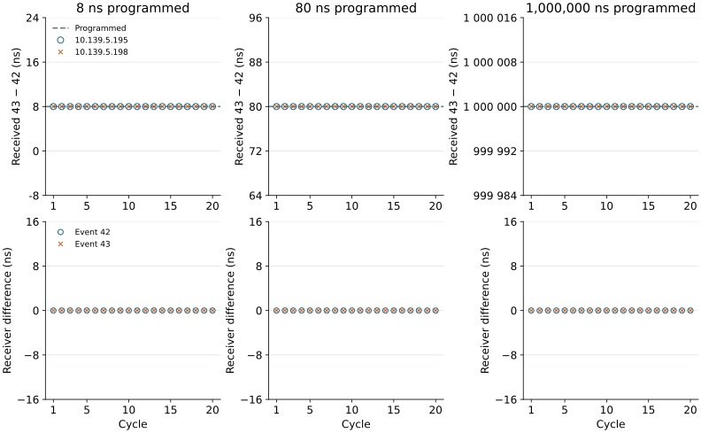
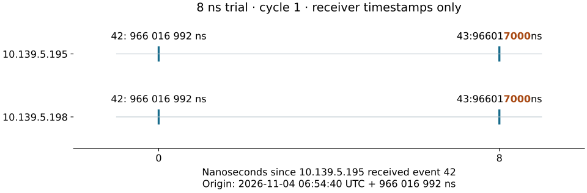

20261017 timing update check
============================

Mark asked whether Michael Davidsaver’s 20261017 firmware and IOC update works on the CXFEL test rack. The IOC is the control program on the host. The update adds a stored event sequence, moves network time handling from the firmware to the IOC, and allows the generator role to change without a reboot. In this test, an LED flash acts as the start button: camera software detects it and asks the generator to run its sequence.

The generator sends numbered event codes over the timing link. Each receiver timestamps incoming codes with a 125 MHz clock, giving **8 ns resolution**. We selected unused codes **42 and 43 as test markers**; they drive no outputs. The sequencer is a stored table of “send this code at this time,” which plays once per trigger. An 8 ns gap is one clock tick and the smallest programmable separation.

Measured result
---------------

The three trials below each contain 20 cycles. Their receiver logs show the programmed separation on both receivers, with matching timestamps between receivers. These measurements check the sequencer and receiver timing; they do not verify every part of the update.

.. list-table::
   :header-rows: 1

   * - Programmed gap
     - 10.139.5.195: received gap
     - 10.139.5.198: received gap
     - Receiver difference
   * - 8 ns
     - 8 ns in all 20 cycles
     - 8 ns in all 20 cycles
     - 0 ns for both markers
   * - 80 ns
     - 80 ns in all 20 cycles
     - 80 ns in all 20 cycles
     - 0 ns for both markers
   * - 1,000,000 ns
     - 1,000,000 ns in all 20 cycles
     - 1,000,000 ns in all 20 cycles
     - 0 ns for both markers

   Each column has its own gap axis. The lower row is 10.139.5.198 minus 10.139.5.195 for each marker. Overlapping marks reflect equal logged values, not omitted cycles.

   Both lanes share the first receiver’s event-42 origin, so a receiver offset would remain visible. No host or browser timestamp positions a mark.

Which recording is which?
-------------------------

The comparison uses the three original evidence files listed below. The later 10-second 8 ns demonstration is a separate repeat, not a replacement for the comparison’s 8 ns run.

.. list-table::
   :header-rows: 1

   * - Use
     - Recording
     - Evidence
   * - 8 ns comparison
     - ``20261104T065440Z-9f4ddd``
     - :download:`led-8ns-evidence.json <../_static/timing-check/scenarios/led-8ns-evidence.json>`
   * - 80 ns comparison
     - ``20261104T065300Z-5ace19``
     - :download:`led-80ns-evidence.json <../_static/timing-check/scenarios/led-80ns-evidence.json>`
   * - 1,000,000 ns comparison
     - ``20261104T051638Z-3fd293``
     - :download:`led-1000000ns-evidence.json <../_static/timing-check/scenarios/led-1000000ns-evidence.json>`
   * - 10-second video / repeat
     - ``20261104T073310Z-044488``
     - :download:`Repeat evidence <../_static/timing-check/scenarios/led-sequence-evidence.json>`

.. raw:: html

   <video class="timing-experiment-video" controls playsinline preload="metadata" poster="../_static/timing-check/scenarios/led-demo-poster.png"><source src="../_static/timing-check/scenarios/led-demo-10s.mp4" type="video/mp4"></video>

Update coverage
---------------

The following readbacks were captured without device writes on 4 November 2026.

.. list-table::
   :header-rows: 1

   * - Change
     - Observed evidence
     - Verification limit
   * - Firmware identity
     - All four devices report ``2026-10-17 16:33:48``. The release file SHA1 matches ``f228abca072271148c6042ba410dd5de443a03f1``.
     - The build date matches release 20261017; the running image hash is not exposed, so exact binary identity is not independently verified.
   * - IOC time / NTP
     - Host reports ``NTPSynchronized=yes``. IOC next second: 2026-11-04 21:08:06 UTC; PPS status is OK and timestamp status is Time OK.
     - The IOC time-distribution path is observed. Removal of the firmware NTP client is documented upstream but is not independently verified by these readbacks.
   * - Runtime generator mode
     - ``EVT:DEV2:20:FPGA:Mode`` reads EVG/EVR; the other three devices read EVR Only.
     - Role readbacks captured. Switching and restoring a role without reboot is not verified; no mode write was made.

The `timing reference guide <https://github.com/osprey-dcs/timing-ioc/blob/ci/documentation/README.md>`_ identifies ``FPGA:Mode`` as the readback and ``FPGA:Mode:S`` as the setting. The `20261017 firmware release <https://github.com/osprey-dcs/timing-firmware/releases/tag/20261017>`_ documents NTP removal. The IOC database supplies ``Nxt:Sec`` from the IOC clock; it does not provide a standalone NTP-status PV.

Records
-------

Nanosecond digits are grouped for reading; highlighted digits change between codes 42 and 43. Times in the tables are UTC on 4 November 2026.

.. raw:: html

   

8 ns trial · 20 cycle records

.. raw:: html

   
<table><thead><tr><th>Cycle</th><th>10.139.5.195 · 42</th><th>10.139.5.195 · 43</th><th>10.139.5.198 · 42</th><th>10.139.5.198 · 43</th><th>Gap .195 (ns)</th><th>Gap .198 (ns)</th><th>B − A, 42 / 43 (ns)</th></tr></thead><tbody><tr><td>1</td><td>06:54:40 966&#8239;016&#8239;992</td><td>06:54:40 966&#8239;01<mark>7</mark>&#8239;<mark>0</mark><mark>0</mark><mark>0</mark></td><td>06:54:40 966&#8239;016&#8239;992</td><td>06:54:40 966&#8239;01<mark>7</mark>&#8239;<mark>0</mark><mark>0</mark><mark>0</mark></td><td>8</td><td>8</td><td>0 / 0</td></tr><tr><td>2</td><td>06:54:41 150&#8239;545&#8239;864</td><td>06:54:41 150&#8239;545&#8239;8<mark>7</mark><mark>2</mark></td><td>06:54:41 150&#8239;545&#8239;864</td><td>06:54:41 150&#8239;545&#8239;8<mark>7</mark><mark>2</mark></td><td>8</td><td>8</td><td>0 / 0</td></tr><tr><td>3</td><td>06:54:41 355&#8239;102&#8239;808</td><td>06:54:41 355&#8239;102&#8239;8<mark>1</mark><mark>6</mark></td><td>06:54:41 355&#8239;102&#8239;808</td><td>06:54:41 355&#8239;102&#8239;8<mark>1</mark><mark>6</mark></td><td>8</td><td>8</td><td>0 / 0</td></tr><tr><td>4</td><td>06:54:41 559&#8239;790&#8239;848</td><td>06:54:41 559&#8239;790&#8239;8<mark>5</mark><mark>6</mark></td><td>06:54:41 559&#8239;790&#8239;848</td><td>06:54:41 559&#8239;790&#8239;8<mark>5</mark><mark>6</mark></td><td>8</td><td>8</td><td>0 / 0</td></tr><tr><td>5</td><td>06:54:41 755&#8239;896&#8239;256</td><td>06:54:41 755&#8239;896&#8239;2<mark>6</mark><mark>4</mark></td><td>06:54:41 755&#8239;896&#8239;256</td><td>06:54:41 755&#8239;896&#8239;2<mark>6</mark><mark>4</mark></td><td>8</td><td>8</td><td>0 / 0</td></tr><tr><td>6</td><td>06:54:41 953&#8239;856&#8239;392</td><td>06:54:41 953&#8239;856&#8239;<mark>4</mark><mark>0</mark><mark>0</mark></td><td>06:54:41 953&#8239;856&#8239;392</td><td>06:54:41 953&#8239;856&#8239;<mark>4</mark><mark>0</mark><mark>0</mark></td><td>8</td><td>8</td><td>0 / 0</td></tr><tr><td>7</td><td>06:54:42 156&#8239;132&#8239;768</td><td>06:54:42 156&#8239;132&#8239;7<mark>7</mark><mark>6</mark></td><td>06:54:42 156&#8239;132&#8239;768</td><td>06:54:42 156&#8239;132&#8239;7<mark>7</mark><mark>6</mark></td><td>8</td><td>8</td><td>0 / 0</td></tr><tr><td>8</td><td>06:54:42 351&#8239;914&#8239;224</td><td>06:54:42 351&#8239;914&#8239;2<mark>3</mark><mark>2</mark></td><td>06:54:42 351&#8239;914&#8239;224</td><td>06:54:42 351&#8239;914&#8239;2<mark>3</mark><mark>2</mark></td><td>8</td><td>8</td><td>0 / 0</td></tr><tr><td>9</td><td>06:54:42 554&#8239;612&#8239;064</td><td>06:54:42 554&#8239;612&#8239;0<mark>7</mark><mark>2</mark></td><td>06:54:42 554&#8239;612&#8239;064</td><td>06:54:42 554&#8239;612&#8239;0<mark>7</mark><mark>2</mark></td><td>8</td><td>8</td><td>0 / 0</td></tr><tr><td>10</td><td>06:54:42 759&#8239;040&#8239;976</td><td>06:54:42 759&#8239;040&#8239;9<mark>8</mark><mark>4</mark></td><td>06:54:42 759&#8239;040&#8239;976</td><td>06:54:42 759&#8239;040&#8239;9<mark>8</mark><mark>4</mark></td><td>8</td><td>8</td><td>0 / 0</td></tr><tr><td>11</td><td>06:54:42 958&#8239;117&#8239;112</td><td>06:54:42 958&#8239;117&#8239;1<mark>2</mark><mark>0</mark></td><td>06:54:42 958&#8239;117&#8239;112</td><td>06:54:42 958&#8239;117&#8239;1<mark>2</mark><mark>0</mark></td><td>8</td><td>8</td><td>0 / 0</td></tr><tr><td>12</td><td>06:54:43 150&#8239;687&#8239;072</td><td>06:54:43 150&#8239;687&#8239;0<mark>8</mark><mark>0</mark></td><td>06:54:43 150&#8239;687&#8239;072</td><td>06:54:43 150&#8239;687&#8239;0<mark>8</mark><mark>0</mark></td><td>8</td><td>8</td><td>0 / 0</td></tr><tr><td>13</td><td>06:54:43 357&#8239;357&#8239;592</td><td>06:54:43 357&#8239;357&#8239;<mark>6</mark><mark>0</mark><mark>0</mark></td><td>06:54:43 357&#8239;357&#8239;592</td><td>06:54:43 357&#8239;357&#8239;<mark>6</mark><mark>0</mark><mark>0</mark></td><td>8</td><td>8</td><td>0 / 0</td></tr><tr><td>14</td><td>06:54:43 551&#8239;123&#8239;880</td><td>06:54:43 551&#8239;123&#8239;88<mark>8</mark></td><td>06:54:43 551&#8239;123&#8239;880</td><td>06:54:43 551&#8239;123&#8239;88<mark>8</mark></td><td>8</td><td>8</td><td>0 / 0</td></tr><tr><td>15</td><td>06:54:43 757&#8239;540&#8239;512</td><td>06:54:43 757&#8239;540&#8239;5<mark>2</mark><mark>0</mark></td><td>06:54:43 757&#8239;540&#8239;512</td><td>06:54:43 757&#8239;540&#8239;5<mark>2</mark><mark>0</mark></td><td>8</td><td>8</td><td>0 / 0</td></tr><tr><td>16</td><td>06:54:43 952&#8239;605&#8239;872</td><td>06:54:43 952&#8239;605&#8239;8<mark>8</mark><mark>0</mark></td><td>06:54:43 952&#8239;605&#8239;872</td><td>06:54:43 952&#8239;605&#8239;8<mark>8</mark><mark>0</mark></td><td>8</td><td>8</td><td>0 / 0</td></tr><tr><td>17</td><td>06:54:44 158&#8239;616&#8239;816</td><td>06:54:44 158&#8239;616&#8239;8<mark>2</mark><mark>4</mark></td><td>06:54:44 158&#8239;616&#8239;816</td><td>06:54:44 158&#8239;616&#8239;8<mark>2</mark><mark>4</mark></td><td>8</td><td>8</td><td>0 / 0</td></tr><tr><td>18</td><td>06:54:44 354&#8239;056&#8239;032</td><td>06:54:44 354&#8239;056&#8239;0<mark>4</mark><mark>0</mark></td><td>06:54:44 354&#8239;056&#8239;032</td><td>06:54:44 354&#8239;056&#8239;0<mark>4</mark><mark>0</mark></td><td>8</td><td>8</td><td>0 / 0</td></tr><tr><td>19</td><td>06:54:44 550&#8239;245&#8239;464</td><td>06:54:44 550&#8239;245&#8239;4<mark>7</mark><mark>2</mark></td><td>06:54:44 550&#8239;245&#8239;464</td><td>06:54:44 550&#8239;245&#8239;4<mark>7</mark><mark>2</mark></td><td>8</td><td>8</td><td>0 / 0</td></tr><tr><td>20</td><td>06:54:44 753&#8239;730&#8239;424</td><td>06:54:44 753&#8239;730&#8239;4<mark>3</mark><mark>2</mark></td><td>06:54:44 753&#8239;730&#8239;424</td><td>06:54:44 753&#8239;730&#8239;4<mark>3</mark><mark>2</mark></td><td>8</td><td>8</td><td>0 / 0</td></tr></tbody></table>

.. raw:: html

   

.. raw:: html

   

80 ns trial · 20 cycle records

.. raw:: html

   
<table><thead><tr><th>Cycle</th><th>10.139.5.195 · 42</th><th>10.139.5.195 · 43</th><th>10.139.5.198 · 42</th><th>10.139.5.198 · 43</th><th>Gap .195 (ns)</th><th>Gap .198 (ns)</th><th>B − A, 42 / 43 (ns)</th></tr></thead><tbody><tr><td>1</td><td>06:53:00 562&#8239;207&#8239;944</td><td>06:53:00 562&#8239;20<mark>8</mark>&#8239;<mark>0</mark><mark>2</mark>4</td><td>06:53:00 562&#8239;207&#8239;944</td><td>06:53:00 562&#8239;20<mark>8</mark>&#8239;<mark>0</mark><mark>2</mark>4</td><td>80</td><td>80</td><td>0 / 0</td></tr><tr><td>2</td><td>06:53:00 757&#8239;030&#8239;888</td><td>06:53:00 757&#8239;030&#8239;<mark>9</mark><mark>6</mark>8</td><td>06:53:00 757&#8239;030&#8239;888</td><td>06:53:00 757&#8239;030&#8239;<mark>9</mark><mark>6</mark>8</td><td>80</td><td>80</td><td>0 / 0</td></tr><tr><td>3</td><td>06:53:00 949&#8239;264&#8239;392</td><td>06:53:00 949&#8239;264&#8239;<mark>4</mark><mark>7</mark>2</td><td>06:53:00 949&#8239;264&#8239;392</td><td>06:53:00 949&#8239;264&#8239;<mark>4</mark><mark>7</mark>2</td><td>80</td><td>80</td><td>0 / 0</td></tr><tr><td>4</td><td>06:53:01 151&#8239;670&#8239;968</td><td>06:53:01 151&#8239;67<mark>1</mark>&#8239;<mark>0</mark><mark>4</mark>8</td><td>06:53:01 151&#8239;670&#8239;968</td><td>06:53:01 151&#8239;67<mark>1</mark>&#8239;<mark>0</mark><mark>4</mark>8</td><td>80</td><td>80</td><td>0 / 0</td></tr><tr><td>5</td><td>06:53:01 352&#8239;771&#8239;096</td><td>06:53:01 352&#8239;771&#8239;<mark>1</mark><mark>7</mark>6</td><td>06:53:01 352&#8239;771&#8239;096</td><td>06:53:01 352&#8239;771&#8239;<mark>1</mark><mark>7</mark>6</td><td>80</td><td>80</td><td>0 / 0</td></tr><tr><td>6</td><td>06:53:01 552&#8239;445&#8239;064</td><td>06:53:01 552&#8239;445&#8239;<mark>1</mark><mark>4</mark>4</td><td>06:53:01 552&#8239;445&#8239;064</td><td>06:53:01 552&#8239;445&#8239;<mark>1</mark><mark>4</mark>4</td><td>80</td><td>80</td><td>0 / 0</td></tr><tr><td>7</td><td>06:53:01 758&#8239;647&#8239;480</td><td>06:53:01 758&#8239;647&#8239;<mark>5</mark><mark>6</mark>0</td><td>06:53:01 758&#8239;647&#8239;480</td><td>06:53:01 758&#8239;647&#8239;<mark>5</mark><mark>6</mark>0</td><td>80</td><td>80</td><td>0 / 0</td></tr><tr><td>8</td><td>06:53:01 950&#8239;748&#8239;624</td><td>06:53:01 950&#8239;748&#8239;<mark>7</mark><mark>0</mark>4</td><td>06:53:01 950&#8239;748&#8239;624</td><td>06:53:01 950&#8239;748&#8239;<mark>7</mark><mark>0</mark>4</td><td>80</td><td>80</td><td>0 / 0</td></tr><tr><td>9</td><td>06:53:02 153&#8239;022&#8239;824</td><td>06:53:02 153&#8239;022&#8239;<mark>9</mark><mark>0</mark>4</td><td>06:53:02 153&#8239;022&#8239;824</td><td>06:53:02 153&#8239;022&#8239;<mark>9</mark><mark>0</mark>4</td><td>80</td><td>80</td><td>0 / 0</td></tr><tr><td>10</td><td>06:53:02 356&#8239;510&#8239;576</td><td>06:53:02 356&#8239;510&#8239;<mark>6</mark><mark>5</mark>6</td><td>06:53:02 356&#8239;510&#8239;576</td><td>06:53:02 356&#8239;510&#8239;<mark>6</mark><mark>5</mark>6</td><td>80</td><td>80</td><td>0 / 0</td></tr><tr><td>11</td><td>06:53:02 550&#8239;925&#8239;136</td><td>06:53:02 550&#8239;925&#8239;<mark>2</mark><mark>1</mark>6</td><td>06:53:02 550&#8239;925&#8239;136</td><td>06:53:02 550&#8239;925&#8239;<mark>2</mark><mark>1</mark>6</td><td>80</td><td>80</td><td>0 / 0</td></tr><tr><td>12</td><td>06:53:02 756&#8239;679&#8239;912</td><td>06:53:02 756&#8239;679&#8239;9<mark>9</mark>2</td><td>06:53:02 756&#8239;679&#8239;912</td><td>06:53:02 756&#8239;679&#8239;9<mark>9</mark>2</td><td>80</td><td>80</td><td>0 / 0</td></tr><tr><td>13</td><td>06:53:02 950&#8239;037&#8239;488</td><td>06:53:02 950&#8239;037&#8239;<mark>5</mark><mark>6</mark>8</td><td>06:53:02 950&#8239;037&#8239;488</td><td>06:53:02 950&#8239;037&#8239;<mark>5</mark><mark>6</mark>8</td><td>80</td><td>80</td><td>0 / 0</td></tr><tr><td>14</td><td>06:53:03 153&#8239;392&#8239;344</td><td>06:53:03 153&#8239;392&#8239;<mark>4</mark><mark>2</mark>4</td><td>06:53:03 153&#8239;392&#8239;344</td><td>06:53:03 153&#8239;392&#8239;<mark>4</mark><mark>2</mark>4</td><td>80</td><td>80</td><td>0 / 0</td></tr><tr><td>15</td><td>06:53:03 356&#8239;810&#8239;032</td><td>06:53:03 356&#8239;810&#8239;<mark>1</mark><mark>1</mark>2</td><td>06:53:03 356&#8239;810&#8239;032</td><td>06:53:03 356&#8239;810&#8239;<mark>1</mark><mark>1</mark>2</td><td>80</td><td>80</td><td>0 / 0</td></tr><tr><td>16</td><td>06:53:03 549&#8239;490&#8239;576</td><td>06:53:03 549&#8239;490&#8239;<mark>6</mark><mark>5</mark>6</td><td>06:53:03 549&#8239;490&#8239;576</td><td>06:53:03 549&#8239;490&#8239;<mark>6</mark><mark>5</mark>6</td><td>80</td><td>80</td><td>0 / 0</td></tr><tr><td>17</td><td>06:53:03 755&#8239;261&#8239;784</td><td>06:53:03 755&#8239;261&#8239;<mark>8</mark><mark>6</mark>4</td><td>06:53:03 755&#8239;261&#8239;784</td><td>06:53:03 755&#8239;261&#8239;<mark>8</mark><mark>6</mark>4</td><td>80</td><td>80</td><td>0 / 0</td></tr><tr><td>18</td><td>06:53:03 950&#8239;889&#8239;176</td><td>06:53:03 950&#8239;889&#8239;<mark>2</mark><mark>5</mark>6</td><td>06:53:03 950&#8239;889&#8239;176</td><td>06:53:03 950&#8239;889&#8239;<mark>2</mark><mark>5</mark>6</td><td>80</td><td>80</td><td>0 / 0</td></tr><tr><td>19</td><td>06:53:04 155&#8239;164&#8239;112</td><td>06:53:04 155&#8239;164&#8239;1<mark>9</mark>2</td><td>06:53:04 155&#8239;164&#8239;112</td><td>06:53:04 155&#8239;164&#8239;1<mark>9</mark>2</td><td>80</td><td>80</td><td>0 / 0</td></tr><tr><td>20</td><td>06:53:04 349&#8239;582&#8239;816</td><td>06:53:04 349&#8239;582&#8239;8<mark>9</mark>6</td><td>06:53:04 349&#8239;582&#8239;816</td><td>06:53:04 349&#8239;582&#8239;8<mark>9</mark>6</td><td>80</td><td>80</td><td>0 / 0</td></tr></tbody></table>

.. raw:: html

   

.. raw:: html

   

1,000,000 ns trial · 20 cycle records

.. raw:: html

   
<table><thead><tr><th>Cycle</th><th>10.139.5.195 · 42</th><th>10.139.5.195 · 43</th><th>10.139.5.198 · 42</th><th>10.139.5.198 · 43</th><th>Gap .195 (ns)</th><th>Gap .198 (ns)</th><th>B − A, 42 / 43 (ns)</th></tr></thead><tbody><tr><td>1</td><td>05:16:38 966&#8239;633&#8239;888</td><td>05:16:38 96<mark>7</mark>&#8239;633&#8239;888</td><td>05:16:38 966&#8239;633&#8239;888</td><td>05:16:38 96<mark>7</mark>&#8239;633&#8239;888</td><td>1,000,000</td><td>1,000,000</td><td>0 / 0</td></tr><tr><td>2</td><td>05:16:39 158&#8239;820&#8239;376</td><td>05:16:39 15<mark>9</mark>&#8239;820&#8239;376</td><td>05:16:39 158&#8239;820&#8239;376</td><td>05:16:39 15<mark>9</mark>&#8239;820&#8239;376</td><td>1,000,000</td><td>1,000,000</td><td>0 / 0</td></tr><tr><td>3</td><td>05:16:39 348&#8239;352&#8239;232</td><td>05:16:39 34<mark>9</mark>&#8239;352&#8239;232</td><td>05:16:39 348&#8239;352&#8239;232</td><td>05:16:39 34<mark>9</mark>&#8239;352&#8239;232</td><td>1,000,000</td><td>1,000,000</td><td>0 / 0</td></tr><tr><td>4</td><td>05:16:39 552&#8239;895&#8239;544</td><td>05:16:39 55<mark>3</mark>&#8239;895&#8239;544</td><td>05:16:39 552&#8239;895&#8239;544</td><td>05:16:39 55<mark>3</mark>&#8239;895&#8239;544</td><td>1,000,000</td><td>1,000,000</td><td>0 / 0</td></tr><tr><td>5</td><td>05:16:39 755&#8239;218&#8239;008</td><td>05:16:39 75<mark>6</mark>&#8239;218&#8239;008</td><td>05:16:39 755&#8239;218&#8239;008</td><td>05:16:39 75<mark>6</mark>&#8239;218&#8239;008</td><td>1,000,000</td><td>1,000,000</td><td>0 / 0</td></tr><tr><td>6</td><td>05:16:39 959&#8239;588&#8239;328</td><td>05:16:39 9<mark>6</mark><mark>0</mark>&#8239;588&#8239;328</td><td>05:16:39 959&#8239;588&#8239;328</td><td>05:16:39 9<mark>6</mark><mark>0</mark>&#8239;588&#8239;328</td><td>1,000,000</td><td>1,000,000</td><td>0 / 0</td></tr><tr><td>7</td><td>05:16:40 153&#8239;020&#8239;392</td><td>05:16:40 15<mark>4</mark>&#8239;020&#8239;392</td><td>05:16:40 153&#8239;020&#8239;392</td><td>05:16:40 15<mark>4</mark>&#8239;020&#8239;392</td><td>1,000,000</td><td>1,000,000</td><td>0 / 0</td></tr><tr><td>8</td><td>05:16:40 354&#8239;367&#8239;904</td><td>05:16:40 35<mark>5</mark>&#8239;367&#8239;904</td><td>05:16:40 354&#8239;367&#8239;904</td><td>05:16:40 35<mark>5</mark>&#8239;367&#8239;904</td><td>1,000,000</td><td>1,000,000</td><td>0 / 0</td></tr><tr><td>9</td><td>05:16:40 555&#8239;127&#8239;976</td><td>05:16:40 55<mark>6</mark>&#8239;127&#8239;976</td><td>05:16:40 555&#8239;127&#8239;976</td><td>05:16:40 55<mark>6</mark>&#8239;127&#8239;976</td><td>1,000,000</td><td>1,000,000</td><td>0 / 0</td></tr><tr><td>10</td><td>05:16:40 759&#8239;335&#8239;544</td><td>05:16:40 7<mark>6</mark><mark>0</mark>&#8239;335&#8239;544</td><td>05:16:40 759&#8239;335&#8239;544</td><td>05:16:40 7<mark>6</mark><mark>0</mark>&#8239;335&#8239;544</td><td>1,000,000</td><td>1,000,000</td><td>0 / 0</td></tr><tr><td>11</td><td>05:16:40 954&#8239;778&#8239;488</td><td>05:16:40 95<mark>5</mark>&#8239;778&#8239;488</td><td>05:16:40 954&#8239;778&#8239;488</td><td>05:16:40 95<mark>5</mark>&#8239;778&#8239;488</td><td>1,000,000</td><td>1,000,000</td><td>0 / 0</td></tr><tr><td>12</td><td>05:16:41 154&#8239;232&#8239;616</td><td>05:16:41 15<mark>5</mark>&#8239;232&#8239;616</td><td>05:16:41 154&#8239;232&#8239;616</td><td>05:16:41 15<mark>5</mark>&#8239;232&#8239;616</td><td>1,000,000</td><td>1,000,000</td><td>0 / 0</td></tr><tr><td>13</td><td>05:16:41 360&#8239;269&#8239;496</td><td>05:16:41 36<mark>1</mark>&#8239;269&#8239;496</td><td>05:16:41 360&#8239;269&#8239;496</td><td>05:16:41 36<mark>1</mark>&#8239;269&#8239;496</td><td>1,000,000</td><td>1,000,000</td><td>0 / 0</td></tr><tr><td>14</td><td>05:16:41 556&#8239;156&#8239;816</td><td>05:16:41 55<mark>7</mark>&#8239;156&#8239;816</td><td>05:16:41 556&#8239;156&#8239;816</td><td>05:16:41 55<mark>7</mark>&#8239;156&#8239;816</td><td>1,000,000</td><td>1,000,000</td><td>0 / 0</td></tr><tr><td>15</td><td>05:16:41 749&#8239;541&#8239;040</td><td>05:16:41 7<mark>5</mark><mark>0</mark>&#8239;541&#8239;040</td><td>05:16:41 749&#8239;541&#8239;040</td><td>05:16:41 7<mark>5</mark><mark>0</mark>&#8239;541&#8239;040</td><td>1,000,000</td><td>1,000,000</td><td>0 / 0</td></tr><tr><td>16</td><td>05:16:41 954&#8239;662&#8239;184</td><td>05:16:41 95<mark>5</mark>&#8239;662&#8239;184</td><td>05:16:41 954&#8239;662&#8239;184</td><td>05:16:41 95<mark>5</mark>&#8239;662&#8239;184</td><td>1,000,000</td><td>1,000,000</td><td>0 / 0</td></tr><tr><td>17</td><td>05:16:42 156&#8239;873&#8239;456</td><td>05:16:42 15<mark>7</mark>&#8239;873&#8239;456</td><td>05:16:42 156&#8239;873&#8239;456</td><td>05:16:42 15<mark>7</mark>&#8239;873&#8239;456</td><td>1,000,000</td><td>1,000,000</td><td>0 / 0</td></tr><tr><td>18</td><td>05:16:42 357&#8239;292&#8239;208</td><td>05:16:42 35<mark>8</mark>&#8239;292&#8239;208</td><td>05:16:42 357&#8239;292&#8239;208</td><td>05:16:42 35<mark>8</mark>&#8239;292&#8239;208</td><td>1,000,000</td><td>1,000,000</td><td>0 / 0</td></tr><tr><td>19</td><td>05:16:42 550&#8239;379&#8239;248</td><td>05:16:42 55<mark>1</mark>&#8239;379&#8239;248</td><td>05:16:42 550&#8239;379&#8239;248</td><td>05:16:42 55<mark>1</mark>&#8239;379&#8239;248</td><td>1,000,000</td><td>1,000,000</td><td>0 / 0</td></tr><tr><td>20</td><td>05:16:42 756&#8239;191&#8239;064</td><td>05:16:42 75<mark>7</mark>&#8239;191&#8239;064</td><td>05:16:42 756&#8239;191&#8239;064</td><td>05:16:42 75<mark>7</mark>&#8239;191&#8239;064</td><td>1,000,000</td><td>1,000,000</td><td>0 / 0</td></tr></tbody></table>

.. raw:: html

   

.. raw:: html

   

Setup and procedure

.. list-table::
   :header-rows: 1

   * - Component
     - Recorded setup
   * - Generator
     - 10.139.5.196 / ``EVT:DEV2:20:``; 125 MHz; sequencer bank 1. Normal mode keeps the bank armed after one table finishes; each trigger still plays it only once.
   * - Receivers
     - 10.139.5.195 / ``EVT:DEV2:10:`` and 10.139.5.198 / ``EVT:DEV2:40:``. A logging slot is a configurable selection of which event code to put in the event log; slots 3 and 4 selected codes 42 and 43.
   * - Sequence
     - 42 at 0 ns; 43 at the selected gap; code 255 at gap + 1,000 ns. Code 255 stops the sequencer table and is not sent over the link. Timer and external-input triggers were disabled.
   * - Start input
     - CAM2 at 192.168.2.1; existing Line1 trigger, approximately 10 frames/s, 1 ms exposure, 1200 × 900 Mono12 images. Peak above 1,000 counts in columns 300–699, rows 550–849 qualified a bright frame after a fresh dark frame.
   * - Other event codes
     - 101 is the existing camera-trigger event. Code 125 marks each second; codes 112 and 113 distribute the POSIX seconds value.
   * - LED / storage
     - Breadboard LED connected to a DG645; exact output and cable endpoints were not recorded. Original images, event rows and settings were saved on host 10.139.4.59.

.. list-table::
   :header-rows: 1

   * - Step
     - Method
   * - Check
     - Confirm visible dark/bright LED states, valid receiver timestamps and links, and no FIFO overflow. Save controls and maps; verify that test markers and logging slots are free.
   * - Acquire
     - After approval of the exact writes, load the table, select the two logging codes and arm once. For each accepted LED transition, issue one trigger and verify its counter increment; stop after 20 accepted transitions.
   * - Compare
     - Pair codes 42 and 43 by cycle, subtract integer hardware timestamps, and compare the same code between receivers. Preserve full seconds across rollover.
   * - Restore
     - Disarm and restore the saved controls and maps, including after timeout or stop. Read back settings and confirm receiver health. Do not change event 101, camera trigger settings or DG645 settings.

.. raw:: html

   

.. raw:: html

   

10-second demonstration command log

.. raw:: html

   <pre>Apply
   pvput -w 3 EVT:DEV2:10:EVR:LOG:evt3 42
   pvput -w 3 EVT:DEV2:10:EVR:LOG:evt4 43
   pvput -w 3 EVT:DEV2:40:EVR:LOG:evt3 42
   pvput -w 3 EVT:DEV2:40:EVR:LOG:evt4 43
   pvput -w 3 EVT:DEV2:20:EVG:SEQ:1:disarm 1
   pvput -w 3 EVT:DEV2:20:EVG:SEQ:1:HWrise 0
   pvput -w 3 EVT:DEV2:20:EVG:SEQ:1:HWfall 0
   pvput -w 3 EVT:DEV2:20:EVG:SEQ:1:Tmr 0
   pvput -w 3 EVT:DEV2:20:EVG:SEQ:1:tMode 1
   pvput -w 3 EVT:DEV2:20:EVG:SEQ:1:slo 1000000000
   pvput -w 3 EVT:DEV2:20:EVG:SEQ:1:codes &#x27;[42,43,255]&#x27;
   pvput -w 3 EVT:DEV2:20:EVG:SEQ:1:times &#x27;[0.0,8.0,1008.0]&#x27;
   pvput -w 3 EVT:DEV2:20:EVG:SEQ:1:store 1

   Trigger (one per fresh LED transition; maximum 20)
   pvput -w 3 EVT:DEV2:20:EVG:SEQ:1:arm 1
   pvput -w 3 EVT:DEV2:20:EVG:SEQ:1:trig 1
   pvput -w 3 EVT:DEV2:20:EVG:SEQ:1:trig 1
   pvput -w 3 EVT:DEV2:20:EVG:SEQ:1:trig 1
   pvput -w 3 EVT:DEV2:20:EVG:SEQ:1:trig 1
   pvput -w 3 EVT:DEV2:20:EVG:SEQ:1:trig 1
   pvput -w 3 EVT:DEV2:20:EVG:SEQ:1:trig 1
   pvput -w 3 EVT:DEV2:20:EVG:SEQ:1:trig 1
   pvput -w 3 EVT:DEV2:20:EVG:SEQ:1:trig 1
   pvput -w 3 EVT:DEV2:20:EVG:SEQ:1:trig 1
   pvput -w 3 EVT:DEV2:20:EVG:SEQ:1:trig 1
   pvput -w 3 EVT:DEV2:20:EVG:SEQ:1:trig 1
   pvput -w 3 EVT:DEV2:20:EVG:SEQ:1:trig 1
   pvput -w 3 EVT:DEV2:20:EVG:SEQ:1:trig 1
   pvput -w 3 EVT:DEV2:20:EVG:SEQ:1:trig 1
   pvput -w 3 EVT:DEV2:20:EVG:SEQ:1:trig 1
   pvput -w 3 EVT:DEV2:20:EVG:SEQ:1:trig 1
   pvput -w 3 EVT:DEV2:20:EVG:SEQ:1:trig 1
   pvput -w 3 EVT:DEV2:20:EVG:SEQ:1:trig 1
   pvput -w 3 EVT:DEV2:20:EVG:SEQ:1:trig 1
   pvput -w 3 EVT:DEV2:20:EVG:SEQ:1:trig 1
   pvput -w 3 EVT:DEV2:20:EVG:SEQ:1:disarm 1

   Disarm
   pvput -w 3 EVT:DEV2:20:EVG:SEQ:1:disarm 1

   Restore
   pvput -w 3 EVT:DEV2:20:EVG:SEQ:1:disarm 1
   pvput -w 3 EVT:DEV2:20:EVG:SEQ:1:HWrise 0
   pvput -w 3 EVT:DEV2:20:EVG:SEQ:1:HWfall 0
   pvput -w 3 EVT:DEV2:20:EVG:SEQ:1:Tmr 0
   pvput -w 3 EVT:DEV2:20:EVG:SEQ:1:tMode 0
   pvput -w 3 EVT:DEV2:20:EVG:SEQ:1:slo 1000000000.0
   pvput -w 3 EVT:DEV2:20:EVG:SEQ:1:codes &#x27;[0]&#x27;
   pvput -w 3 EVT:DEV2:20:EVG:SEQ:1:times &#x27;[0.0]&#x27;
   pvput -w 3 EVT:DEV2:20:EVG:SEQ:1:store 1
   pvput -w 3 EVT:DEV2:10:EVR:LOG:evt3 0
   pvput -w 3 EVT:DEV2:10:EVR:LOG:evt4 0
   pvput -w 3 EVT:DEV2:40:EVR:LOG:evt3 0
   pvput -w 3 EVT:DEV2:40:EVR:LOG:evt4 0
   </pre>

.. raw:: html

   

.. raw:: html

   

Host software records

Host detection-to-request intervals measure computer processing, not receiver hardware timing, so they are excluded from every receiver result and plot.

.. list-table::
   :header-rows: 1

   * - Recording
     - Mean
     - Range
   * - 20261104T073310Z-044488
     - 3.41 ms
     - 2.53–4.18 ms

:download:`Full software records <../_static/timing-check/scenarios/led-sequence-evidence.json>`

.. raw:: html

   

.. raw:: html

   

Firmware, IOC clock and role readbacks

.. raw:: html

   <pre>{
     &quot;captured_utc&quot;: &quot;2026-11-04T21:08:05.520696+00:00&quot;,
     &quot;pv_writes&quot;: 0,
     &quot;pvs&quot;: {
       &quot;EVT:DEV2:10:APP:IPADDR&quot;: {
         &quot;value&quot;: &quot;10.139.5.195&quot;,
         &quot;label&quot;: null,
         &quot;alarm&quot;: {
           &quot;severity&quot;: 0,
           &quot;status&quot;: 0,
           &quot;message&quot;: &quot;&quot;
         },
         &quot;timeStamp&quot;: {
           &quot;secondsPastEpoch&quot;: 1793733689,
           &quot;nanoseconds&quot;: 134012610,
           &quot;userTag&quot;: 0
         }
       },
       &quot;EVT:DEV2:10:Date:FW-I&quot;: {
         &quot;value&quot;: &quot;2026-10-17 16:33:48&quot;,
         &quot;label&quot;: null,
         &quot;alarm&quot;: {
           &quot;severity&quot;: 0,
           &quot;status&quot;: 0,
           &quot;message&quot;: &quot;&quot;
         },
         &quot;timeStamp&quot;: {
           &quot;secondsPastEpoch&quot;: 1792280028,
           &quot;nanoseconds&quot;: 0,
           &quot;userTag&quot;: 0
         }
       },
       &quot;EVT:DEV2:10:Date:SW-I&quot;: {
         &quot;value&quot;: &quot;2026-10-17 16:37:31&quot;,
         &quot;label&quot;: null,
         &quot;alarm&quot;: {
           &quot;severity&quot;: 0,
           &quot;status&quot;: 0,
           &quot;message&quot;: &quot;&quot;
         },
         &quot;timeStamp&quot;: {
           &quot;secondsPastEpoch&quot;: 1792280251,
           &quot;nanoseconds&quot;: 0,
           &quot;userTag&quot;: 0
         }
       },
       &quot;EVT:DEV2:10:FPGA:Mode&quot;: {
         &quot;value&quot;: 0,
         &quot;label&quot;: &quot;EVR Only&quot;,
         &quot;alarm&quot;: {
           &quot;severity&quot;: 0,
           &quot;status&quot;: 0,
           &quot;message&quot;: &quot;&quot;
         },
         &quot;timeStamp&quot;: {
           &quot;secondsPastEpoch&quot;: 1793734438,
           &quot;nanoseconds&quot;: 910762708,
           &quot;userTag&quot;: 0
         }
       },
       &quot;EVT:DEV2:10:FPGA:Mode:S&quot;: {
         &quot;value&quot;: 0,
         &quot;label&quot;: &quot;EVR Only&quot;,
         &quot;alarm&quot;: {
           &quot;severity&quot;: 0,
           &quot;status&quot;: 0,
           &quot;message&quot;: &quot;&quot;
         },
         &quot;timeStamp&quot;: {
           &quot;secondsPastEpoch&quot;: 1793734438,
           &quot;nanoseconds&quot;: 910621618,
           &quot;userTag&quot;: 0
         }
       },
       &quot;EVT:DEV2:10:Ref:Freq&quot;: {
         &quot;value&quot;: 125.0,
         &quot;label&quot;: null,
         &quot;alarm&quot;: {
           &quot;severity&quot;: 0,
           &quot;status&quot;: 0,
           &quot;message&quot;: &quot;&quot;
         },
         &quot;timeStamp&quot;: {
           &quot;secondsPastEpoch&quot;: 1793734438,
           &quot;nanoseconds&quot;: 910634398,
           &quot;userTag&quot;: 0
         }
       },
       &quot;EVT:DEV2:10:EVR:status&quot;: {
         &quot;value&quot;: 8839,
         &quot;label&quot;: null,
         &quot;alarm&quot;: {
           &quot;severity&quot;: 0,
           &quot;status&quot;: 0,
           &quot;message&quot;: &quot;&quot;
         },
         &quot;timeStamp&quot;: {
           &quot;secondsPastEpoch&quot;: 1793826484,
           &quot;nanoseconds&quot;: 633808301,
           &quot;userTag&quot;: 0
         }
       },
       &quot;EVT:DEV2:10:EVR:now&quot;: {
         &quot;value&quot;: &quot;2026-11-04 14:08:04.757&quot;,
         &quot;label&quot;: null,
         &quot;alarm&quot;: {
           &quot;severity&quot;: 0,
           &quot;status&quot;: 0,
           &quot;message&quot;: &quot;&quot;
         },
         &quot;timeStamp&quot;: {
           &quot;secondsPastEpoch&quot;: 1793826484,
           &quot;nanoseconds&quot;: 756779909,
           &quot;userTag&quot;: 0
         }
       },
       &quot;EVT:DEV2:20:APP:IPADDR&quot;: {
         &quot;value&quot;: &quot;10.139.5.196&quot;,
         &quot;label&quot;: null,
         &quot;alarm&quot;: {
           &quot;severity&quot;: 0,
           &quot;status&quot;: 0,
           &quot;message&quot;: &quot;&quot;
         },
         &quot;timeStamp&quot;: {
           &quot;secondsPastEpoch&quot;: 1793735151,
           &quot;nanoseconds&quot;: 881230362,
           &quot;userTag&quot;: 0
         }
       },
       &quot;EVT:DEV2:20:Date:FW-I&quot;: {
         &quot;value&quot;: &quot;2026-10-17 16:33:48&quot;,
         &quot;label&quot;: null,
         &quot;alarm&quot;: {
           &quot;severity&quot;: 0,
           &quot;status&quot;: 0,
           &quot;message&quot;: &quot;&quot;
         },
         &quot;timeStamp&quot;: {
           &quot;secondsPastEpoch&quot;: 1792280028,
           &quot;nanoseconds&quot;: 0,
           &quot;userTag&quot;: 0
         }
       },
       &quot;EVT:DEV2:20:Date:SW-I&quot;: {
         &quot;value&quot;: &quot;2026-10-17 16:37:31&quot;,
         &quot;label&quot;: null,
         &quot;alarm&quot;: {
           &quot;severity&quot;: 0,
           &quot;status&quot;: 0,
           &quot;message&quot;: &quot;&quot;
         },
         &quot;timeStamp&quot;: {
           &quot;secondsPastEpoch&quot;: 1792280251,
           &quot;nanoseconds&quot;: 0,
           &quot;userTag&quot;: 0
         }
       },
       &quot;EVT:DEV2:20:FPGA:Mode&quot;: {
         &quot;value&quot;: 1,
         &quot;label&quot;: &quot;EVG/EVR&quot;,
         &quot;alarm&quot;: {
           &quot;severity&quot;: 0,
           &quot;status&quot;: 0,
           &quot;message&quot;: &quot;&quot;
         },
         &quot;timeStamp&quot;: {
           &quot;secondsPastEpoch&quot;: 1793735161,
           &quot;nanoseconds&quot;: 987554348,
           &quot;userTag&quot;: 0
         }
       },
       &quot;EVT:DEV2:20:FPGA:Mode:S&quot;: {
         &quot;value&quot;: 1,
         &quot;label&quot;: &quot;EVG/EVR&quot;,
         &quot;alarm&quot;: {
           &quot;severity&quot;: 0,
           &quot;status&quot;: 0,
           &quot;message&quot;: &quot;&quot;
         },
         &quot;timeStamp&quot;: {
           &quot;secondsPastEpoch&quot;: 1793735161,
           &quot;nanoseconds&quot;: 984429674,
           &quot;userTag&quot;: 0
         }
       },
       &quot;EVT:DEV2:20:Ref:Freq&quot;: {
         &quot;value&quot;: 125.0,
         &quot;label&quot;: null,
         &quot;alarm&quot;: {
           &quot;severity&quot;: 0,
           &quot;status&quot;: 0,
           &quot;message&quot;: &quot;&quot;
         },
         &quot;timeStamp&quot;: {
           &quot;secondsPastEpoch&quot;: 1793735161,
           &quot;nanoseconds&quot;: 984445474,
           &quot;userTag&quot;: 0
         }
       },
       &quot;EVT:DEV2:20:EVR:status&quot;: {
         &quot;value&quot;: 8839,
         &quot;label&quot;: null,
         &quot;alarm&quot;: {
           &quot;severity&quot;: 0,
           &quot;status&quot;: 0,
           &quot;message&quot;: &quot;&quot;
         },
         &quot;timeStamp&quot;: {
           &quot;secondsPastEpoch&quot;: 1793826485,
           &quot;nanoseconds&quot;: 381016080,
           &quot;userTag&quot;: 0
         }
       },
       &quot;EVT:DEV2:20:EVR:now&quot;: {
         &quot;value&quot;: &quot;2026-11-04 14:08:05.493&quot;,
         &quot;label&quot;: null,
         &quot;alarm&quot;: {
           &quot;severity&quot;: 0,
           &quot;status&quot;: 0,
           &quot;message&quot;: &quot;&quot;
         },
         &quot;timeStamp&quot;: {
           &quot;secondsPastEpoch&quot;: 1793826485,
           &quot;nanoseconds&quot;: 493178129,
           &quot;userTag&quot;: 0
         }
       },
       &quot;EVT:DEV2:30:APP:IPADDR&quot;: {
         &quot;value&quot;: &quot;10.139.5.197&quot;,
         &quot;label&quot;: null,
         &quot;alarm&quot;: {
           &quot;severity&quot;: 0,
           &quot;status&quot;: 0,
           &quot;message&quot;: &quot;&quot;
         },
         &quot;timeStamp&quot;: {
           &quot;secondsPastEpoch&quot;: 1793734949,
           &quot;nanoseconds&quot;: 807789439,
           &quot;userTag&quot;: 0
         }
       },
       &quot;EVT:DEV2:30:Date:FW-I&quot;: {
         &quot;value&quot;: &quot;2026-10-17 16:33:48&quot;,
         &quot;label&quot;: null,
         &quot;alarm&quot;: {
           &quot;severity&quot;: 0,
           &quot;status&quot;: 0,
           &quot;message&quot;: &quot;&quot;
         },
         &quot;timeStamp&quot;: {
           &quot;secondsPastEpoch&quot;: 1792280028,
           &quot;nanoseconds&quot;: 0,
           &quot;userTag&quot;: 0
         }
       },
       &quot;EVT:DEV2:30:Date:SW-I&quot;: {
         &quot;value&quot;: &quot;2026-10-17 16:37:31&quot;,
         &quot;label&quot;: null,
         &quot;alarm&quot;: {
           &quot;severity&quot;: 0,
           &quot;status&quot;: 0,
           &quot;message&quot;: &quot;&quot;
         },
         &quot;timeStamp&quot;: {
           &quot;secondsPastEpoch&quot;: 1792280251,
           &quot;nanoseconds&quot;: 0,
           &quot;userTag&quot;: 0
         }
       },
       &quot;EVT:DEV2:30:FPGA:Mode&quot;: {
         &quot;value&quot;: 0,
         &quot;label&quot;: &quot;EVR Only&quot;,
         &quot;alarm&quot;: {
           &quot;severity&quot;: 0,
           &quot;status&quot;: 0,
           &quot;message&quot;: &quot;&quot;
         },
         &quot;timeStamp&quot;: {
           &quot;secondsPastEpoch&quot;: 1793734958,
           &quot;nanoseconds&quot;: 864763758,
           &quot;userTag&quot;: 0
         }
       },
       &quot;EVT:DEV2:30:FPGA:Mode:S&quot;: {
         &quot;value&quot;: 0,
         &quot;label&quot;: &quot;EVR Only&quot;,
         &quot;alarm&quot;: {
           &quot;severity&quot;: 0,
           &quot;status&quot;: 0,
           &quot;message&quot;: &quot;&quot;
         },
         &quot;timeStamp&quot;: {
           &quot;secondsPastEpoch&quot;: 1793734958,
           &quot;nanoseconds&quot;: 861665004,
           &quot;userTag&quot;: 0
         }
       },
       &quot;EVT:DEV2:30:Ref:Freq&quot;: {
         &quot;value&quot;: 125.0,
         &quot;label&quot;: null,
         &quot;alarm&quot;: {
           &quot;severity&quot;: 0,
           &quot;status&quot;: 0,
           &quot;message&quot;: &quot;&quot;
         },
         &quot;timeStamp&quot;: {
           &quot;secondsPastEpoch&quot;: 1793734958,
           &quot;nanoseconds&quot;: 861677884,
           &quot;userTag&quot;: 0
         }
       },
       &quot;EVT:DEV2:30:EVR:status&quot;: {
         &quot;value&quot;: 8839,
         &quot;label&quot;: null,
         &quot;alarm&quot;: {
           &quot;severity&quot;: 0,
           &quot;status&quot;: 0,
           &quot;message&quot;: &quot;&quot;
         },
         &quot;timeStamp&quot;: {
           &quot;secondsPastEpoch&quot;: 1793826485,
           &quot;nanoseconds&quot;: 307562569,
           &quot;userTag&quot;: 0
         }
       },
       &quot;EVT:DEV2:30:EVR:now&quot;: {
         &quot;value&quot;: &quot;2026-11-04 14:08:05.420&quot;,
         &quot;label&quot;: null,
         &quot;alarm&quot;: {
           &quot;severity&quot;: 0,
           &quot;status&quot;: 0,
           &quot;message&quot;: &quot;&quot;
         },
         &quot;timeStamp&quot;: {
           &quot;secondsPastEpoch&quot;: 1793826485,
           &quot;nanoseconds&quot;: 419726610,
           &quot;userTag&quot;: 0
         }
       },
       &quot;EVT:DEV2:40:APP:IPADDR&quot;: {
         &quot;value&quot;: &quot;10.139.5.198&quot;,
         &quot;label&quot;: null,
         &quot;alarm&quot;: {
           &quot;severity&quot;: 0,
           &quot;status&quot;: 0,
           &quot;message&quot;: &quot;&quot;
         },
         &quot;timeStamp&quot;: {
           &quot;secondsPastEpoch&quot;: 1793734730,
           &quot;nanoseconds&quot;: 620533943,
           &quot;userTag&quot;: 0
         }
       },
       &quot;EVT:DEV2:40:Date:FW-I&quot;: {
         &quot;value&quot;: &quot;2026-10-17 16:33:48&quot;,
         &quot;label&quot;: null,
         &quot;alarm&quot;: {
           &quot;severity&quot;: 0,
           &quot;status&quot;: 0,
           &quot;message&quot;: &quot;&quot;
         },
         &quot;timeStamp&quot;: {
           &quot;secondsPastEpoch&quot;: 1792280028,
           &quot;nanoseconds&quot;: 0,
           &quot;userTag&quot;: 0
         }
       },
       &quot;EVT:DEV2:40:Date:SW-I&quot;: {
         &quot;value&quot;: &quot;2026-10-17 16:37:31&quot;,
         &quot;label&quot;: null,
         &quot;alarm&quot;: {
           &quot;severity&quot;: 0,
           &quot;status&quot;: 0,
           &quot;message&quot;: &quot;&quot;
         },
         &quot;timeStamp&quot;: {
           &quot;secondsPastEpoch&quot;: 1792280251,
           &quot;nanoseconds&quot;: 0,
           &quot;userTag&quot;: 0
         }
       },
       &quot;EVT:DEV2:40:FPGA:Mode&quot;: {
         &quot;value&quot;: 0,
         &quot;label&quot;: &quot;EVR Only&quot;,
         &quot;alarm&quot;: {
           &quot;severity&quot;: 0,
           &quot;status&quot;: 0,
           &quot;message&quot;: &quot;&quot;
         },
         &quot;timeStamp&quot;: {
           &quot;secondsPastEpoch&quot;: 1793734741,
           &quot;nanoseconds&quot;: 693474059,
           &quot;userTag&quot;: 0
         }
       },
       &quot;EVT:DEV2:40:FPGA:Mode:S&quot;: {
         &quot;value&quot;: 0,
         &quot;label&quot;: &quot;EVR Only&quot;,
         &quot;alarm&quot;: {
           &quot;severity&quot;: 0,
           &quot;status&quot;: 0,
           &quot;message&quot;: &quot;&quot;
         },
         &quot;timeStamp&quot;: {
           &quot;secondsPastEpoch&quot;: 1793734741,
           &quot;nanoseconds&quot;: 690384744,
           &quot;userTag&quot;: 0
         }
       },
       &quot;EVT:DEV2:40:Ref:Freq&quot;: {
         &quot;value&quot;: 125.0,
         &quot;label&quot;: null,
         &quot;alarm&quot;: {
           &quot;severity&quot;: 0,
           &quot;status&quot;: 0,
           &quot;message&quot;: &quot;&quot;
         },
         &quot;timeStamp&quot;: {
           &quot;secondsPastEpoch&quot;: 1793734741,
           &quot;nanoseconds&quot;: 690393704,
           &quot;userTag&quot;: 0
         }
       },
       &quot;EVT:DEV2:40:EVR:status&quot;: {
         &quot;value&quot;: 8839,
         &quot;label&quot;: null,
         &quot;alarm&quot;: {
           &quot;severity&quot;: 0,
           &quot;status&quot;: 0,
           &quot;message&quot;: &quot;&quot;
         },
         &quot;timeStamp&quot;: {
           &quot;secondsPastEpoch&quot;: 1793826484,
           &quot;nanoseconds&quot;: 120304716,
           &quot;userTag&quot;: 0
         }
       },
       &quot;EVT:DEV2:40:EVR:now&quot;: {
         &quot;value&quot;: &quot;2026-11-04 14:08:05.232&quot;,
         &quot;label&quot;: null,
         &quot;alarm&quot;: {
           &quot;severity&quot;: 0,
           &quot;status&quot;: 0,
           &quot;message&quot;: &quot;&quot;
         },
         &quot;timeStamp&quot;: {
           &quot;secondsPastEpoch&quot;: 1793826485,
           &quot;nanoseconds&quot;: 232428074,
           &quot;userTag&quot;: 0
         }
       },
       &quot;EVT:DEV2:20:Nxt:Sec&quot;: {
         &quot;value&quot;: 1793826486,
         &quot;label&quot;: null,
         &quot;alarm&quot;: {
           &quot;severity&quot;: 0,
           &quot;status&quot;: 0,
           &quot;message&quot;: &quot;&quot;
         },
         &quot;timeStamp&quot;: {
           &quot;secondsPastEpoch&quot;: 1793826485,
           &quot;nanoseconds&quot;: 157965,
           &quot;userTag&quot;: 0
         }
       },
       &quot;EVT:DEV2:20:Nxt:Sec_&quot;: {
         &quot;value&quot;: 1793826486,
         &quot;label&quot;: null,
         &quot;alarm&quot;: {
           &quot;severity&quot;: 0,
           &quot;status&quot;: 0,
           &quot;message&quot;: &quot;&quot;
         },
         &quot;timeStamp&quot;: {
           &quot;secondsPastEpoch&quot;: 1793826485,
           &quot;nanoseconds&quot;: 62984,
           &quot;userTag&quot;: 0
         }
       },
       &quot;EVT:DEV2:20:EVG:PPS:Vld&quot;: {
         &quot;value&quot;: 0,
         &quot;label&quot;: &quot;OK&quot;,
         &quot;alarm&quot;: {
           &quot;severity&quot;: 0,
           &quot;status&quot;: 0,
           &quot;message&quot;: &quot;&quot;
         },
         &quot;timeStamp&quot;: {
           &quot;secondsPastEpoch&quot;: 1793826485,
           &quot;nanoseconds&quot;: 382047911,
           &quot;userTag&quot;: 0
         }
       },
       &quot;EVT:DEV2:20:EVG:TS:Vld&quot;: {
         &quot;value&quot;: 1,
         &quot;label&quot;: &quot;Time OK&quot;,
         &quot;alarm&quot;: {
           &quot;severity&quot;: 0,
           &quot;status&quot;: 0,
           &quot;message&quot;: &quot;&quot;
         },
         &quot;timeStamp&quot;: {
           &quot;secondsPastEpoch&quot;: 1793826485,
           &quot;nanoseconds&quot;: 481171881,
           &quot;userTag&quot;: 0
         }
       },
       &quot;EVT:DEV2:20:EVG:SEQ:1:tModeR&quot;: {
         &quot;value&quot;: 0,
         &quot;label&quot;: &quot;Single&quot;,
         &quot;alarm&quot;: {
           &quot;severity&quot;: 0,
           &quot;status&quot;: 0,
           &quot;message&quot;: &quot;&quot;
         },
         &quot;timeStamp&quot;: {
           &quot;secondsPastEpoch&quot;: 1793820704,
           &quot;nanoseconds&quot;: 781191967,
           &quot;userTag&quot;: 0
         }
       }
     },
     &quot;release_artifact&quot;: {
       &quot;filename&quot;: &quot;EVG-20261017-cdcfe1f.bit&quot;,
       &quot;sha1&quot;: &quot;f228abca072271148c6042ba410dd5de443a03f1&quot;,
       &quot;expected_sha1&quot;: &quot;f228abca072271148c6042ba410dd5de443a03f1&quot;,
       &quot;running_image_hash_exposed&quot;: false
     },
     &quot;chrony&quot;: {
       &quot;exit_code&quot;: 0,
       &quot;output&quot;: &quot;Reference ID    : 43D7F9E5 (dreamstation.systems)\nStratum         : 3\nRef time (UTC)  : Wed Nov 04 21:07:38 2026\nSystem time     : 0.000002678 seconds slow of NTP time\nLast offset     : -0.000018822 seconds\nRMS offset      : 0.000132369 seconds\nFrequency       : 8.516 ppm fast\nResidual freq   : +0.002 ppm\nSkew            : 0.020 ppm\nRoot delay      : 0.065930255 seconds\nRoot dispersion : 0.000456190 seconds\nUpdate interval : 1039.9 seconds\nLeap status     : Normal\n&quot;,
       &quot;error&quot;: &quot;&quot;
     },
     &quot;host_ntp&quot;: {
       &quot;exit_code&quot;: 0,
       &quot;output&quot;: &quot;NTP=yes\nNTPSynchronized=yes\n&quot;,
       &quot;error&quot;: &quot;&quot;
     },
     &quot;limits&quot;: [
       &quot;Build-date readbacks and release-file hash do not prove the running image hash.&quot;,
       &quot;NTP client removal is documented upstream, not independently proven by these readbacks.&quot;,
       &quot;Generator mode was read, not switched.&quot;
     ]
   }</pre>

:download:`Readback snapshot <../_static/timing-check/scenarios/update-readbacks.json>`

.. raw:: html

   

Findings and limits
-------------------

The sequencer produces the requested separations down to one 8 ns clock tick, and the two receivers agree on the logged event timestamps in all three trials. This supports using common event markers to correlate CXFEL device records. It does not establish absolute UTC accuracy, variation below 8 ns, physical output response or lossless logging at 1 kHz.

NTP-client removal and a runtime role switch remain unverified. A later camera-view mismatch must be resolved before repeating the optical start check; it does not change the archived receiver measurements.
