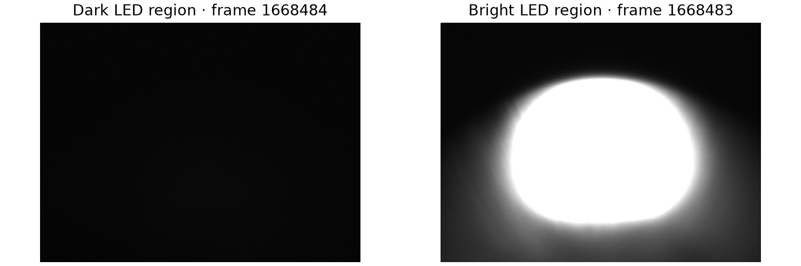
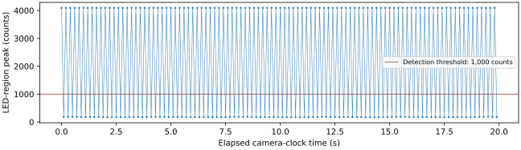

LED-triggered event sequence
============================

:doc:`All experiments <scenario_results>`.

Objective
---------

This experiment tests whether a visible LED transition can start an identified timing sequence whose events reach both receivers with the configured spacing. CAM2 provides the optical observation; the event generator then sends code 42 followed by code 43 at a configured offset of 1,000,000 ns.
The measured response is the interval between the two received events. The experiment also records software command milestones, so camera-processing delays remain separate from hardware event spacing. It does not measure the instant of optical turn-on or the physical fiber-transmit time.

Setup
-----

.. list-table::
   :header-rows: 1

   * - Component
     - Address / PV prefix
     - Configuration and verification
   * - LED source
     - Breadboard connected to a DG645
     - The existing source is left unchanged. The particular DG645 unit and connector have not been traced; fresh CAM2 images confirm that its light is visible.
   * - CAM2
     - 192.168.2.1 / CAM:DEV2:20:
     - External Line1 trigger; 1 ms exposure; 1200 × 900 Mono12. The existing approximately 10 Hz stream remains active throughout the trial.
   * - Optical detector
     - Image columns 300–699; rows 550–849
     - Coordinates start at zero. A region peak above 1,000 counts is bright. Every accepted trigger requires a new dark frame followed by a newer bright frame.
   * - Event generator
     - 10.139.5.196 / EVT:DEV2:20:
     - Firmware and IOC 20261017; 125 MHz clock. Bank 1 uses Normal mode with all timer and electrical-input trigger masks disabled.
   * - Sequence
     - Codes 42, 43, 255
     - Configured offsets are 0, 1,000,000 and 1,001,000 ns. Code 255 stops the table and is not transmitted. Twenty camera-qualified software triggers are permitted, after which the bank is disarmed.
   * - Receiver A
     - 10.139.5.195 / EVT:DEV2:10:
     - Spare logging selections 3 and 4 record codes 42 and 43. Receiver timestamps have 8 ns resolution.
   * - Receiver B
     - 10.139.5.198 / EVT:DEV2:40:
     - The same codes are logged independently for comparison with receiver A. Neither code drives a pulse output.
   * - Camera trigger source
     - 10.139.5.197 / EVT:DEV2:30:
     - Existing event-101 output settings are preserved. The cable destination is not independently verified.
   * - Data acquisition
     - IOC host 10.139.4.59
     - The trial records receiver rows, camera metadata, original image arrays, qualified frame IDs, host command times, run-counter checks and restoration readbacks.

The procedure below repeats the experiment on the existing rack without moving cables. Rebuilding the optical arrangement elsewhere also requires identifying the DG645 and camera-trigger cable endpoints.

Procedure
---------

.. list-table::
   :header-rows: 1

   * - Stage
     - Method
     - Record or acceptance check
   * - 1. Establish the baseline
     - Record the existing optical stream before changing the sequencer. Confirm that both light states are visible and that camera acquisition is active.
     - Save original images and metadata. The fresh baseline below demonstrates separation of the bright and dark states.
   * - 2. Review the trial
     - Read the original bank table, trigger masks and full receiver maps, then review the exact apply, trigger and restore commands. Require healthy links, valid timestamps and a clear FIFO-overflow bit.
     - Codes 42 and 43 must be unused, and logging selections 3 and 4 must be free. No protection events or unrelated outputs are changed.
   * - 3. Configure and record
     - Load the listed table, enable the two logging selections on both receivers and begin a 60 s recording with lossless images.
     - Save the pretrial snapshot and command readbacks before the first trigger. Event 101, DG645 and camera acquisition remain unchanged.
   * - 4. Qualify each trigger
     - Arm the bank once. For each of 20 cycles, wait for a fresh dark frame and then a fresh bright frame before issuing one software trigger.
     - Record both frame IDs, region peaks and detection time. Verify one modulo-16 run-counter increment and an idle/armed bank after every cycle. A timeout or operator stop prevents further triggers.
   * - 5. Measure the sequence
     - After receiver readout, match the complete 42/43 sequence for each cycle. Calculate the 42-to-43 interval separately on each receiver and compare the two receivers for each code.
     - A complete trial contains 40 events per receiver in the expected order. Report counts, missing events, mean, standard deviation and range; do not substitute the configured offset for the measured interval.
   * - 6. Restore and verify
     - Disarm the sequencer and restore the saved controls and logging selections, including after an interrupted trial.
     - Compare fresh values and full event maps with the original snapshot, then confirm idle/disarmed state and receiver health.

Results
-------

The fresh baseline, recording ``20261104T045838Z-09f9a3``, contains 200 saved images over 20 seconds. It is an optical-readiness measurement rather than a completed LED-triggered sequence trial.

.. list-table::
   :header-rows: 1

   * - Baseline measurement
     - Observed value
     - Interpretation
   * - Saved images / camera metadata
     - 200 / 200
     - Every recorded camera timestamp has a stored image.
   * - Bright / dark images
     - 100 / 100
     - Both states exceed the separation needed for the selected threshold.
   * - Observed dark-to-bright transitions
     - 99
     - Transitions are identified between sampled images; they are not optical edge timestamps.
   * - Frame-ID gaps / writer overruns
     - 0 / 0
     - These checks describe delivery and storage during the baseline.
   * - Camera-clock interval
     - mean 99,998,630.2 ns; standard deviation 12,424.9 ns
     - The camera clock resolution has not been verified; these are reported frame intervals.
   * - Event-101 receiver comparison
     - 180 pairs; mean 0 ns; standard deviation 0 ns
     - Both receivers reported equal timestamps at 8 ns resolution for the matched baseline events. This is not an LED-to-event delay.

   Original pixel values from the fresh baseline, shown with the same 0–4095 intensity scale. Both panels use the defined LED region.

   Measured region peaks for all baseline images. The threshold separates the recorded bright and dark samples.

The 20-cycle active trial is prepared but has not run. Its event counts, reception gaps and software response intervals therefore have no measured values yet.

:download:`Baseline frame records <../_static/timing-check/scenarios/led-baseline-frames.csv>` and :download:`image hashes and measurements <../_static/timing-check/scenarios/led-baseline-evidence.json>` preserve the source evidence.

.. raw:: html

   

Baseline frame log

.. list-table::
   :header-rows: 1

   * - Frame ID
     - Camera clock (s)
     - Region peak
     - State
   * - 1668483
     - 12048035.2501975
     - 4094
     - Bright
   * - 1668484
     - 12048035.3502069
     - 183
     - Dark
   * - 1668485
     - 12048035.4502162
     - 4094
     - Bright
   * - 1668486
     - 12048035.5502005
     - 187
     - Dark
   * - 1668487
     - 12048035.6502098
     - 4094
     - Bright
   * - 1668488
     - 12048035.750194
     - 184
     - Dark
   * - 1668489
     - 12048035.8502034
     - 4094
     - Bright
   * - 1668490
     - 12048035.9501877
     - 184
     - Dark
   * - 1668491
     - 12048036.050197
     - 4094
     - Bright
   * - 1668492
     - 12048036.1502064
     - 180
     - Dark
   * - 1668493
     - 12048036.2501906
     - 4094
     - Bright
   * - 1668494
     - 12048036.3502
     - 182
     - Dark
   * - 1668495
     - 12048036.4501842
     - 4094
     - Bright
   * - 1668496
     - 12048036.5501936
     - 180
     - Dark
   * - 1668497
     - 12048036.6501778
     - 4094
     - Bright
   * - 1668498
     - 12048036.7501872
     - 175
     - Dark
   * - 1668499
     - 12048036.8501965
     - 4094
     - Bright
   * - 1668500
     - 12048036.9501808
     - 184
     - Dark
   * - 1668501
     - 12048037.0501901
     - 4094
     - Bright
   * - 1668502
     - 12048037.1501744
     - 175
     - Dark
   * - 1668503
     - 12048037.2501837
     - 4094
     - Bright
   * - 1668504
     - 12048037.350168
     - 174
     - Dark
   * - 1668505
     - 12048037.4501773
     - 4094
     - Bright
   * - 1668506
     - 12048037.5501867
     - 177
     - Dark
   * - 1668507
     - 12048037.6501709
     - 4094
     - Bright
   * - 1668508
     - 12048037.7501803
     - 175
     - Dark
   * - 1668509
     - 12048037.8501645
     - 4094
     - Bright
   * - 1668510
     - 12048037.9501739
     - 173
     - Dark
   * - 1668511
     - 12048038.0501581
     - 4094
     - Bright
   * - 1668512
     - 12048038.1501675
     - 175
     - Dark
   * - 1668513
     - 12048038.2501768
     - 4094
     - Bright
   * - 1668514
     - 12048038.3501611
     - 176
     - Dark
   * - 1668515
     - 12048038.4501705
     - 4094
     - Bright
   * - 1668516
     - 12048038.5501547
     - 174
     - Dark
   * - 1668517
     - 12048038.6501641
     - 4094
     - Bright
   * - 1668518
     - 12048038.7501483
     - 178
     - Dark
   * - 1668519
     - 12048038.8501576
     - 4094
     - Bright
   * - 1668520
     - 12048038.950167
     - 176
     - Dark
   * - 1668521
     - 12048039.0501513
     - 4094
     - Bright
   * - 1668522
     - 12048039.1501606
     - 181
     - Dark
   * - 1668523
     - 12048039.2501449
     - 4094
     - Bright
   * - 1668524
     - 12048039.3501542
     - 186
     - Dark
   * - 1668525
     - 12048039.4501384
     - 4094
     - Bright
   * - 1668526
     - 12048039.5501478
     - 190
     - Dark
   * - 1668527
     - 12048039.6501572
     - 4094
     - Bright
   * - 1668528
     - 12048039.7501414
     - 190
     - Dark
   * - 1668529
     - 12048039.8501508
     - 4094
     - Bright
   * - 1668530
     - 12048039.950135
     - 189
     - Dark
   * - 1668531
     - 12048040.0501444
     - 4094
     - Bright
   * - 1668532
     - 12048040.1501286
     - 180
     - Dark
   * - 1668533
     - 12048040.250138
     - 4094
     - Bright
   * - 1668534
     - 12048040.3501473
     - 177
     - Dark
   * - 1668535
     - 12048040.4501316
     - 4094
     - Bright
   * - 1668536
     - 12048040.5501409
     - 181
     - Dark
   * - 1668537
     - 12048040.6501252
     - 4094
     - Bright
   * - 1668538
     - 12048040.7501345
     - 176
     - Dark
   * - 1668539
     - 12048040.8501188
     - 4094
     - Bright
   * - 1668540
     - 12048040.9501281
     - 176
     - Dark
   * - 1668541
     - 12048041.0501375
     - 4094
     - Bright
   * - 1668542
     - 12048041.1501217
     - 176
     - Dark
   * - 1668543
     - 12048041.2501311
     - 4094
     - Bright
   * - 1668544
     - 12048041.3501153
     - 175
     - Dark
   * - 1668545
     - 12048041.4501247
     - 4094
     - Bright
   * - 1668546
     - 12048041.5501089
     - 176
     - Dark
   * - 1668547
     - 12048041.6501183
     - 4094
     - Bright
   * - 1668548
     - 12048041.7501277
     - 178
     - Dark
   * - 1668549
     - 12048041.8501119
     - 4094
     - Bright
   * - 1668550
     - 12048041.9501212
     - 174
     - Dark
   * - 1668551
     - 12048042.0501055
     - 4094
     - Bright
   * - 1668552
     - 12048042.1501149
     - 174
     - Dark
   * - 1668553
     - 12048042.2500991
     - 4094
     - Bright
   * - 1668554
     - 12048042.3501085
     - 178
     - Dark
   * - 1668555
     - 12048042.4501178
     - 4094
     - Bright
   * - 1668556
     - 12048042.550102
     - 173
     - Dark
   * - 1668557
     - 12048042.6501114
     - 4094
     - Bright
   * - 1668558
     - 12048042.7500957
     - 174
     - Dark
   * - 1668559
     - 12048042.850105
     - 4094
     - Bright
   * - 1668560
     - 12048042.9500893
     - 182
     - Dark
   * - 1668561
     - 12048043.0500986
     - 4094
     - Bright
   * - 1668562
     - 12048043.150108
     - 189
     - Dark
   * - 1668563
     - 12048043.2500922
     - 4094
     - Bright
   * - 1668564
     - 12048043.3501016
     - 188
     - Dark
   * - 1668565
     - 12048043.4500858
     - 4094
     - Bright
   * - 1668566
     - 12048043.5500952
     - 182
     - Dark
   * - 1668567
     - 12048043.6500794
     - 4094
     - Bright
   * - 1668568
     - 12048043.7500888
     - 185
     - Dark
   * - 1668569
     - 12048043.8500981
     - 4094
     - Bright
   * - 1668570
     - 12048043.9500824
     - 178
     - Dark
   * - 1668571
     - 12048044.0500917
     - 4094
     - Bright
   * - 1668572
     - 12048044.150076
     - 176
     - Dark
   * - 1668573
     - 12048044.2500853
     - 4094
     - Bright
   * - 1668574
     - 12048044.3500696
     - 173
     - Dark
   * - 1668575
     - 12048044.4500789
     - 4094
     - Bright
   * - 1668576
     - 12048044.5500883
     - 178
     - Dark
   * - 1668577
     - 12048044.6500725
     - 4094
     - Bright
   * - 1668578
     - 12048044.7500819
     - 175
     - Dark
   * - 1668579
     - 12048044.8500661
     - 4094
     - Bright
   * - 1668580
     - 12048044.9500755
     - 175
     - Dark
   * - 1668581
     - 12048045.0500597
     - 4094
     - Bright
   * - 1668582
     - 12048045.1500691
     - 172
     - Dark
   * - 1668583
     - 12048045.2500533
     - 4094
     - Bright
   * - 1668584
     - 12048045.3500627
     - 172
     - Dark
   * - 1668585
     - 12048045.4500721
     - 4094
     - Bright
   * - 1668586
     - 12048045.5500563
     - 173
     - Dark
   * - 1668587
     - 12048045.6500656
     - 4094
     - Bright
   * - 1668588
     - 12048045.7500499
     - 172
     - Dark
   * - 1668589
     - 12048045.8500593
     - 4094
     - Bright
   * - 1668590
     - 12048045.9500435
     - 172
     - Dark
   * - 1668591
     - 12048046.0500529
     - 4094
     - Bright
   * - 1668592
     - 12048046.1500622
     - 170
     - Dark
   * - 1668593
     - 12048046.2500464
     - 4094
     - Bright
   * - 1668594
     - 12048046.3500558
     - 174
     - Dark
   * - 1668595
     - 12048046.4500401
     - 4094
     - Bright
   * - 1668596
     - 12048046.5500494
     - 174
     - Dark
   * - 1668597
     - 12048046.6500337
     - 4094
     - Bright
   * - 1668598
     - 12048046.750043
     - 181
     - Dark
   * - 1668599
     - 12048046.8500524
     - 4094
     - Bright
   * - 1668600
     - 12048046.9500366
     - 182
     - Dark
   * - 1668601
     - 12048047.050046
     - 4094
     - Bright
   * - 1668602
     - 12048047.1500302
     - 187
     - Dark
   * - 1668603
     - 12048047.2500396
     - 4094
     - Bright
   * - 1668604
     - 12048047.3500238
     - 187
     - Dark
   * - 1668605
     - 12048047.4500332
     - 4094
     - Bright
   * - 1668606
     - 12048047.5500425
     - 183
     - Dark
   * - 1668607
     - 12048047.6500268
     - 4094
     - Bright
   * - 1668608
     - 12048047.7500361
     - 180
     - Dark
   * - 1668609
     - 12048047.8500204
     - 4094
     - Bright
   * - 1668610
     - 12048047.9500297
     - 179
     - Dark
   * - 1668611
     - 12048048.050014
     - 4094
     - Bright
   * - 1668612
     - 12048048.1500233
     - 174
     - Dark
   * - 1668613
     - 12048048.2500327
     - 4094
     - Bright
   * - 1668614
     - 12048048.3500169
     - 179
     - Dark
   * - 1668615
     - 12048048.4500263
     - 4094
     - Bright
   * - 1668616
     - 12048048.5500105
     - 176
     - Dark
   * - 1668617
     - 12048048.6500199
     - 4094
     - Bright
   * - 1668618
     - 12048048.7500041
     - 176
     - Dark
   * - 1668619
     - 12048048.8500135
     - 4094
     - Bright
   * - 1668620
     - 12048048.9500229
     - 178
     - Dark
   * - 1668621
     - 12048049.0500071
     - 4094
     - Bright
   * - 1668622
     - 12048049.1500165
     - 171
     - Dark
   * - 1668623
     - 12048049.2500007
     - 4094
     - Bright
   * - 1668624
     - 12048049.35001
     - 170
     - Dark
   * - 1668625
     - 12048049.4499943
     - 4094
     - Bright
   * - 1668626
     - 12048049.5500037
     - 172
     - Dark
   * - 1668627
     - 12048049.650013
     - 4094
     - Bright
   * - 1668628
     - 12048049.7499973
     - 173
     - Dark
   * - 1668629
     - 12048049.8500066
     - 4094
     - Bright
   * - 1668630
     - 12048049.9499908
     - 173
     - Dark
   * - 1668631
     - 12048050.0500002
     - 4094
     - Bright
   * - 1668632
     - 12048050.1499845
     - 176
     - Dark
   * - 1668633
     - 12048050.2499938
     - 4094
     - Bright
   * - 1668634
     - 12048050.3500032
     - 178
     - Dark
   * - 1668635
     - 12048050.4499874
     - 4094
     - Bright
   * - 1668636
     - 12048050.5499968
     - 183
     - Dark
   * - 1668637
     - 12048050.649981
     - 4094
     - Bright
   * - 1668638
     - 12048050.7499904
     - 188
     - Dark
   * - 1668639
     - 12048050.8499746
     - 4094
     - Bright
   * - 1668640
     - 12048050.949984
     - 187
     - Dark
   * - 1668641
     - 12048051.0499933
     - 4094
     - Bright
   * - 1668642
     - 12048051.1499776
     - 182
     - Dark
   * - 1668643
     - 12048051.2499869
     - 4094
     - Bright
   * - 1668644
     - 12048051.3499712
     - 181
     - Dark
   * - 1668645
     - 12048051.4499805
     - 4094
     - Bright
   * - 1668646
     - 12048051.5499648
     - 178
     - Dark
   * - 1668647
     - 12048051.6499741
     - 4094
     - Bright
   * - 1668648
     - 12048051.7499835
     - 174
     - Dark
   * - 1668649
     - 12048051.8499677
     - 4094
     - Bright
   * - 1668650
     - 12048051.9499771
     - 173
     - Dark
   * - 1668651
     - 12048052.0499613
     - 4094
     - Bright
   * - 1668652
     - 12048052.1499707
     - 174
     - Dark
   * - 1668653
     - 12048052.2499549
     - 4094
     - Bright
   * - 1668654
     - 12048052.3499643
     - 174
     - Dark
   * - 1668655
     - 12048052.4499736
     - 4094
     - Bright
   * - 1668656
     - 12048052.5499579
     - 174
     - Dark
   * - 1668657
     - 12048052.6499673
     - 4094
     - Bright
   * - 1668658
     - 12048052.7499515
     - 176
     - Dark
   * - 1668659
     - 12048052.8499609
     - 4094
     - Bright
   * - 1668660
     - 12048052.9499451
     - 172
     - Dark
   * - 1668661
     - 12048053.0499544
     - 4094
     - Bright
   * - 1668662
     - 12048053.1499638
     - 173
     - Dark
   * - 1668663
     - 12048053.2499481
     - 4094
     - Bright
   * - 1668664
     - 12048053.3499574
     - 175
     - Dark
   * - 1668665
     - 12048053.4499417
     - 4094
     - Bright
   * - 1668666
     - 12048053.549951
     - 177
     - Dark
   * - 1668667
     - 12048053.6499352
     - 4094
     - Bright
   * - 1668668
     - 12048053.7499446
     - 173
     - Dark
   * - 1668669
     - 12048053.849954
     - 4094
     - Bright
   * - 1668670
     - 12048053.9499382
     - 174
     - Dark
   * - 1668671
     - 12048054.0499476
     - 4094
     - Bright
   * - 1668672
     - 12048054.1499318
     - 180
     - Dark
   * - 1668673
     - 12048054.2499412
     - 4094
     - Bright
   * - 1668674
     - 12048054.3499254
     - 185
     - Dark
   * - 1668675
     - 12048054.4499348
     - 4094
     - Bright
   * - 1668676
     - 12048054.5499441
     - 186
     - Dark
   * - 1668677
     - 12048054.6499284
     - 4094
     - Bright
   * - 1668678
     - 12048054.7499377
     - 193
     - Dark
   * - 1668679
     - 12048054.849922
     - 4094
     - Bright
   * - 1668680
     - 12048054.9499313
     - 183
     - Dark
   * - 1668681
     - 12048055.0499156
     - 4094
     - Bright
   * - 1668682
     - 12048055.1499249
     - 180
     - Dark

.. raw:: html

   

.. raw:: html

   

Exact active-trial commands; not executed
<pre>Apply
   pvput -w 3 EVT:DEV2:10:EVR:LOG:evt3 42
   pvput -w 3 EVT:DEV2:10:EVR:LOG:evt4 43
   pvput -w 3 EVT:DEV2:40:EVR:LOG:evt3 42
   pvput -w 3 EVT:DEV2:40:EVR:LOG:evt4 43
   pvput -w 3 EVT:DEV2:20:EVG:SEQ:1:disarm 1
   pvput -w 3 EVT:DEV2:20:EVG:SEQ:1:HWrise 0
   pvput -w 3 EVT:DEV2:20:EVG:SEQ:1:HWfall 0
   pvput -w 3 EVT:DEV2:20:EVG:SEQ:1:Tmr 0
   pvput -w 3 EVT:DEV2:20:EVG:SEQ:1:tMode 1
   pvput -w 3 EVT:DEV2:20:EVG:SEQ:1:slo 1000000000
   pvput -w 3 EVT:DEV2:20:EVG:SEQ:1:codes &#x27;[42,43,255]&#x27;
   pvput -w 3 EVT:DEV2:20:EVG:SEQ:1:times &#x27;[0.0,1000000.0,1001000.0]&#x27;
   pvput -w 3 EVT:DEV2:20:EVG:SEQ:1:store 1

   Trigger: qualify each trig with a fresh dark-to-bright transition
   pvput -w 3 EVT:DEV2:20:EVG:SEQ:1:arm 1
   pvput -w 3 EVT:DEV2:20:EVG:SEQ:1:trig 1
   pvput -w 3 EVT:DEV2:20:EVG:SEQ:1:trig 1
   pvput -w 3 EVT:DEV2:20:EVG:SEQ:1:trig 1
   pvput -w 3 EVT:DEV2:20:EVG:SEQ:1:trig 1
   pvput -w 3 EVT:DEV2:20:EVG:SEQ:1:trig 1
   pvput -w 3 EVT:DEV2:20:EVG:SEQ:1:trig 1
   pvput -w 3 EVT:DEV2:20:EVG:SEQ:1:trig 1
   pvput -w 3 EVT:DEV2:20:EVG:SEQ:1:trig 1
   pvput -w 3 EVT:DEV2:20:EVG:SEQ:1:trig 1
   pvput -w 3 EVT:DEV2:20:EVG:SEQ:1:trig 1
   pvput -w 3 EVT:DEV2:20:EVG:SEQ:1:trig 1
   pvput -w 3 EVT:DEV2:20:EVG:SEQ:1:trig 1
   pvput -w 3 EVT:DEV2:20:EVG:SEQ:1:trig 1
   pvput -w 3 EVT:DEV2:20:EVG:SEQ:1:trig 1
   pvput -w 3 EVT:DEV2:20:EVG:SEQ:1:trig 1
   pvput -w 3 EVT:DEV2:20:EVG:SEQ:1:trig 1
   pvput -w 3 EVT:DEV2:20:EVG:SEQ:1:trig 1
   pvput -w 3 EVT:DEV2:20:EVG:SEQ:1:trig 1
   pvput -w 3 EVT:DEV2:20:EVG:SEQ:1:trig 1
   pvput -w 3 EVT:DEV2:20:EVG:SEQ:1:trig 1
   pvput -w 3 EVT:DEV2:20:EVG:SEQ:1:disarm 1

   Stop
   pvput -w 3 EVT:DEV2:20:EVG:SEQ:1:disarm 1

   Restore
   pvput -w 3 EVT:DEV2:20:EVG:SEQ:1:disarm 1
   pvput -w 3 EVT:DEV2:20:EVG:SEQ:1:HWrise 0
   pvput -w 3 EVT:DEV2:20:EVG:SEQ:1:HWfall 0
   pvput -w 3 EVT:DEV2:20:EVG:SEQ:1:Tmr 0
   pvput -w 3 EVT:DEV2:20:EVG:SEQ:1:tMode 0
   pvput -w 3 EVT:DEV2:20:EVG:SEQ:1:slo 1000000000.0
   pvput -w 3 EVT:DEV2:20:EVG:SEQ:1:codes &#x27;[0]&#x27;
   pvput -w 3 EVT:DEV2:20:EVG:SEQ:1:times &#x27;[0.0]&#x27;
   pvput -w 3 EVT:DEV2:20:EVG:SEQ:1:store 1
   pvput -w 3 EVT:DEV2:10:EVR:LOG:evt3 0
   pvput -w 3 EVT:DEV2:10:EVR:LOG:evt4 0
   pvput -w 3 EVT:DEV2:40:EVR:LOG:evt3 0
   pvput -w 3 EVT:DEV2:40:EVR:LOG:evt4 0
   </pre>

Findings
--------

The baseline demonstrates that the current camera stream can distinguish the LED states while both receivers retain consistent event-101 timestamps. It supports proceeding with camera-qualified sequence triggering without changing the working optical source.
The active trial will establish whether LED detection reliably starts the two-event sequence and whether both receivers retain its measured spacing. A successful result would qualify that software-and-sequencer path; it would not establish optical turn-on latency, physical transmit time, an electrical output response or 1 kHz operation.
