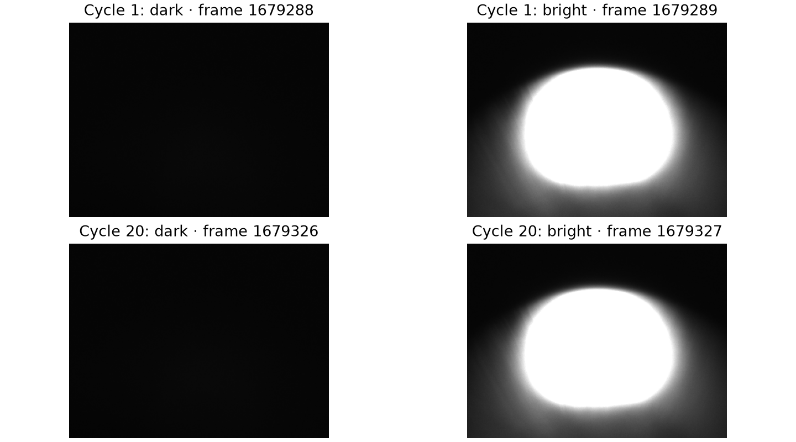
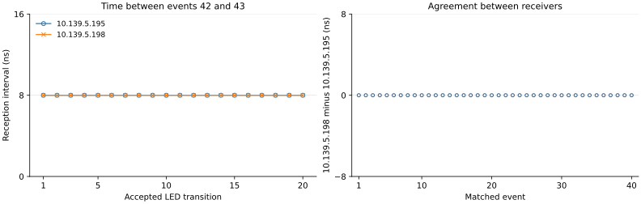
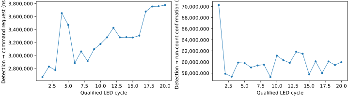

LED-triggered event sequence
============================

:doc:`All experiments <scenario_results>`.

Objective
---------

This experiment tests whether a visible LED transition can start an identified timing sequence whose events reach both receivers with the configured spacing. CAM2 provides the optical observation; the event generator then sends code 42 followed by code 43 at a configured offset of 1,000,000 ns.
The measured response is the interval between the two received events. The experiment also records software command milestones, so camera-processing delays remain separate from hardware event spacing. It does not measure the instant of optical turn-on or the physical fiber-transmit time.

Setup
-----

.. list-table::
   :header-rows: 1

   * - Component
     - Address / PV prefix
     - Configuration and verification
   * - LED source
     - Breadboard connected to a DG645
     - The existing source is left unchanged. The particular DG645 unit and connector have not been traced; fresh CAM2 images confirm that its light is visible.
   * - CAM2
     - 192.168.2.1 / CAM:DEV2:20:
     - External Line1 trigger; 1 ms exposure; 1200 × 900 Mono12. The existing approximately 10 Hz stream remains active throughout the trial.
   * - Optical detector
     - Image columns 300–699; rows 550–849
     - Coordinates start at zero. A region peak above 1,000 counts is bright. Every accepted trigger requires a new dark frame followed by a newer bright frame.
   * - Event generator
     - 10.139.5.196 / EVT:DEV2:20:
     - Firmware and IOC 20261017; 125 MHz clock. Bank 1 uses Normal mode with all timer and electrical-input trigger masks disabled.
   * - Sequence
     - Codes 42, 43, 255
     - Configured offsets are 0, 1,000,000 and 1,001,000 ns. Code 255 stops the table and is not transmitted. Twenty camera-qualified software triggers are permitted, after which the bank is disarmed.
   * - Receiver A
     - 10.139.5.195 / EVT:DEV2:10:
     - Spare logging selections 3 and 4 record codes 42 and 43. Receiver timestamps have 8 ns resolution.
   * - Receiver B
     - 10.139.5.198 / EVT:DEV2:40:
     - The same codes are logged independently for comparison with receiver A. Neither code drives a pulse output.
   * - Camera trigger source
     - 10.139.5.197 / EVT:DEV2:30:
     - Existing event-101 output settings are preserved. The cable destination is not independently verified.
   * - Acquisition software
     - /home/cxfeldev/Desktop/dario/timing-check/console
     - The primary LED feedback configuration implements the protocol. run_led_sequence.py prepares a reviewed bundle and executes it only with an explicit matching approval; verify_led_sequence.py recalculates the result from saved data.
   * - Data acquisition
     - IOC host 10.139.4.59
     - The trial records receiver rows, camera metadata, original image arrays, qualified frame IDs, host command times, run-counter checks and restoration readbacks.

The procedure below repeats the experiment on the existing rack without moving cables. Rebuilding the optical arrangement elsewhere also requires identifying the DG645 and camera-trigger cable endpoints.

Procedure
---------

.. list-table::
   :header-rows: 1

   * - Stage
     - Method
     - Record or acceptance check
   * - 1. Establish the baseline
     - Record the existing optical stream before changing the sequencer. Confirm that both light states are visible and that camera acquisition is active.
     - Save original images and metadata. The fresh baseline below demonstrates separation of the bright and dark states.
   * - 2. Review the trial
     - Read the original bank table, trigger masks and full receiver maps, then review the exact apply, trigger and restore commands. Require healthy links, valid timestamps and a clear FIFO-overflow bit.
     - Codes 42 and 43 must be unused, and logging selections 3 and 4 must be free. No protection events or unrelated outputs are changed.
   * - 3. Configure and record
     - Load the listed table, enable the two logging selections on both receivers and begin a 60 s recording with lossless images.
     - Save the pretrial snapshot and command readbacks before the first trigger. Event 101, DG645 and camera acquisition remain unchanged.
   * - 4. Qualify each trigger
     - Arm the bank once. For each of 20 cycles, wait for a fresh dark frame and then a fresh bright frame before issuing one software trigger.
     - Record both frame IDs, region peaks and detection time. Verify one modulo-16 run-counter increment and an idle/armed bank after every cycle. A timeout or operator stop prevents further triggers.
   * - 5. Measure the sequence
     - After receiver readout, match the complete 42/43 sequence for each cycle. Calculate the 42-to-43 interval separately on each receiver and compare the two receivers for each code.
     - A complete trial contains 40 events per receiver in the expected order. Report counts, missing events, mean, standard deviation and range; do not substitute the configured offset for the measured interval.
   * - 6. Restore and verify
     - Disarm the sequencer and restore the saved controls and logging selections, including after an interrupted trial.
     - Compare fresh values and full event maps with the original snapshot, then confirm idle/disarmed state and receiver health.

Results
-------

The active recording ``20261104T051638Z-3fd293`` completed 20 camera-qualified sequences during a 60-second acquisition. Each accepted LED transition generated event 42 followed by event 43; both receivers recorded all 40 expected events. All 600 images were saved without frame-ID gaps, writer overruns or unassociated frames.
The original pixels confirm every qualifying dark and bright frame. The starting sequencer controls and complete receiver maps were restored, while event 101, camera acquisition, pulse outputs and DG645 settings remained unchanged.

.. list-table::
   :header-rows: 1

   * - Measurement
     - Observed result
     - Meaning
   * - Optical qualification
     - 20 of 20 requested sequences; 40 source frames verified
     - Every trigger followed a fresh dark-to-bright pair in the stored images. Only the first 20 accepted transitions triggered sequences; later images were background observations after disarming.
   * - Reception completeness
     - 40 of 40 events on each receiver
     - Both codes arrived in the expected order for every cycle.
   * - Measured 42 → 43 gap at 10.139.5.195
     - mean 1,000,000 ns; standard deviation 0 ns; range 1,000,000–1,000,000 ns
     - This interval is calculated from two hardware reception timestamps on the same receiver.
   * - Measured 42 → 43 gap at 10.139.5.198
     - mean 1,000,000 ns; standard deviation 0 ns; range 1,000,000–1,000,000 ns
     - The independent receiver gives the same measured interval.
   * - Receiver B minus A
     - mean 0 ns; standard deviation 0 ns; range 0–0 ns
     - All 40 matched events have equal reported timestamps at 8 ns resolution.
   * - Host detection → command request
     - mean 3,267,748 ns; standard deviation 336,534 ns; range 2,668,934–3,777,316 ns
     - Host monotonic time from software qualification to the start of the trigger write; this is not an optical-edge or physical transmit measurement.
   * - Host detection → run-count confirmation
     - mean 60,032,252 ns; standard deviation 2,669,866 ns; range 57,292,733–70,288,531 ns
     - This includes command transport and IOC/readback verification, so it must not be interpreted as hardware actuation latency.
   * - Image delivery and storage
     - 600 camera timestamps; 600 saved images; no observed gaps or overruns
     - All source frames used for qualification are present in the lossless recording.
   * - Restoration and health
     - Original controls and full maps matched; bank idle and disarmed; four links/timestamps valid; overflow clear
     - Fresh readbacks independently confirmed restoration after the trial.

   Actual source frames for the first and last qualified cycles, using the same 0–4095 intensity scale. The full-size original arrays remain in the recording.

   Measured receiver intervals and timestamp differences. Each plotted point comes from a stored hardware event record; no transmit timestamps are reconstructed.

   Measured host software milestones for the same 20 cycles. These intervals use the host monotonic clock and remain separate from receiver hardware timing.

.. list-table::
   :header-rows: 1

   * - Timing point
     - Recorded clock / evidence
     - Interpretation
   * - LED observation
     - Camera image ID, camera clock and region peak
     - Confirms the observed light state; a sampled image does not timestamp optical turn-on.
   * - Software trigger request
     - Host wall-clock timestamps and monotonic intervals
     - Records when the application started and completed its write, not when the event left the fiber transmitter.
   * - Events 42 and 43 received
     - Receiver POSIX seconds and nanoseconds; 8 ns resolution
     - Provides the measured event spacing and receiver agreement shown above. Absolute UTC accuracy was not calibrated.
   * - Follow-up action
     - Event 43 was emitted by the sequencer after event 42 and logged by both receivers
     - The sequence does not wait for an EVR acknowledgment, and neither event drives an electrical output in this trial.

The 20-second pretrial baseline contained 200 saved images, with 100 bright and 100 dark states and 99 sampled dark-to-bright transitions. It verified optical visibility before arming; the plots above use the active trial rather than substituting baseline images.
:download:`Cycle measurements <../_static/timing-check/scenarios/led-sequence-cycles.csv>` and :download:`verified source evidence <../_static/timing-check/scenarios/led-sequence-evidence.json>` preserve the clocks, frame IDs, original-image hashes and restoration checks.

.. raw:: html

   

Hardware event records

.. list-table::
   :header-rows: 1

   * - Cycle
     - Code
     - 10.139.5.195 reported UTC
     - 10.139.5.198 reported UTC
     - B minus A (ns)
   * - 1
     - 42
     - 2026-11-04 05:16:38.966633888
     - 2026-11-04 05:16:38.966633888
     - 0
   * - 1
     - 43
     - 2026-11-04 05:16:38.967633888
     - 2026-11-04 05:16:38.967633888
     - 0
   * - 2
     - 42
     - 2026-11-04 05:16:39.158820376
     - 2026-11-04 05:16:39.158820376
     - 0
   * - 2
     - 43
     - 2026-11-04 05:16:39.159820376
     - 2026-11-04 05:16:39.159820376
     - 0
   * - 3
     - 42
     - 2026-11-04 05:16:39.348352232
     - 2026-11-04 05:16:39.348352232
     - 0
   * - 3
     - 43
     - 2026-11-04 05:16:39.349352232
     - 2026-11-04 05:16:39.349352232
     - 0
   * - 4
     - 42
     - 2026-11-04 05:16:39.552895544
     - 2026-11-04 05:16:39.552895544
     - 0
   * - 4
     - 43
     - 2026-11-04 05:16:39.553895544
     - 2026-11-04 05:16:39.553895544
     - 0
   * - 5
     - 42
     - 2026-11-04 05:16:39.755218008
     - 2026-11-04 05:16:39.755218008
     - 0
   * - 5
     - 43
     - 2026-11-04 05:16:39.756218008
     - 2026-11-04 05:16:39.756218008
     - 0
   * - 6
     - 42
     - 2026-11-04 05:16:39.959588328
     - 2026-11-04 05:16:39.959588328
     - 0
   * - 6
     - 43
     - 2026-11-04 05:16:39.960588328
     - 2026-11-04 05:16:39.960588328
     - 0
   * - 7
     - 42
     - 2026-11-04 05:16:40.153020392
     - 2026-11-04 05:16:40.153020392
     - 0
   * - 7
     - 43
     - 2026-11-04 05:16:40.154020392
     - 2026-11-04 05:16:40.154020392
     - 0
   * - 8
     - 42
     - 2026-11-04 05:16:40.354367904
     - 2026-11-04 05:16:40.354367904
     - 0
   * - 8
     - 43
     - 2026-11-04 05:16:40.355367904
     - 2026-11-04 05:16:40.355367904
     - 0
   * - 9
     - 42
     - 2026-11-04 05:16:40.555127976
     - 2026-11-04 05:16:40.555127976
     - 0
   * - 9
     - 43
     - 2026-11-04 05:16:40.556127976
     - 2026-11-04 05:16:40.556127976
     - 0
   * - 10
     - 42
     - 2026-11-04 05:16:40.759335544
     - 2026-11-04 05:16:40.759335544
     - 0
   * - 10
     - 43
     - 2026-11-04 05:16:40.760335544
     - 2026-11-04 05:16:40.760335544
     - 0
   * - 11
     - 42
     - 2026-11-04 05:16:40.954778488
     - 2026-11-04 05:16:40.954778488
     - 0
   * - 11
     - 43
     - 2026-11-04 05:16:40.955778488
     - 2026-11-04 05:16:40.955778488
     - 0
   * - 12
     - 42
     - 2026-11-04 05:16:41.154232616
     - 2026-11-04 05:16:41.154232616
     - 0
   * - 12
     - 43
     - 2026-11-04 05:16:41.155232616
     - 2026-11-04 05:16:41.155232616
     - 0
   * - 13
     - 42
     - 2026-11-04 05:16:41.360269496
     - 2026-11-04 05:16:41.360269496
     - 0
   * - 13
     - 43
     - 2026-11-04 05:16:41.361269496
     - 2026-11-04 05:16:41.361269496
     - 0
   * - 14
     - 42
     - 2026-11-04 05:16:41.556156816
     - 2026-11-04 05:16:41.556156816
     - 0
   * - 14
     - 43
     - 2026-11-04 05:16:41.557156816
     - 2026-11-04 05:16:41.557156816
     - 0
   * - 15
     - 42
     - 2026-11-04 05:16:41.749541040
     - 2026-11-04 05:16:41.749541040
     - 0
   * - 15
     - 43
     - 2026-11-04 05:16:41.750541040
     - 2026-11-04 05:16:41.750541040
     - 0
   * - 16
     - 42
     - 2026-11-04 05:16:41.954662184
     - 2026-11-04 05:16:41.954662184
     - 0
   * - 16
     - 43
     - 2026-11-04 05:16:41.955662184
     - 2026-11-04 05:16:41.955662184
     - 0
   * - 17
     - 42
     - 2026-11-04 05:16:42.156873456
     - 2026-11-04 05:16:42.156873456
     - 0
   * - 17
     - 43
     - 2026-11-04 05:16:42.157873456
     - 2026-11-04 05:16:42.157873456
     - 0
   * - 18
     - 42
     - 2026-11-04 05:16:42.357292208
     - 2026-11-04 05:16:42.357292208
     - 0
   * - 18
     - 43
     - 2026-11-04 05:16:42.358292208
     - 2026-11-04 05:16:42.358292208
     - 0
   * - 19
     - 42
     - 2026-11-04 05:16:42.550379248
     - 2026-11-04 05:16:42.550379248
     - 0
   * - 19
     - 43
     - 2026-11-04 05:16:42.551379248
     - 2026-11-04 05:16:42.551379248
     - 0
   * - 20
     - 42
     - 2026-11-04 05:16:42.756191064
     - 2026-11-04 05:16:42.756191064
     - 0
   * - 20
     - 43
     - 2026-11-04 05:16:42.757191064
     - 2026-11-04 05:16:42.757191064
     - 0

.. raw:: html

   

.. raw:: html

   

Optical qualification and host processing records

.. list-table::
   :header-rows: 1

   * - Cycle
     - Dark / bright frame ID
     - Dark / bright peak
     - Detection → request (ns)
     - Detection → confirmation (ns)
   * - 1
     - 1679288 / 1679289
     - 180 / 4094
     - 2668934
     - 70288531
   * - 2
     - 1679290 / 1679291
     - 175 / 4094
     - 2829684
     - 57891383
   * - 3
     - 1679292 / 1679293
     - 174 / 4094
     - 2775824
     - 57367422
   * - 4
     - 1679294 / 1679295
     - 173 / 4094
     - 3652366
     - 59897747
   * - 5
     - 1679296 / 1679297
     - 175 / 4094
     - 3471105
     - 59816886
   * - 6
     - 1679298 / 1679299
     - 175 / 4094
     - 2883354
     - 59026075
   * - 7
     - 1679300 / 1679301
     - 176 / 4094
     - 3063115
     - 59385456
   * - 8
     - 1679302 / 1679303
     - 177 / 4094
     - 2914924
     - 59531615
   * - 9
     - 1679304 / 1679305
     - 171 / 4094
     - 3097775
     - 57292733
   * - 10
     - 1679306 / 1679307
     - 172 / 4094
     - 3178755
     - 61154488
   * - 11
     - 1679308 / 1679309
     - 174 / 4094
     - 3279495
     - 60337897
   * - 12
     - 1679310 / 1679311
     - 173 / 4094
     - 3426305
     - 59855186
   * - 13
     - 1679312 / 1679313
     - 178 / 4094
     - 3279255
     - 61858459
   * - 14
     - 1679314 / 1679315
     - 181 / 4094
     - 3282315
     - 61490179
   * - 15
     - 1679316 / 1679317
     - 186 / 4094
     - 3277795
     - 57765303
   * - 16
     - 1679318 / 1679319
     - 185 / 4094
     - 3306245
     - 60119536
   * - 17
     - 1679320 / 1679321
     - 183 / 4094
     - 3677585
     - 58001464
   * - 18
     - 1679322 / 1679323
     - 183 / 4094
     - 3754735
     - 60099796
   * - 19
     - 1679324 / 1679325
     - 186 / 4094
     - 3758085
     - 59470655
   * - 20
     - 1679326 / 1679327
     - 179 / 4094
     - 3777316
     - 59994236

.. raw:: html

   

.. raw:: html

   

Executed command log
<pre>Apply
   pvput -w 3 EVT:DEV2:10:EVR:LOG:evt3 42
   pvput -w 3 EVT:DEV2:10:EVR:LOG:evt4 43
   pvput -w 3 EVT:DEV2:40:EVR:LOG:evt3 42
   pvput -w 3 EVT:DEV2:40:EVR:LOG:evt4 43
   pvput -w 3 EVT:DEV2:20:EVG:SEQ:1:disarm 1
   pvput -w 3 EVT:DEV2:20:EVG:SEQ:1:HWrise 0
   pvput -w 3 EVT:DEV2:20:EVG:SEQ:1:HWfall 0
   pvput -w 3 EVT:DEV2:20:EVG:SEQ:1:Tmr 0
   pvput -w 3 EVT:DEV2:20:EVG:SEQ:1:tMode 1
   pvput -w 3 EVT:DEV2:20:EVG:SEQ:1:slo 1000000000
   pvput -w 3 EVT:DEV2:20:EVG:SEQ:1:codes &#x27;[42,43,255]&#x27;
   pvput -w 3 EVT:DEV2:20:EVG:SEQ:1:times &#x27;[0.0,1000000.0,1001000.0]&#x27;
   pvput -w 3 EVT:DEV2:20:EVG:SEQ:1:store 1

   Trigger: qualify each trig with a fresh dark-to-bright transition
   pvput -w 3 EVT:DEV2:20:EVG:SEQ:1:arm 1
   pvput -w 3 EVT:DEV2:20:EVG:SEQ:1:trig 1
   pvput -w 3 EVT:DEV2:20:EVG:SEQ:1:trig 1
   pvput -w 3 EVT:DEV2:20:EVG:SEQ:1:trig 1
   pvput -w 3 EVT:DEV2:20:EVG:SEQ:1:trig 1
   pvput -w 3 EVT:DEV2:20:EVG:SEQ:1:trig 1
   pvput -w 3 EVT:DEV2:20:EVG:SEQ:1:trig 1
   pvput -w 3 EVT:DEV2:20:EVG:SEQ:1:trig 1
   pvput -w 3 EVT:DEV2:20:EVG:SEQ:1:trig 1
   pvput -w 3 EVT:DEV2:20:EVG:SEQ:1:trig 1
   pvput -w 3 EVT:DEV2:20:EVG:SEQ:1:trig 1
   pvput -w 3 EVT:DEV2:20:EVG:SEQ:1:trig 1
   pvput -w 3 EVT:DEV2:20:EVG:SEQ:1:trig 1
   pvput -w 3 EVT:DEV2:20:EVG:SEQ:1:trig 1
   pvput -w 3 EVT:DEV2:20:EVG:SEQ:1:trig 1
   pvput -w 3 EVT:DEV2:20:EVG:SEQ:1:trig 1
   pvput -w 3 EVT:DEV2:20:EVG:SEQ:1:trig 1
   pvput -w 3 EVT:DEV2:20:EVG:SEQ:1:trig 1
   pvput -w 3 EVT:DEV2:20:EVG:SEQ:1:trig 1
   pvput -w 3 EVT:DEV2:20:EVG:SEQ:1:trig 1
   pvput -w 3 EVT:DEV2:20:EVG:SEQ:1:trig 1
   pvput -w 3 EVT:DEV2:20:EVG:SEQ:1:disarm 1

   Disarm
   pvput -w 3 EVT:DEV2:20:EVG:SEQ:1:disarm 1

   Restore
   pvput -w 3 EVT:DEV2:20:EVG:SEQ:1:disarm 1
   pvput -w 3 EVT:DEV2:20:EVG:SEQ:1:HWrise 0
   pvput -w 3 EVT:DEV2:20:EVG:SEQ:1:HWfall 0
   pvput -w 3 EVT:DEV2:20:EVG:SEQ:1:Tmr 0
   pvput -w 3 EVT:DEV2:20:EVG:SEQ:1:tMode 0
   pvput -w 3 EVT:DEV2:20:EVG:SEQ:1:slo 1000000000.0
   pvput -w 3 EVT:DEV2:20:EVG:SEQ:1:codes &#x27;[0]&#x27;
   pvput -w 3 EVT:DEV2:20:EVG:SEQ:1:times &#x27;[0.0]&#x27;
   pvput -w 3 EVT:DEV2:20:EVG:SEQ:1:store 1
   pvput -w 3 EVT:DEV2:10:EVR:LOG:evt3 0
   pvput -w 3 EVT:DEV2:10:EVR:LOG:evt4 0
   pvput -w 3 EVT:DEV2:40:EVR:LOG:evt3 0
   pvput -w 3 EVT:DEV2:40:EVR:LOG:evt4 0
   </pre>

Findings
--------

The tested path converted 20 observed LED transitions into 20 complete event sequences, and both receivers retained the programmed 1,000,000 ns spacing. Their reported timestamps agreed for all 40 events at the available 8 ns resolution, which supports consistent event identification and timestamp correlation at these settings.
The host took 3.268 ms on average to start the trigger write after image qualification. Run-count confirmation took 60.032 ms on average, including IOC readback. These software measurements show why control-plane verification must be kept separate from the hardware sequence interval.
For CXFEL, this result demonstrates an optical-observation-driven timing sequence with repeatable receiver timestamps. It does not establish nanosecond optical response, physical transmit-to-receive delay, an EVR-controlled output pulse or full-rate operation. Those measurements require recorded physical input/output signals; camera frames and command completion cannot supply the missing edge timestamps.
