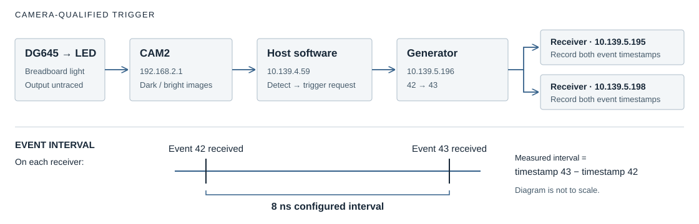

LED-triggered event sequence
============================

:doc:`All experiments <scenario_results>`.

Objective
---------

This experiment checks whether camera detection of an LED flash can start a two-event sequence that both receivers record with consistent timing. The interval is between the received events, rather than between LED turn-on and reception.

Results
-------

The source images and raw receiver records were checked independently for recording ``20261104T065440Z-9f4ddd``. The comparison below includes a separate 80 ns trial.

.. list-table::
   :header-rows: 1

   * - Measurement
     - Recorded result
   * - Qualified LED transitions
     - 20 of 20; all 40 source frames verified
   * - Events received
     - 40 of 40 on each receiver
   * - Time between events, 10.139.5.195
     - Mean 8 ns; standard deviation 0 ns
   * - Time between events, 10.139.5.198
     - Mean 8 ns; standard deviation 0 ns
   * - Receiver B minus A
     - Mean 0 ns; standard deviation 0 ns across 40 events
   * - Capture and restoration
     - 599 images saved; no frame-ID gaps or writer overruns. Original settings/maps restored and verified.

.. list-table::
   :header-rows: 1

   * - Requested gap (ns)
     - Measured mean, A / B (ns)
     - Standard deviation, A / B (ns)
     - Events received, A / B
     - Source
   * - 80
     - 80 / 80
     - 0 / 0
     - 40 / 40
     - :download:`Evidence <../_static/timing-check/scenarios/led-80ns-evidence.json>`
   * - 8
     - 8 / 8
     - 0 / 0
     - 40 / 40
     - :download:`Evidence <../_static/timing-check/scenarios/led-8ns-evidence.json>`

The 8 ns capture saved 599 contiguous images (IDs 1738106–1738704). Its paired metadata log also contains leading frame 1738105, for which no image was stored. All 40 frames used for trigger qualification are present.

.. figure:: ../_static/timing-check/scenarios/led-qualified-images.png
   :alt: A common intensity scale preserves the contrast used to qualify the first and last cycles; no brightness adjustment was applied to individual panels.
   :width: 100%

   A common intensity scale preserves the contrast used to qualify the first and last cycles; no brightness adjustment was applied to individual panels.

.. figure:: ../_static/timing-check/scenarios/led-hardware-timing.svg
   :alt: The vertical tick spacing is one hardware clock period, so variation below a tick cannot be resolved.
   :width: 100%

   The vertical tick spacing is one hardware clock period, so variation below a tick cannot be resolved.

:download:`Cycle data <../_static/timing-check/scenarios/led-sequence-cycles.csv>` · :download:`Source evidence and checks <../_static/timing-check/scenarios/led-sequence-evidence.json>`.

Setup
-----

.. list-table::
   :header-rows: 1

   * - Component
     - Address / PV prefix
     - Settings used
   * - Generator
     - 10.139.5.196 / EVT:DEV2:20:
     - Release 20261017; 125 MHz clock; bank 1 in Normal mode. Timer and external-input trigger masks are disabled.
   * - Receivers
     - 10.139.5.195 / EVT:DEV2:10: and 10.139.5.198 / EVT:DEV2:40:
     - Logging slots 3 and 4 select codes 42 and 43. Timestamp resolution is 8 ns; neither code drives a pulse output.
   * - CAM2
     - 192.168.2.1 / CAM:DEV2:20:
     - Existing Line1-triggered stream at approximately 10 frames/s; 1 ms exposure; 1200 × 900 Mono12. Event-101 output on 10.139.5.197 is unchanged.
   * - LED detection
     - Breadboard LED connected to a DG645
     - Use columns 300–699 and rows 550–849, starting at zero. A peak above 1,000 counts is bright. The DG645 unit/output and camera-trigger cable endpoints remain unrecorded.
   * - Sequence
     - Codes 42, 43 and stop code 255
     - Offsets: 0, 8 and 1,008 ns. Code 255 ends the table without transmission. Accept 20 fresh dark-to-bright transitions.
   * - Recording
     - IOC host 10.139.4.59
     - The console saves receiver logs, camera metadata, lossless images and command/readback records under timing-check/console/runs/.

Procedure
---------

.. list-table::
   :header-rows: 1

   * - Stage
     - Method and check
   * - 1. Check and review
     - Confirm visible dark and bright LED states, valid receiver links/timestamps and no FIFO overflow. Save the controls and maps; verify that codes 42/43 and logging slots 3/4 are unused before reviewing the exact commands.
   * - 2. Configure and record
     - Load the listed table and logging selections, then start a 60 s lossless recording. Preserve event 101, pulse outputs, camera acquisition and DG645 settings.
   * - 3. Trigger and measure
     - Arm once and accept 20 fresh dark-to-bright frame pairs, issuing one software trigger per pair. Check each run-counter increment, including its 15-to-0 wrap, and match 40 events per receiver. Subtract the code-42 reception time from code 43 on each receiver.
   * - 4. Restore
     - Disarm and restore the saved controls and logging selections, including after a stop or timeout. Compare fresh controls and full maps with the original snapshot, then confirm receiver health.

.. raw:: html

   

Software processing measurements

.. list-table::
   :header-rows: 1

   * - Host interval
     - Mean / standard deviation / range (ns)
   * - Detection → request
     - 3,847,305 / 439,738 / 3,028,904–4,529,596
   * - Detection → run-count confirmation
     - 61,522,930 / 4,235,463 / 56,985,892–75,918,539

.. figure:: ../_static/timing-check/scenarios/led-software-timing.svg
   :alt: Host processing intervals for the same 20 cycles; run-count confirmation includes IOC readback.
   :width: 100%

   Host processing intervals for the same 20 cycles; run-count confirmation includes IOC readback.

.. raw:: html

   

.. raw:: html

   

Hardware event records

.. list-table::
   :header-rows: 1

   * - Cycle
     - Code
     - 10.139.5.195 reported UTC
     - 10.139.5.198 reported UTC
     - B minus A (ns)
   * - 1
     - 42
     - 2026-11-04 06:54:40.966016992
     - 2026-11-04 06:54:40.966016992
     - 0
   * - 1
     - 43
     - 2026-11-04 06:54:40.966017000
     - 2026-11-04 06:54:40.966017000
     - 0
   * - 2
     - 42
     - 2026-11-04 06:54:41.150545864
     - 2026-11-04 06:54:41.150545864
     - 0
   * - 2
     - 43
     - 2026-11-04 06:54:41.150545872
     - 2026-11-04 06:54:41.150545872
     - 0
   * - 3
     - 42
     - 2026-11-04 06:54:41.355102808
     - 2026-11-04 06:54:41.355102808
     - 0
   * - 3
     - 43
     - 2026-11-04 06:54:41.355102816
     - 2026-11-04 06:54:41.355102816
     - 0
   * - 4
     - 42
     - 2026-11-04 06:54:41.559790848
     - 2026-11-04 06:54:41.559790848
     - 0
   * - 4
     - 43
     - 2026-11-04 06:54:41.559790856
     - 2026-11-04 06:54:41.559790856
     - 0
   * - 5
     - 42
     - 2026-11-04 06:54:41.755896256
     - 2026-11-04 06:54:41.755896256
     - 0
   * - 5
     - 43
     - 2026-11-04 06:54:41.755896264
     - 2026-11-04 06:54:41.755896264
     - 0
   * - 6
     - 42
     - 2026-11-04 06:54:41.953856392
     - 2026-11-04 06:54:41.953856392
     - 0
   * - 6
     - 43
     - 2026-11-04 06:54:41.953856400
     - 2026-11-04 06:54:41.953856400
     - 0
   * - 7
     - 42
     - 2026-11-04 06:54:42.156132768
     - 2026-11-04 06:54:42.156132768
     - 0
   * - 7
     - 43
     - 2026-11-04 06:54:42.156132776
     - 2026-11-04 06:54:42.156132776
     - 0
   * - 8
     - 42
     - 2026-11-04 06:54:42.351914224
     - 2026-11-04 06:54:42.351914224
     - 0
   * - 8
     - 43
     - 2026-11-04 06:54:42.351914232
     - 2026-11-04 06:54:42.351914232
     - 0
   * - 9
     - 42
     - 2026-11-04 06:54:42.554612064
     - 2026-11-04 06:54:42.554612064
     - 0
   * - 9
     - 43
     - 2026-11-04 06:54:42.554612072
     - 2026-11-04 06:54:42.554612072
     - 0
   * - 10
     - 42
     - 2026-11-04 06:54:42.759040976
     - 2026-11-04 06:54:42.759040976
     - 0
   * - 10
     - 43
     - 2026-11-04 06:54:42.759040984
     - 2026-11-04 06:54:42.759040984
     - 0
   * - 11
     - 42
     - 2026-11-04 06:54:42.958117112
     - 2026-11-04 06:54:42.958117112
     - 0
   * - 11
     - 43
     - 2026-11-04 06:54:42.958117120
     - 2026-11-04 06:54:42.958117120
     - 0
   * - 12
     - 42
     - 2026-11-04 06:54:43.150687072
     - 2026-11-04 06:54:43.150687072
     - 0
   * - 12
     - 43
     - 2026-11-04 06:54:43.150687080
     - 2026-11-04 06:54:43.150687080
     - 0
   * - 13
     - 42
     - 2026-11-04 06:54:43.357357592
     - 2026-11-04 06:54:43.357357592
     - 0
   * - 13
     - 43
     - 2026-11-04 06:54:43.357357600
     - 2026-11-04 06:54:43.357357600
     - 0
   * - 14
     - 42
     - 2026-11-04 06:54:43.551123880
     - 2026-11-04 06:54:43.551123880
     - 0
   * - 14
     - 43
     - 2026-11-04 06:54:43.551123888
     - 2026-11-04 06:54:43.551123888
     - 0
   * - 15
     - 42
     - 2026-11-04 06:54:43.757540512
     - 2026-11-04 06:54:43.757540512
     - 0
   * - 15
     - 43
     - 2026-11-04 06:54:43.757540520
     - 2026-11-04 06:54:43.757540520
     - 0
   * - 16
     - 42
     - 2026-11-04 06:54:43.952605872
     - 2026-11-04 06:54:43.952605872
     - 0
   * - 16
     - 43
     - 2026-11-04 06:54:43.952605880
     - 2026-11-04 06:54:43.952605880
     - 0
   * - 17
     - 42
     - 2026-11-04 06:54:44.158616816
     - 2026-11-04 06:54:44.158616816
     - 0
   * - 17
     - 43
     - 2026-11-04 06:54:44.158616824
     - 2026-11-04 06:54:44.158616824
     - 0
   * - 18
     - 42
     - 2026-11-04 06:54:44.354056032
     - 2026-11-04 06:54:44.354056032
     - 0
   * - 18
     - 43
     - 2026-11-04 06:54:44.354056040
     - 2026-11-04 06:54:44.354056040
     - 0
   * - 19
     - 42
     - 2026-11-04 06:54:44.550245464
     - 2026-11-04 06:54:44.550245464
     - 0
   * - 19
     - 43
     - 2026-11-04 06:54:44.550245472
     - 2026-11-04 06:54:44.550245472
     - 0
   * - 20
     - 42
     - 2026-11-04 06:54:44.753730424
     - 2026-11-04 06:54:44.753730424
     - 0
   * - 20
     - 43
     - 2026-11-04 06:54:44.753730432
     - 2026-11-04 06:54:44.753730432
     - 0

.. raw:: html

   

.. raw:: html

   

Optical qualification and host processing records

.. list-table::
   :header-rows: 1

   * - Cycle
     - Dark / bright frame ID
     - Dark / bright peak
     - Detected (host UTC)
     - Write started (host UTC)
     - Put returned (host UTC)
     - Detection → request (ns)
     - Detection → confirmation (ns)
   * - 1
     - 1738108 / 1738109
     - 181 / 4094
     - 2026-11-04 06:54:40.834020127
     - 2026-11-04 06:54:40.837192522
     - 2026-11-04 06:54:40.854802077
     - 3171244
     - 70735762
   * - 2
     - 1738110 / 1738111
     - 181 / 4094
     - 2026-11-04 06:54:41.029100099
     - 2026-11-04 06:54:41.032130603
     - 2026-11-04 06:54:41.039324283
     - 3028904
     - 60296247
   * - 3
     - 1738112 / 1738113
     - 178 / 4094
     - 2026-11-04 06:54:41.233728764
     - 2026-11-04 06:54:41.237345069
     - 2026-11-04 06:54:41.243887389
     - 3614286
     - 59874907
   * - 4
     - 1738114 / 1738115
     - 176 / 4094
     - 2026-11-04 06:54:41.438058729
     - 2026-11-04 06:54:41.441374654
     - 2026-11-04 06:54:41.448568995
     - 3314585
     - 60977329
   * - 5
     - 1738116 / 1738117
     - 180 / 4094
     - 2026-11-04 06:54:41.633431972
     - 2026-11-04 06:54:41.637509707
     - 2026-11-04 06:54:41.644673258
     - 4076525
     - 75918539
   * - 6
     - 1738118 / 1738119
     - 175 / 4094
     - 2026-11-04 06:54:41.833853471
     - 2026-11-04 06:54:41.837324256
     - 2026-11-04 06:54:41.842654564
     - 3469515
     - 56985892
   * - 7
     - 1738120 / 1738121
     - 175 / 4094
     - 2026-11-04 06:54:42.036067303
     - 2026-11-04 06:54:42.039897159
     - 2026-11-04 06:54:42.044933826
     - 3828176
     - 59246406
   * - 8
     - 1738122 / 1738123
     - 173 / 4094
     - 2026-11-04 06:54:42.229825623
     - 2026-11-04 06:54:42.233475178
     - 2026-11-04 06:54:42.240717649
     - 3648165
     - 60131777
   * - 9
     - 1738124 / 1738125
     - 172 / 4094
     - 2026-11-04 06:54:42.434404049
     - 2026-11-04 06:54:42.437822324
     - 2026-11-04 06:54:42.443396832
     - 3416885
     - 58464624
   * - 10
     - 1738126 / 1738127
     - 174 / 4094
     - 2026-11-04 06:54:42.637652092
     - 2026-11-04 06:54:42.641467178
     - 2026-11-04 06:54:42.647829507
     - 3814006
     - 60212587
   * - 11
     - 1738128 / 1738129
     - 172 / 4094
     - 2026-11-04 06:54:42.835335148
     - 2026-11-04 06:54:42.839705194
     - 2026-11-04 06:54:42.846925474
     - 4369446
     - 61182748
   * - 12
     - 1738130 / 1738131
     - 173 / 4094
     - 2026-11-04 06:54:43.030305499
     - 2026-11-04 06:54:43.033911035
     - 2026-11-04 06:54:43.039519233
     - 3603666
     - 59995467
   * - 13
     - 1738132 / 1738133
     - 176 / 4094
     - 2026-11-04 06:54:43.235140775
     - 2026-11-04 06:54:43.238819731
     - 2026-11-04 06:54:43.246149151
     - 3678196
     - 61628129
   * - 14
     - 1738134 / 1738135
     - 178 / 4094
     - 2026-11-04 06:54:43.431732719
     - 2026-11-04 06:54:43.435734655
     - 2026-11-04 06:54:43.439906321
     - 4000376
     - 57957334
   * - 15
     - 1738136 / 1738137
     - 172 / 4094
     - 2026-11-04 06:54:43.634808593
     - 2026-11-04 06:54:43.639054799
     - 2026-11-04 06:54:43.646313419
     - 4244946
     - 62041099
   * - 16
     - 1738138 / 1738139
     - 178 / 4094
     - 2026-11-04 06:54:43.830330165
     - 2026-11-04 06:54:43.834246091
     - 2026-11-04 06:54:43.841408901
     - 3914226
     - 61560589
   * - 17
     - 1738140 / 1738141
     - 181 / 4094
     - 2026-11-04 06:54:44.035631482
     - 2026-11-04 06:54:44.040162448
     - 2026-11-04 06:54:44.047409809
     - 4529596
     - 60424507
   * - 18
     - 1738142 / 1738143
     - 184 / 4094
     - 2026-11-04 06:54:44.231057604
     - 2026-11-04 06:54:44.235533860
     - 2026-11-04 06:54:44.242855951
     - 4475816
     - 62872801
   * - 19
     - 1738144 / 1738145
     - 187 / 4094
     - 2026-11-04 06:54:44.429128220
     - 2026-11-04 06:54:44.433600306
     - 2026-11-04 06:54:44.439047474
     - 4472036
     - 60224327
   * - 20
     - 1738146 / 1738147
     - 188 / 4094
     - 2026-11-04 06:54:44.634807767
     - 2026-11-04 06:54:44.639083603
     - 2026-11-04 06:54:44.642521418
     - 4275496
     - 59727526

.. raw:: html

   

.. raw:: html

   

Executed command log
<pre>Apply
   pvput -w 3 EVT:DEV2:10:EVR:LOG:evt3 42
   pvput -w 3 EVT:DEV2:10:EVR:LOG:evt4 43
   pvput -w 3 EVT:DEV2:40:EVR:LOG:evt3 42
   pvput -w 3 EVT:DEV2:40:EVR:LOG:evt4 43
   pvput -w 3 EVT:DEV2:20:EVG:SEQ:1:disarm 1
   pvput -w 3 EVT:DEV2:20:EVG:SEQ:1:HWrise 0
   pvput -w 3 EVT:DEV2:20:EVG:SEQ:1:HWfall 0
   pvput -w 3 EVT:DEV2:20:EVG:SEQ:1:Tmr 0
   pvput -w 3 EVT:DEV2:20:EVG:SEQ:1:tMode 1
   pvput -w 3 EVT:DEV2:20:EVG:SEQ:1:slo 1000000000
   pvput -w 3 EVT:DEV2:20:EVG:SEQ:1:codes &#x27;[42,43,255]&#x27;
   pvput -w 3 EVT:DEV2:20:EVG:SEQ:1:times &#x27;[0.0,8.0,1008.0]&#x27;
   pvput -w 3 EVT:DEV2:20:EVG:SEQ:1:store 1

   Trigger: qualify each trig with a fresh dark-to-bright transition
   pvput -w 3 EVT:DEV2:20:EVG:SEQ:1:arm 1
   pvput -w 3 EVT:DEV2:20:EVG:SEQ:1:trig 1
   pvput -w 3 EVT:DEV2:20:EVG:SEQ:1:trig 1
   pvput -w 3 EVT:DEV2:20:EVG:SEQ:1:trig 1
   pvput -w 3 EVT:DEV2:20:EVG:SEQ:1:trig 1
   pvput -w 3 EVT:DEV2:20:EVG:SEQ:1:trig 1
   pvput -w 3 EVT:DEV2:20:EVG:SEQ:1:trig 1
   pvput -w 3 EVT:DEV2:20:EVG:SEQ:1:trig 1
   pvput -w 3 EVT:DEV2:20:EVG:SEQ:1:trig 1
   pvput -w 3 EVT:DEV2:20:EVG:SEQ:1:trig 1
   pvput -w 3 EVT:DEV2:20:EVG:SEQ:1:trig 1
   pvput -w 3 EVT:DEV2:20:EVG:SEQ:1:trig 1
   pvput -w 3 EVT:DEV2:20:EVG:SEQ:1:trig 1
   pvput -w 3 EVT:DEV2:20:EVG:SEQ:1:trig 1
   pvput -w 3 EVT:DEV2:20:EVG:SEQ:1:trig 1
   pvput -w 3 EVT:DEV2:20:EVG:SEQ:1:trig 1
   pvput -w 3 EVT:DEV2:20:EVG:SEQ:1:trig 1
   pvput -w 3 EVT:DEV2:20:EVG:SEQ:1:trig 1
   pvput -w 3 EVT:DEV2:20:EVG:SEQ:1:trig 1
   pvput -w 3 EVT:DEV2:20:EVG:SEQ:1:trig 1
   pvput -w 3 EVT:DEV2:20:EVG:SEQ:1:trig 1
   pvput -w 3 EVT:DEV2:20:EVG:SEQ:1:disarm 1

   Disarm
   pvput -w 3 EVT:DEV2:20:EVG:SEQ:1:disarm 1

   Restore
   pvput -w 3 EVT:DEV2:20:EVG:SEQ:1:disarm 1
   pvput -w 3 EVT:DEV2:20:EVG:SEQ:1:HWrise 0
   pvput -w 3 EVT:DEV2:20:EVG:SEQ:1:HWfall 0
   pvput -w 3 EVT:DEV2:20:EVG:SEQ:1:Tmr 0
   pvput -w 3 EVT:DEV2:20:EVG:SEQ:1:tMode 0
   pvput -w 3 EVT:DEV2:20:EVG:SEQ:1:slo 1000000000.0
   pvput -w 3 EVT:DEV2:20:EVG:SEQ:1:codes &#x27;[0]&#x27;
   pvput -w 3 EVT:DEV2:20:EVG:SEQ:1:times &#x27;[0.0]&#x27;
   pvput -w 3 EVT:DEV2:20:EVG:SEQ:1:store 1
   pvput -w 3 EVT:DEV2:10:EVR:LOG:evt3 0
   pvput -w 3 EVT:DEV2:10:EVR:LOG:evt4 0
   pvput -w 3 EVT:DEV2:40:EVR:LOG:evt3 0
   pvput -w 3 EVT:DEV2:40:EVR:LOG:evt4 0
   </pre>

Findings
--------

The measured spacing and receiver agreement support using the timing system to correlate event records across these devices. They do not establish absolute UTC accuracy or variation smaller than one clock tick.
The camera-qualified trigger also includes host processing: the mean delay from detection to the start of the trigger request was 3.85 ms. This path therefore does not provide an 8 ns optical response. Physical LED turn-on, wire transmit time and a receiver-driven output response remain unmeasured.
