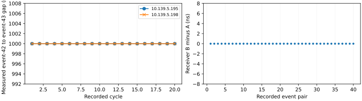

Repeated sequence
=================

:doc:`All experiments <scenario_results>`.

Objective
---------

Check that Normal mode can repeat a table without rearming, while both receivers retain every event and its spacing.

Setup
-----

.. list-table::
   :header-rows: 1

   * - Device
     - IP address
     - PV prefix
   * - Generator
     - 10.139.5.196
     - EVT:DEV2:20:
   * - Receiver A
     - 10.139.5.195
     - EVT:DEV2:10:
   * - Receiver B
     - 10.139.5.198
     - EVT:DEV2:40:

.. list-table::
   :header-rows: 1

   * - Setting
     - Value
     - Measurement scope
   * - Firmware / IOC
     - 20261017
     - The same release was used on the participating chassis.
   * - Reference clock
     - 125 MHz
     - Receiver timestamp resolution is 8 ns; absolute UTC accuracy was not checked.
   * - Test-event actions
     - Logging only
     - Codes 42 and 43 were not assigned to pulse outputs.

.. list-table::
   :header-rows: 1

   * - Table entry
     - Configured offset (ns)
   * - 42
     - 0
   * - 43
     - 1,000
   * - 255 (stop; not transmitted)
     - 2,000

Procedure
---------

.. list-table::
   :header-rows: 1

   * - Stage
     - Method
     - Verification
   * - 1. Establish initial conditions
     - Read receiver status and save the sequencer controls and complete event maps before applying the reviewed commands.
     - Both links and timestamps must be valid, and the FIFO-overflow bit must be clear.
   * - 2. Select event logging
     - Check that the test codes are unused, then select them in spare logging slots 3 and 4 on both receivers.
     - The test codes must remain logging-only; no output action is added.
   * - 3. Load the sequence
     - Load the table listed above into bank 1 while keeping timer and electrical-input trigger masks disabled.
     - Read the table and mode back before execution.
   * - 4. Execute the trial
     - Select Normal mode, arm once and issue 20 software triggers nominally 100 ms apart.
     - Verify one counter increment per trigger and an idle/armed bank between cycles. The four-bit counter wraps from 15 to 0.
   * - 5. Acquire the evidence
     - Record the receiver logs for 10 seconds and match the complete event code, count and order on both receivers.
     - Calculate the event gaps from hardware reception timestamps, independently for each receiver.
   * - 6. Restore the rack
     - Disarm the bank and restore the saved controls and logging selections.
     - Read the controls and full event maps again to confirm that they match the initial snapshot.

Results
-------

Both receivers recorded 40 of 40 expected events. The code order matched the table. The starting settings were restored and verified.

.. list-table::
   :header-rows: 1

   * - Measurement
     - Recorded result
   * - Measured event gaps, A / B
     - 1,000 ns / 1,000 ns
   * - Receiver difference, B minus A
     - mean 0 ns; standard deviation 0 ns; range 0 to 0 ns
   * - Hardware transmit time
     - Not measured
   * - Transmit-to-receive delay
     - Not measured
   * - Physical output response
     - Not measured; test codes selected logging only

   Measured reception gaps and receiver differences for the 20 recorded cycles.

.. list-table::
   :header-rows: 1

   * - Cycle
     - Event
     - 10.139.5.195 receipt (UTC)
     - 10.139.5.198 receipt (UTC)
     - B − A (ns)
   * - 1
     - 42
     - 2026-11-04 02:22:16.859154128
     - 2026-11-04 02:22:16.859154128
     - 0
   * - 1
     - 43
     - 2026-11-04 02:22:16.859155128
     - 2026-11-04 02:22:16.859155128
     - 0
   * - 2
     - 42
     - 2026-11-04 02:22:16.945613384
     - 2026-11-04 02:22:16.945613384
     - 0
   * - 2
     - 43
     - 2026-11-04 02:22:16.945614384
     - 2026-11-04 02:22:16.945614384
     - 0
   * - 3
     - 42
     - 2026-11-04 02:22:17.047992352
     - 2026-11-04 02:22:17.047992352
     - 0
   * - 3
     - 43
     - 2026-11-04 02:22:17.047993352
     - 2026-11-04 02:22:17.047993352
     - 0
   * - 4
     - 42
     - 2026-11-04 02:22:17.148285496
     - 2026-11-04 02:22:17.148285496
     - 0
   * - 4
     - 43
     - 2026-11-04 02:22:17.148286496
     - 2026-11-04 02:22:17.148286496
     - 0
   * - 5
     - 42
     - 2026-11-04 02:22:17.247445768
     - 2026-11-04 02:22:17.247445768
     - 0
   * - 5
     - 43
     - 2026-11-04 02:22:17.247446768
     - 2026-11-04 02:22:17.247446768
     - 0
   * - 6
     - 42
     - 2026-11-04 02:22:17.346536592
     - 2026-11-04 02:22:17.346536592
     - 0
   * - 6
     - 43
     - 2026-11-04 02:22:17.346537592
     - 2026-11-04 02:22:17.346537592
     - 0
   * - 7
     - 42
     - 2026-11-04 02:22:17.451367696
     - 2026-11-04 02:22:17.451367696
     - 0
   * - 7
     - 43
     - 2026-11-04 02:22:17.451368696
     - 2026-11-04 02:22:17.451368696
     - 0
   * - 8
     - 42
     - 2026-11-04 02:22:17.548382424
     - 2026-11-04 02:22:17.548382424
     - 0
   * - 8
     - 43
     - 2026-11-04 02:22:17.548383424
     - 2026-11-04 02:22:17.548383424
     - 0
   * - 9
     - 42
     - 2026-11-04 02:22:17.644014272
     - 2026-11-04 02:22:17.644014272
     - 0
   * - 9
     - 43
     - 2026-11-04 02:22:17.644015272
     - 2026-11-04 02:22:17.644015272
     - 0
   * - 10
     - 42
     - 2026-11-04 02:22:17.747475488
     - 2026-11-04 02:22:17.747475488
     - 0
   * - 10
     - 43
     - 2026-11-04 02:22:17.747476488
     - 2026-11-04 02:22:17.747476488
     - 0
   * - 11
     - 42
     - 2026-11-04 02:22:17.848239384
     - 2026-11-04 02:22:17.848239384
     - 0
   * - 11
     - 43
     - 2026-11-04 02:22:17.848240384
     - 2026-11-04 02:22:17.848240384
     - 0
   * - 12
     - 42
     - 2026-11-04 02:22:17.946318992
     - 2026-11-04 02:22:17.946318992
     - 0
   * - 12
     - 43
     - 2026-11-04 02:22:17.946319992
     - 2026-11-04 02:22:17.946319992
     - 0
   * - 13
     - 42
     - 2026-11-04 02:22:18.046979328
     - 2026-11-04 02:22:18.046979328
     - 0
   * - 13
     - 43
     - 2026-11-04 02:22:18.046980328
     - 2026-11-04 02:22:18.046980328
     - 0
   * - 14
     - 42
     - 2026-11-04 02:22:18.148083424
     - 2026-11-04 02:22:18.148083424
     - 0
   * - 14
     - 43
     - 2026-11-04 02:22:18.148084424
     - 2026-11-04 02:22:18.148084424
     - 0
   * - 15
     - 42
     - 2026-11-04 02:22:18.247219824
     - 2026-11-04 02:22:18.247219824
     - 0
   * - 15
     - 43
     - 2026-11-04 02:22:18.247220824
     - 2026-11-04 02:22:18.247220824
     - 0
   * - 16
     - 42
     - 2026-11-04 02:22:18.348678744
     - 2026-11-04 02:22:18.348678744
     - 0
   * - 16
     - 43
     - 2026-11-04 02:22:18.348679744
     - 2026-11-04 02:22:18.348679744
     - 0
   * - 17
     - 42
     - 2026-11-04 02:22:18.447268928
     - 2026-11-04 02:22:18.447268928
     - 0
   * - 17
     - 43
     - 2026-11-04 02:22:18.447269928
     - 2026-11-04 02:22:18.447269928
     - 0
   * - 18
     - 42
     - 2026-11-04 02:22:18.545298016
     - 2026-11-04 02:22:18.545298016
     - 0
   * - 18
     - 43
     - 2026-11-04 02:22:18.545299016
     - 2026-11-04 02:22:18.545299016
     - 0
   * - 19
     - 42
     - 2026-11-04 02:22:18.648128992
     - 2026-11-04 02:22:18.648128992
     - 0
   * - 19
     - 43
     - 2026-11-04 02:22:18.648129992
     - 2026-11-04 02:22:18.648129992
     - 0
   * - 20
     - 42
     - 2026-11-04 02:22:18.748118208
     - 2026-11-04 02:22:18.748118208
     - 0
   * - 20
     - 43
     - 2026-11-04 02:22:18.748119208
     - 2026-11-04 02:22:18.748119208
     - 0

The first receptions of consecutive cycles were 99,419,162 ns apart on average, with a range of 86,459,256–104,831,104 ns.
This variation includes host-paced software triggering; it does not measure reference-clock jitter.

Recording: ``20261104T022216Z-5c9f85``. The table was recalculated from the saved receiver rows.
:download:`Event CSV <../_static/timing-check/scenarios/scenario-4-events.csv>` contains the same timestamps.

.. raw:: html

   

Command log

Apply

.. code-block:: bash

   pvput -w 3 EVT:DEV2:10:EVR:LOG:evt3 42
   pvput -w 3 EVT:DEV2:10:EVR:LOG:evt4 43
   pvput -w 3 EVT:DEV2:40:EVR:LOG:evt3 42
   pvput -w 3 EVT:DEV2:40:EVR:LOG:evt4 43
   pvput -w 3 EVT:DEV2:20:EVG:SEQ:1:disarm 1
   pvput -w 3 EVT:DEV2:20:EVG:SEQ:1:HWrise 0
   pvput -w 3 EVT:DEV2:20:EVG:SEQ:1:HWfall 0
   pvput -w 3 EVT:DEV2:20:EVG:SEQ:1:Tmr 0
   pvput -w 3 EVT:DEV2:20:EVG:SEQ:1:tMode 1
   pvput -w 3 EVT:DEV2:20:EVG:SEQ:1:slo 1000000000
   pvput -w 3 EVT:DEV2:20:EVG:SEQ:1:codes '[42,43,255]'
   pvput -w 3 EVT:DEV2:20:EVG:SEQ:1:times '[0.0,1000.0,2000.0]'
   pvput -w 3 EVT:DEV2:20:EVG:SEQ:1:store 1

Trigger

.. code-block:: bash

   pvput -w 3 EVT:DEV2:20:EVG:SEQ:1:arm 1
   pvput -w 3 EVT:DEV2:20:EVG:SEQ:1:trig 1
   pvput -w 3 EVT:DEV2:20:EVG:SEQ:1:trig 1
   pvput -w 3 EVT:DEV2:20:EVG:SEQ:1:trig 1
   pvput -w 3 EVT:DEV2:20:EVG:SEQ:1:trig 1
   pvput -w 3 EVT:DEV2:20:EVG:SEQ:1:trig 1
   pvput -w 3 EVT:DEV2:20:EVG:SEQ:1:trig 1
   pvput -w 3 EVT:DEV2:20:EVG:SEQ:1:trig 1
   pvput -w 3 EVT:DEV2:20:EVG:SEQ:1:trig 1
   pvput -w 3 EVT:DEV2:20:EVG:SEQ:1:trig 1
   pvput -w 3 EVT:DEV2:20:EVG:SEQ:1:trig 1
   pvput -w 3 EVT:DEV2:20:EVG:SEQ:1:trig 1
   pvput -w 3 EVT:DEV2:20:EVG:SEQ:1:trig 1
   pvput -w 3 EVT:DEV2:20:EVG:SEQ:1:trig 1
   pvput -w 3 EVT:DEV2:20:EVG:SEQ:1:trig 1
   pvput -w 3 EVT:DEV2:20:EVG:SEQ:1:trig 1
   pvput -w 3 EVT:DEV2:20:EVG:SEQ:1:trig 1
   pvput -w 3 EVT:DEV2:20:EVG:SEQ:1:trig 1
   pvput -w 3 EVT:DEV2:20:EVG:SEQ:1:trig 1
   pvput -w 3 EVT:DEV2:20:EVG:SEQ:1:trig 1
   pvput -w 3 EVT:DEV2:20:EVG:SEQ:1:trig 1
   pvput -w 3 EVT:DEV2:20:EVG:SEQ:1:disarm 1

Disarm

.. code-block:: bash

   pvput -w 3 EVT:DEV2:20:EVG:SEQ:1:disarm 1

Restore

.. code-block:: bash

   pvput -w 3 EVT:DEV2:20:EVG:SEQ:1:disarm 1
   pvput -w 3 EVT:DEV2:20:EVG:SEQ:1:HWrise 0
   pvput -w 3 EVT:DEV2:20:EVG:SEQ:1:HWfall 0
   pvput -w 3 EVT:DEV2:20:EVG:SEQ:1:Tmr 0
   pvput -w 3 EVT:DEV2:20:EVG:SEQ:1:tMode 0
   pvput -w 3 EVT:DEV2:20:EVG:SEQ:1:slo 1000000000.0
   pvput -w 3 EVT:DEV2:20:EVG:SEQ:1:codes '[0]'
   pvput -w 3 EVT:DEV2:20:EVG:SEQ:1:times '[0.0]'
   pvput -w 3 EVT:DEV2:20:EVG:SEQ:1:store 1
   pvput -w 3 EVT:DEV2:10:EVR:LOG:evt3 0
   pvput -w 3 EVT:DEV2:10:EVR:LOG:evt4 0
   pvput -w 3 EVT:DEV2:40:EVR:LOG:evt3 0
   pvput -w 3 EVT:DEV2:40:EVR:LOG:evt4 0

.. raw:: html

   

Findings
--------

Normal mode retained all 40 events on each receiver. Every measured within-cycle gap was 1,000 ns, with 0 ns reported variation.
These results support timestamp agreement at 8 ns resolution. They do not establish the physical send-to-receive delay.
