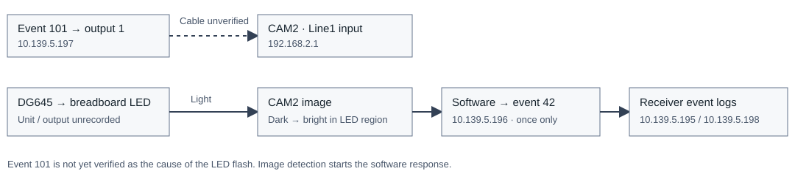

LED feedback and timestamp consistency
======================================

:download:`PDF <../_static/timing-check/scenarios/CXFEL-timing-validation.pdf>` · :download:`Offline HTML <../_static/timing-check/scenarios/CXFEL-timing-validation.html>`

Objective
---------

Detect a breadboard LED flash with CAM2. Send one timing event after detection.
Check that both receivers record the event and agree on its timestamp.

**Status:** LED feedback is configuration 5 and the primary test. It has not run.
The completed sequence and camera tests below provide reference measurements.

Setup
-----

.. list-table:: Equipment
   :header-rows: 1
   :widths: 24 25 51

   * - Device
     - IP address
     - PV prefix and function
   * - Event generator
     - 10.139.5.196
     - ``EVT:DEV2:20:``; sends events 101 and 42
   * - Receiver A
     - 10.139.5.195
     - ``EVT:DEV2:10:``; records event timestamps
   * - Receiver B
     - 10.139.5.198
     - ``EVT:DEV2:40:``; records event timestamps
   * - Output receiver
     - 10.139.5.197
     - ``EVT:DEV2:30:``; output 1 selects event 101
   * - CAM2
     - 192.168.2.1
     - ``CAM:DEV2:20:``; external Line1 trigger; 1 ms exposure; 1200 × 900 Mono12
   * - DG645 and LED
     - Connected unit unrecorded
     - Breadboard LED connects to a DG645; unit and output require identification
   * - Recording host
     - 10.139.4.59
     - Runs the IOC and analysis; camera interface: 192.168.2.100

The timing chassis use firmware and IOC release 20261017. The clock frequency is
125 MHz. Receiver timestamps have 8 ns resolution.

   Image detection starts the response event. The LED drive path still requires verification.

The camera-trigger cable and DG645 output have not been identified.
Do not assume that event 101 causes the LED flash.
A photodiode connected to a verified timing input is required to measure the optical edge with hardware timestamps.

Procedure
---------

1. Identify the LED drive cable and camera trigger cable. Record both endpoints.
   Keep the existing camera acquisition and DG645 settings.
2. Read receiver status. Require valid links and timestamps, with no FIFO overflow.
   Save the current controls and event maps.
3. Review :doc:`the exact commands <led_feedback_commands>` before the live trial.
   Use configuration 5: event 101 at 1 Hz; output delay 0 ns; pulse width 100,000 ns.
   Load event 42 at 0 ns and stop code 255 at 1,000 ns in sequencer bank 1.
4. Record for 30 seconds. Save receiver logs, camera metadata and image arrays.
   Use image columns 300–699 and rows 550–849, with zero-based coordinates.
5. Wait for a new frame with a region peak of 1,000 counts or less.
   Then wait for a new frame with a peak above 1,000 counts.
6. After that transition, send event 42 once. Check for one receipt on each receiver.
   Reserve the final three seconds for receiver readout. If no transition occurs, send no response event.
7. Disarm the sequencer. Restore the saved controls and event maps.
   Read them again to confirm restoration.

Record the dark and bright frame IDs, region peaks, response event timestamps and receiver difference.
Record the host time from image detection to sequence confirmation separately.
This host interval includes software, network and readback delays. It is not an optical delay measurement.

Results
-------

The LED-feedback test has no measured result yet.
The reference tests were recorded on November 3–4, 2026.
The starting settings were restored and verified after each changed test.

.. list-table:: Reference measurements
   :header-rows: 1
   :widths: 25 35 40

   * - Test
     - Received
     - Timing result
   * - Single event
     - 1 of 1 on each receiver
     - Receiver difference: 0 ns
   * - Two events
     - 2 of 2 on each receiver
     - Gap: 1,000 ns; receiver difference: 0 ns
   * - Multiple delays
     - 3 of 3 on each receiver
     - Gaps: 1,000 ns and 9,000 ns; receiver difference: 0 ns
   * - Repeated sequence
     - 40 of 40 on each receiver; 20 cycles
     - Each pair: 1,000 ns; gap-error standard deviation: 0 ns
   * - Previous camera-rate test
     - 60 images at 1 Hz; no frame-ID gaps or save overruns
     - 58 receiver pairs: 0 ns difference; 0 of 60 LED-bright images

.. figure:: ../_static/timing-check/scenarios/scenario-4.svg
   :alt: Recorded gaps and software-paced cycle intervals for 20 repeated sequences.
   :width: 100%

   All 20 event pairs retained the programmed gap. Host pacing varied between cycles.

.. container:: experiment-image-pair

   .. figure:: ../_static/timing-check/scenarios/stage-101-led-bright.png
      :alt: Bright LED in the actual 10 Hz baseline image.

      10 Hz reference: LED bright.

   .. figure:: ../_static/timing-check/scenarios/stage-105-led-dim.png
      :alt: Dim LED region in the actual 1 Hz camera trial.

      1 Hz trial: no bright LED detected.

See the :doc:`test records <test_records>` for exact UTC timestamps, settings, commands and data files.
The previous camera-rate test did not send a response event after image detection.

Findings
--------

Both receivers recorded all expected sequence events. Their timestamps agreed at 8 ns resolution.
These measurements support event delivery and timestamp consistency for CXFEL at the tested settings.
They do not establish electrical output delay, absolute UTC accuracy or 1 kHz operation.

The camera received frames at 1 Hz, but the images did not establish LED-flash capture.
Verify the LED drive and exposure timing before the feedback trial.
Camera-based feedback can test the complete software response. Hardware optical timing requires a photodiode input.

.. toctree::
   :hidden:

   test_records
   led_feedback_commands
