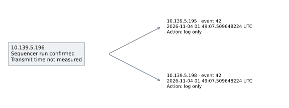
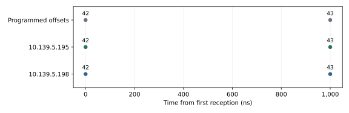
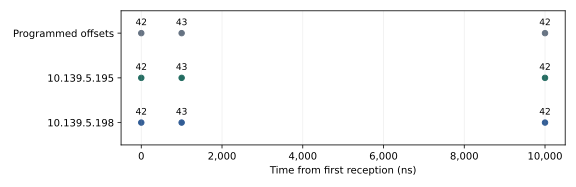
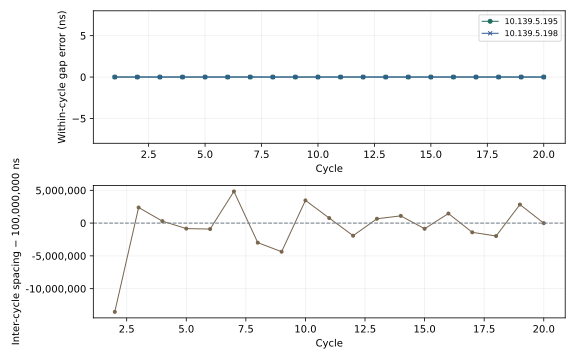
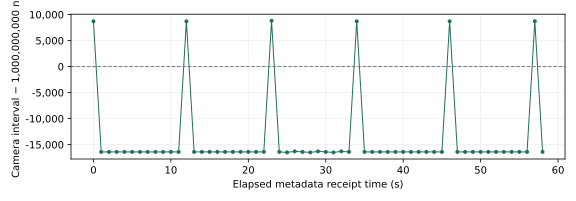

Timing validation: five scenarios
=================================

:download:`Portable PDF <../_static/timing-check/scenarios/CXFEL-timing-validation.pdf>` · :download:`Offline HTML with embedded graphics and data <../_static/timing-check/scenarios/CXFEL-timing-validation.html>`

Objective
---------

Test event generation, reception and timestamp agreement on the CXFEL digital
timing rack. Test one event, a two-event gap, multiple delays, repeated Normal-mode
execution, and camera response to an event-rate change.

The report contains the recorded results and graphics. It can be read without
access to the test rack or its control interface.

Setup
-----

All test chassis ran firmware and IOC release 20261017. The reference clock was
125 MHz. Receiver timestamps use 8 ns ticks. Nanosecond units do not establish
1 ns accuracy or absolute UTC accuracy.

.. list-table:: Equipment
   :header-rows: 1

   * - Function
     - IP address
     - PV prefix
     - Configuration
   * - Generator / local receiver
     - 10.139.5.196
     - EVT:DEV2:20:
     - EVG/EVR role; sequencer bank 1
   * - Compared receiver A
     - 10.139.5.195
     - EVT:DEV2:10:
     - Test-event logging
   * - Output receiver
     - 10.139.5.197
     - EVT:DEV2:30:
     - Output 1 selects event 101
   * - Compared receiver B
     - 10.139.5.198
     - EVT:DEV2:40:
     - Test-event logging
   * - CAM2
     - 192.168.2.1
     - CAM:DEV2:20:
     - External Line1 rising-edge FrameStart; 1 ms exposure; 1200 × 900 Mono12
   * - DG645 units
     - 10.139.4.87 / 10.139.4.88
     - DGEN:DEV2:20: / DGEN:DEV2:30:
     - LED breadboard attached; connected unit/output unrecorded
   * - IOC / analysis host
     - 10.139.4.59
     - —
     - Camera network interface 192.168.2.100

The exact fiber ports and camera-trigger cable endpoints were not recorded.
Output 1 on 10.139.5.197 is the configured event-101 pulse output. Its cable
destination remains unverified. The records do not establish physical cable skew.

Procedure
---------

1. Read each receiver status. Require link-up and timestamp-valid bits. Require
   the FIFO overflow bit to be clear. Save the original controls and event maps.
2. Check that test codes 42 and 43 are unused. Enable them for logging on
   10.139.5.195 and 10.139.5.198. Keep their pulse-output action bits clear.
3. For scenarios 1–3, load the listed bank-1 table in Single mode. Arm and issue
   one software trigger. Code 255 ends the table and is not transmitted.
4. For scenario 4, load the two-event table in Normal mode. Keep timer and input
   trigger masks zero. Arm once. Issue 20 software triggers, nominally 100 ms
   apart. After each trigger, verify one counter increment and idle/armed state.
5. The bank counter is four bits and wraps modulo 16. Verify every increment;
   a final raw counter value alone cannot count a 20-cycle trial.
6. For scenario 5, set event 101 to 1 Hz. Keep output 1 on 10.139.5.197 at 0 ns
   delay and 100,000 ns width. Keep camera acquisition and DG645 settings unchanged.
7. Record full receiver logs and camera metadata. Save lossless images for the
   camera test. Use the full recording for analysis, not a rolling display buffer.
8. Match test codes, counts and order on both compared receivers. For scenario 4,
   calculate each gap from that cycle's first event. Subtract A timestamps from B.
9. Disarm and wait for idle/disarmed readbacks. Restore the starting settings.
   Compare fresh controls and full event maps with the saved originals.

.. list-table:: Test definitions
   :header-rows: 1

   * - Scenario
     - Event table or setting
     - Capture
   * - 1 · Single event
     - 42 at 0 ns; stop at 1,000 ns
     - One execution; 10 s recording
   * - 2 · Two-event gap
     - 42 at 0 ns; 43 at 1,000 ns; stop at 2,000 ns
     - One execution; 60 s recording
   * - 3 · Multiple delays
     - 42 at 0 ns; 43 at 1,000 ns; 42 at 10,000 ns; stop at 11,000 ns
     - One execution; 10 s recording
   * - 4 · Repeated sequence
     - 42 at 0 ns; 43 at 1,000 ns; stop at 2,000 ns
     - 20 Normal-mode executions; 10 s recording
   * - 5 · LED / camera
     - Event 101 at 1 Hz; output width 100,000 ns
     - 60 s; full images saved

Event times are offsets within a table. Scenario 3 has gaps of 1,000 ns and
9,000 ns. Codes 42 and 43 are logging-only tests; they do not drive camera or LED
outputs. Scenario 5 changes the event-101 rate, not the DG645 settings.

Results
-------

.. list-table:: All numbered scenarios
   :header-rows: 1

   * - Scenario
     - Observed
     - Result
   * - 1
     - 1 / 1 and 1 / 1 events received
     - Receiver difference 0 ns
   * - 2
     - 2 / 2 and 2 / 2 events received
     - Receiver difference 0 ns; maximum gap error 0 ns
   * - 3
     - 3 / 3 and 3 / 3 events received
     - Receiver difference 0 ns; maximum gap error 0 ns
   * - 4
     - 40 / 40 and 40 / 40 events received
     - Receiver difference 0 ns; maximum gap error 0 ns
   * - 5
     - 60 camera timestamps; 60 images
     - 0 frame-ID gaps; 0 save overruns; LED-flash capture not established

:download:`Machine-readable results <../_static/timing-check/scenarios/reference-results.json>`.

The differences below are reported timestamp differences at 8 ns resolution.
They are not measurements of electrical output edges or source-to-receiver latency.

1. Single event
~~~~~~~~~~~~~~~

.. list-table:: Programmed and received times
   :header-rows: 1

   * - Event
     - Programmed (ns)
     - 10.139.5.195 (ns)
     - 10.139.5.198 (ns)
     - B − A (ns)
   * - 42
     - 0
     - 0
     - 0
     - 0

.. list-table:: Reception timestamps
   :header-rows: 1

   * - Event
     - 10.139.5.195 — UTC
     - 10.139.5.198 — UTC
   * - 42
     - 2026-11-04 01:49:07.509648224 UTC
     - 2026-11-04 01:49:07.509648224 UTC

   Logical event path. Arrow length does not represent cable length or measured latency.

Recorded data: :download:`scenario 1 event log <../_static/timing-check/scenarios/scenario-1-events.csv>`.
Reference recording: ``20261104T014907Z-4f26f2``.

2. Two-event gap
~~~~~~~~~~~~~~~~

.. list-table:: Programmed and received times
   :header-rows: 1

   * - Event
     - Programmed (ns)
     - 10.139.5.195 (ns)
     - 10.139.5.198 (ns)
     - B − A (ns)
   * - 42
     - 0
     - 0
     - 0
     - 0
   * - 43
     - 1,000
     - 1,000
     - 1,000
     - 0

.. list-table:: Reception timestamps
   :header-rows: 1

   * - Event
     - 10.139.5.195 — UTC
     - 10.139.5.198 — UTC
   * - 42
     - 2026-11-04 00:28:34.494070584 UTC
     - 2026-11-04 00:28:34.494070584 UTC
   * - 43
     - 2026-11-04 00:28:34.494071584 UTC
     - 2026-11-04 00:28:34.494071584 UTC

   Numbers identify event codes. Each receiver's first reception is the time origin; source transmit time is not measured.

Recorded data: :download:`scenario 2 event log <../_static/timing-check/scenarios/scenario-2-events.csv>`.
Reference recording: ``20261104T002834Z-e2c3c2``.

3. Multiple delays
~~~~~~~~~~~~~~~~~~

.. list-table:: Programmed and received times
   :header-rows: 1

   * - Event
     - Programmed (ns)
     - 10.139.5.195 (ns)
     - 10.139.5.198 (ns)
     - B − A (ns)
   * - 42
     - 0
     - 0
     - 0
     - 0
   * - 43
     - 1,000
     - 1,000
     - 1,000
     - 0
   * - 42
     - 10,000
     - 10,000
     - 10,000
     - 0

.. list-table:: Reception timestamps
   :header-rows: 1

   * - Event
     - 10.139.5.195 — UTC
     - 10.139.5.198 — UTC
   * - 42
     - 2026-11-04 01:49:23.410365384 UTC
     - 2026-11-04 01:49:23.410365384 UTC
   * - 43
     - 2026-11-04 01:49:23.410366384 UTC
     - 2026-11-04 01:49:23.410366384 UTC
   * - 42
     - 2026-11-04 01:49:23.410375384 UTC
     - 2026-11-04 01:49:23.410375384 UTC

   Numbers identify event codes. Each receiver's first reception is the time origin; source transmit time is not measured.

Recorded data: :download:`scenario 3 event log <../_static/timing-check/scenarios/scenario-3-events.csv>`.
Reference recording: ``20261104T014923Z-d14cc7``.

4. Repeated Normal-mode sequence
~~~~~~~~~~~~~~~~~~~~~~~~~~~~~~~~

Both receivers logged 40 of 40 events across 20 cycles.
Every cycle retained the programmed 1,000 ns gap. The bank remained armed
between software triggers. The final disarm and restoration were verified.

.. list-table:: Within-cycle gap error
   :header-rows: 1

   * - Receiver
     - Samples
     - Mean (ns)
     - σ (ns)
     - Minimum (ns)
     - Maximum (ns)
   * - 10.139.5.195
     - 20
     - 0
     - 0
     - 0
     - 0
   * - 10.139.5.198
     - 20
     - 0
     - 0
     - 0
     - 0

   Top: FPGA-programmed gap stability. Bottom: received inter-cycle spacing under host scheduling. The lower trace does not measure oscillator jitter.

.. list-table:: Received software-paced inter-cycle intervals
   :header-rows: 1

   * - Mean (ns)
     - σ (ns)
     - Minimum (ns)
     - Maximum (ns)
   * - 99,419,162
     - 3,771,209
     - 86,459,256
     - 104,831,104

The request cadence was nominally 100 ms. Its variation includes host scheduling,
network communication and command verification. It is separate from the 1,000 ns
gap generated inside each hardware table.

The hardware run counter wraps modulo 16. The verified counter sequence was
``1, 2, 3, 4, 5, 6, 7, 8, 9, 10, 11, 12, 13, 14, 15, 0, 1, 2, 3, 4``.
Twenty individual increments were checked. The final counter value of 4 alone
would not demonstrate twenty runs. The four-bit width is defined in the
`tagged sequencer HDL <https://github.com/osprey-dcs/timing-firmware/blob/20261017/ip_repo/ospreyEVG/hdl/ospreyEVGsequencer.v#L224-L240>`_.

.. raw:: html

   

Complete cycle and reception log

.. list-table:: Every measured cycle
   :header-rows: 1

   * - Cycle
     - Gap A (ns)
     - Gap B (ns)
     - Counter after trigger
     - Armed / idle verified
   * - 1
     - 1,000
     - 1,000
     - 1
     - Yes / yes
   * - 2
     - 1,000
     - 1,000
     - 2
     - Yes / yes
   * - 3
     - 1,000
     - 1,000
     - 3
     - Yes / yes
   * - 4
     - 1,000
     - 1,000
     - 4
     - Yes / yes
   * - 5
     - 1,000
     - 1,000
     - 5
     - Yes / yes
   * - 6
     - 1,000
     - 1,000
     - 6
     - Yes / yes
   * - 7
     - 1,000
     - 1,000
     - 7
     - Yes / yes
   * - 8
     - 1,000
     - 1,000
     - 8
     - Yes / yes
   * - 9
     - 1,000
     - 1,000
     - 9
     - Yes / yes
   * - 10
     - 1,000
     - 1,000
     - 10
     - Yes / yes
   * - 11
     - 1,000
     - 1,000
     - 11
     - Yes / yes
   * - 12
     - 1,000
     - 1,000
     - 12
     - Yes / yes
   * - 13
     - 1,000
     - 1,000
     - 13
     - Yes / yes
   * - 14
     - 1,000
     - 1,000
     - 14
     - Yes / yes
   * - 15
     - 1,000
     - 1,000
     - 15
     - Yes / yes
   * - 16
     - 1,000
     - 1,000
     - 0
     - Yes / yes
   * - 17
     - 1,000
     - 1,000
     - 1
     - Yes / yes
   * - 18
     - 1,000
     - 1,000
     - 2
     - Yes / yes
   * - 19
     - 1,000
     - 1,000
     - 3
     - Yes / yes
   * - 20
     - 1,000
     - 1,000
     - 4
     - Yes / yes

.. list-table:: Every recorded test event
   :header-rows: 1

   * - Cycle
     - Event
     - 10.139.5.195 — UTC
     - 10.139.5.198 — UTC
     - B − A (ns)
   * - 1
     - 42
     - 2026-11-04 02:22:16.859154128 UTC
     - 2026-11-04 02:22:16.859154128 UTC
     - 0
   * - 1
     - 43
     - 2026-11-04 02:22:16.859155128 UTC
     - 2026-11-04 02:22:16.859155128 UTC
     - 0
   * - 2
     - 42
     - 2026-11-04 02:22:16.945613384 UTC
     - 2026-11-04 02:22:16.945613384 UTC
     - 0
   * - 2
     - 43
     - 2026-11-04 02:22:16.945614384 UTC
     - 2026-11-04 02:22:16.945614384 UTC
     - 0
   * - 3
     - 42
     - 2026-11-04 02:22:17.047992352 UTC
     - 2026-11-04 02:22:17.047992352 UTC
     - 0
   * - 3
     - 43
     - 2026-11-04 02:22:17.047993352 UTC
     - 2026-11-04 02:22:17.047993352 UTC
     - 0
   * - 4
     - 42
     - 2026-11-04 02:22:17.148285496 UTC
     - 2026-11-04 02:22:17.148285496 UTC
     - 0
   * - 4
     - 43
     - 2026-11-04 02:22:17.148286496 UTC
     - 2026-11-04 02:22:17.148286496 UTC
     - 0
   * - 5
     - 42
     - 2026-11-04 02:22:17.247445768 UTC
     - 2026-11-04 02:22:17.247445768 UTC
     - 0
   * - 5
     - 43
     - 2026-11-04 02:22:17.247446768 UTC
     - 2026-11-04 02:22:17.247446768 UTC
     - 0
   * - 6
     - 42
     - 2026-11-04 02:22:17.346536592 UTC
     - 2026-11-04 02:22:17.346536592 UTC
     - 0
   * - 6
     - 43
     - 2026-11-04 02:22:17.346537592 UTC
     - 2026-11-04 02:22:17.346537592 UTC
     - 0
   * - 7
     - 42
     - 2026-11-04 02:22:17.451367696 UTC
     - 2026-11-04 02:22:17.451367696 UTC
     - 0
   * - 7
     - 43
     - 2026-11-04 02:22:17.451368696 UTC
     - 2026-11-04 02:22:17.451368696 UTC
     - 0
   * - 8
     - 42
     - 2026-11-04 02:22:17.548382424 UTC
     - 2026-11-04 02:22:17.548382424 UTC
     - 0
   * - 8
     - 43
     - 2026-11-04 02:22:17.548383424 UTC
     - 2026-11-04 02:22:17.548383424 UTC
     - 0
   * - 9
     - 42
     - 2026-11-04 02:22:17.644014272 UTC
     - 2026-11-04 02:22:17.644014272 UTC
     - 0
   * - 9
     - 43
     - 2026-11-04 02:22:17.644015272 UTC
     - 2026-11-04 02:22:17.644015272 UTC
     - 0
   * - 10
     - 42
     - 2026-11-04 02:22:17.747475488 UTC
     - 2026-11-04 02:22:17.747475488 UTC
     - 0
   * - 10
     - 43
     - 2026-11-04 02:22:17.747476488 UTC
     - 2026-11-04 02:22:17.747476488 UTC
     - 0
   * - 11
     - 42
     - 2026-11-04 02:22:17.848239384 UTC
     - 2026-11-04 02:22:17.848239384 UTC
     - 0
   * - 11
     - 43
     - 2026-11-04 02:22:17.848240384 UTC
     - 2026-11-04 02:22:17.848240384 UTC
     - 0
   * - 12
     - 42
     - 2026-11-04 02:22:17.946318992 UTC
     - 2026-11-04 02:22:17.946318992 UTC
     - 0
   * - 12
     - 43
     - 2026-11-04 02:22:17.946319992 UTC
     - 2026-11-04 02:22:17.946319992 UTC
     - 0
   * - 13
     - 42
     - 2026-11-04 02:22:18.046979328 UTC
     - 2026-11-04 02:22:18.046979328 UTC
     - 0
   * - 13
     - 43
     - 2026-11-04 02:22:18.046980328 UTC
     - 2026-11-04 02:22:18.046980328 UTC
     - 0
   * - 14
     - 42
     - 2026-11-04 02:22:18.148083424 UTC
     - 2026-11-04 02:22:18.148083424 UTC
     - 0
   * - 14
     - 43
     - 2026-11-04 02:22:18.148084424 UTC
     - 2026-11-04 02:22:18.148084424 UTC
     - 0
   * - 15
     - 42
     - 2026-11-04 02:22:18.247219824 UTC
     - 2026-11-04 02:22:18.247219824 UTC
     - 0
   * - 15
     - 43
     - 2026-11-04 02:22:18.247220824 UTC
     - 2026-11-04 02:22:18.247220824 UTC
     - 0
   * - 16
     - 42
     - 2026-11-04 02:22:18.348678744 UTC
     - 2026-11-04 02:22:18.348678744 UTC
     - 0
   * - 16
     - 43
     - 2026-11-04 02:22:18.348679744 UTC
     - 2026-11-04 02:22:18.348679744 UTC
     - 0
   * - 17
     - 42
     - 2026-11-04 02:22:18.447268928 UTC
     - 2026-11-04 02:22:18.447268928 UTC
     - 0
   * - 17
     - 43
     - 2026-11-04 02:22:18.447269928 UTC
     - 2026-11-04 02:22:18.447269928 UTC
     - 0
   * - 18
     - 42
     - 2026-11-04 02:22:18.545298016 UTC
     - 2026-11-04 02:22:18.545298016 UTC
     - 0
   * - 18
     - 43
     - 2026-11-04 02:22:18.545299016 UTC
     - 2026-11-04 02:22:18.545299016 UTC
     - 0
   * - 19
     - 42
     - 2026-11-04 02:22:18.648128992 UTC
     - 2026-11-04 02:22:18.648128992 UTC
     - 0
   * - 19
     - 43
     - 2026-11-04 02:22:18.648129992 UTC
     - 2026-11-04 02:22:18.648129992 UTC
     - 0
   * - 20
     - 42
     - 2026-11-04 02:22:18.748118208 UTC
     - 2026-11-04 02:22:18.748118208 UTC
     - 0
   * - 20
     - 43
     - 2026-11-04 02:22:18.748119208 UTC
     - 2026-11-04 02:22:18.748119208 UTC
     - 0

.. raw:: html

   

Recorded data: :download:`scenario 4 event log <../_static/timing-check/scenarios/scenario-4-events.csv>`.
Reference recording: ``20261104T022216Z-5c9f85``.

5. LED and camera response
~~~~~~~~~~~~~~~~~~~~~~~~~~

At a configured event rate of 1 Hz, CAM2 supplied 60 timestamps and
the recorder saved 60 full images. There were 0 frame-ID gaps,
0 writer overruns and 0 unassociated saved images.

**Camera delivery was demonstrated. Synchronized LED-flash capture was not.**
None of the 60 frames exceeded the fixed LED-bright threshold of 1000 counts
in image columns 300–699 and rows 550–849. Region peaks were 172–191 counts.
The data do not determine whether this was caused by phase, routing or the DG645 setup.

.. list-table:: Measured response
   :header-rows: 1

   * - Measurement
     - Result
   * - Configured event-101 rate
     - 1 Hz
   * - Received camera rate
     - 1.000014 frames/s
   * - Mean camera interval
     - 999,986,154 ns
   * - Camera interval σ
     - 7,592 ns
   * - Compared receiver event pairs
     - 58
   * - Receiver difference mean / σ / min / max
     - 0 / 0 / 0 / 0 ns

   Camera timestamps measure frame spacing on the camera clock. They do not measure electrical trigger jitter.

.. container:: experiment-image-pair

   .. figure:: ../_static/timing-check/scenarios/stage-101-led-bright.png
      :alt: Actual LED-bright image recorded during the 10 Hz baseline.

      10 Hz baseline: LED bright, frame 1343188.

   .. figure:: ../_static/timing-check/scenarios/stage-105-led-dim.png
      :alt: Actual LED-dim image recorded during the 1 Hz camera trial.

      1 Hz trial: LED dim, frame 1547826.

Both are display copies of saved 12-bit arrays. They are different test conditions;
the bright reference is not presented as a successful 1 Hz exposure.

Camera clock resolution and its conversion to receiver time were not verified.
A matching frame rate does not establish one identified timing event per frame.
The 10 Hz reference shows the LED bright. The 1 Hz trial does not establish LED-flash capture.
The data do not identify the connected DG645 output or the reason for the dim 1 Hz frames.

:download:`Complete saved-frame metadata <../_static/timing-check/scenarios/scenario-5-frames.csv>`.
Reference recording: ``20261104T013636Z-7f8d4f``.

Baseline and restoration
~~~~~~~~~~~~~~~~~~~~~~~~

The unchanged 10 Hz baseline supplied 600 camera timestamps and
saved 600 images. Its 580 compared receiver pairs had
reported mean / σ / min / max differences of 0 / 0 / 0 / 0 ns.

.. list-table:: Reference recordings
   :header-rows: 1

   * - Scenario
     - Recording ID
     - Restoration
   * - 1
     - 20261104T014907Z-4f26f2
     - Changed controls and full maps restored and verified
   * - 2
     - 20261104T002834Z-e2c3c2
     - Changed controls and full maps restored and verified
   * - 3
     - 20261104T014923Z-d14cc7
     - Changed controls and full maps restored and verified
   * - 4
     - 20261104T022216Z-5c9f85
     - Changed controls and full maps restored and verified
   * - 5
     - 20261104T013636Z-7f8d4f
     - Changed controls and full maps restored and verified

.. raw:: html

   

Exact applied, trigger and restoration commands

**Scenario 1**

Apply

.. code-block:: bash

   pvput -w 3 EVT:DEV2:10:EVR:LOG:evt3 42
   pvput -w 3 EVT:DEV2:40:EVR:LOG:evt3 42
   pvput -w 3 EVT:DEV2:20:EVG:SEQ:1:disarm 1
   pvput -w 3 EVT:DEV2:20:EVG:SEQ:1:HWrise 0
   pvput -w 3 EVT:DEV2:20:EVG:SEQ:1:HWfall 0
   pvput -w 3 EVT:DEV2:20:EVG:SEQ:1:Tmr 0
   pvput -w 3 EVT:DEV2:20:EVG:SEQ:1:tMode 0
   pvput -w 3 EVT:DEV2:20:EVG:SEQ:1:slo 1000000000
   pvput -w 3 EVT:DEV2:20:EVG:SEQ:1:codes '[42,255]'
   pvput -w 3 EVT:DEV2:20:EVG:SEQ:1:times '[0.0,1000.0]'
   pvput -w 3 EVT:DEV2:20:EVG:SEQ:1:store 1

Trigger

.. code-block:: bash

   pvput -w 3 EVT:DEV2:20:EVG:SEQ:1:arm 1
   pvput -w 3 EVT:DEV2:20:EVG:SEQ:1:trig 1

Restore

.. code-block:: bash

   pvput -w 3 EVT:DEV2:20:EVG:SEQ:1:disarm 1
   pvput -w 3 EVT:DEV2:20:EVG:SEQ:1:HWrise 0
   pvput -w 3 EVT:DEV2:20:EVG:SEQ:1:HWfall 0
   pvput -w 3 EVT:DEV2:20:EVG:SEQ:1:Tmr 0
   pvput -w 3 EVT:DEV2:20:EVG:SEQ:1:tMode 0
   pvput -w 3 EVT:DEV2:20:EVG:SEQ:1:slo 1000000000.0
   pvput -w 3 EVT:DEV2:20:EVG:SEQ:1:codes '[0]'
   pvput -w 3 EVT:DEV2:20:EVG:SEQ:1:times '[0.0]'
   pvput -w 3 EVT:DEV2:20:EVG:SEQ:1:store 1
   pvput -w 3 EVT:DEV2:10:EVR:LOG:evt3 0
   pvput -w 3 EVT:DEV2:40:EVR:LOG:evt3 0

**Scenario 2**

Apply

.. code-block:: bash

   pvput -w 3 EVT:DEV2:10:EVR:LOG:evt3 42
   pvput -w 3 EVT:DEV2:10:EVR:LOG:evt4 43
   pvput -w 3 EVT:DEV2:40:EVR:LOG:evt3 42
   pvput -w 3 EVT:DEV2:40:EVR:LOG:evt4 43
   pvput -w 3 EVT:DEV2:20:EVG:SEQ:1:disarm 1
   pvput -w 3 EVT:DEV2:20:EVG:SEQ:1:HWrise 0
   pvput -w 3 EVT:DEV2:20:EVG:SEQ:1:HWfall 0
   pvput -w 3 EVT:DEV2:20:EVG:SEQ:1:Tmr 0
   pvput -w 3 EVT:DEV2:20:EVG:SEQ:1:tMode 0
   pvput -w 3 EVT:DEV2:20:EVG:SEQ:1:slo 1000000000
   pvput -w 3 EVT:DEV2:20:EVG:SEQ:1:codes '[42,43,255]'
   pvput -w 3 EVT:DEV2:20:EVG:SEQ:1:times '[0.0,1000.0,2000.0]'
   pvput -w 3 EVT:DEV2:20:EVG:SEQ:1:store 1

Trigger

.. code-block:: bash

   pvput -w 3 EVT:DEV2:20:EVG:SEQ:1:arm 1
   pvput -w 3 EVT:DEV2:20:EVG:SEQ:1:trig 1

Restore

.. code-block:: bash

   pvput -w 3 EVT:DEV2:20:EVG:SEQ:1:disarm 1
   pvput -w 3 EVT:DEV2:20:EVG:SEQ:1:HWrise 0
   pvput -w 3 EVT:DEV2:20:EVG:SEQ:1:HWfall 0
   pvput -w 3 EVT:DEV2:20:EVG:SEQ:1:Tmr 0
   pvput -w 3 EVT:DEV2:20:EVG:SEQ:1:tMode 0
   pvput -w 3 EVT:DEV2:20:EVG:SEQ:1:slo 1000000000.0
   pvput -w 3 EVT:DEV2:20:EVG:SEQ:1:codes '[0]'
   pvput -w 3 EVT:DEV2:20:EVG:SEQ:1:times '[0.0]'
   pvput -w 3 EVT:DEV2:20:EVG:SEQ:1:store 1
   pvput -w 3 EVT:DEV2:10:EVR:LOG:evt3 0
   pvput -w 3 EVT:DEV2:10:EVR:LOG:evt4 0
   pvput -w 3 EVT:DEV2:40:EVR:LOG:evt3 0
   pvput -w 3 EVT:DEV2:40:EVR:LOG:evt4 0

**Scenario 3**

Apply

.. code-block:: bash

   pvput -w 3 EVT:DEV2:10:EVR:LOG:evt3 42
   pvput -w 3 EVT:DEV2:10:EVR:LOG:evt4 43
   pvput -w 3 EVT:DEV2:40:EVR:LOG:evt3 42
   pvput -w 3 EVT:DEV2:40:EVR:LOG:evt4 43
   pvput -w 3 EVT:DEV2:20:EVG:SEQ:1:disarm 1
   pvput -w 3 EVT:DEV2:20:EVG:SEQ:1:HWrise 0
   pvput -w 3 EVT:DEV2:20:EVG:SEQ:1:HWfall 0
   pvput -w 3 EVT:DEV2:20:EVG:SEQ:1:Tmr 0
   pvput -w 3 EVT:DEV2:20:EVG:SEQ:1:tMode 0
   pvput -w 3 EVT:DEV2:20:EVG:SEQ:1:slo 1000000000
   pvput -w 3 EVT:DEV2:20:EVG:SEQ:1:codes '[42,43,42,255]'
   pvput -w 3 EVT:DEV2:20:EVG:SEQ:1:times '[0.0,1000.0,10000.0,11000.0]'
   pvput -w 3 EVT:DEV2:20:EVG:SEQ:1:store 1

Trigger

.. code-block:: bash

   pvput -w 3 EVT:DEV2:20:EVG:SEQ:1:arm 1
   pvput -w 3 EVT:DEV2:20:EVG:SEQ:1:trig 1

Restore

.. code-block:: bash

   pvput -w 3 EVT:DEV2:20:EVG:SEQ:1:disarm 1
   pvput -w 3 EVT:DEV2:20:EVG:SEQ:1:HWrise 0
   pvput -w 3 EVT:DEV2:20:EVG:SEQ:1:HWfall 0
   pvput -w 3 EVT:DEV2:20:EVG:SEQ:1:Tmr 0
   pvput -w 3 EVT:DEV2:20:EVG:SEQ:1:tMode 0
   pvput -w 3 EVT:DEV2:20:EVG:SEQ:1:slo 1000000000.0
   pvput -w 3 EVT:DEV2:20:EVG:SEQ:1:codes '[0]'
   pvput -w 3 EVT:DEV2:20:EVG:SEQ:1:times '[0.0]'
   pvput -w 3 EVT:DEV2:20:EVG:SEQ:1:store 1
   pvput -w 3 EVT:DEV2:10:EVR:LOG:evt3 0
   pvput -w 3 EVT:DEV2:10:EVR:LOG:evt4 0
   pvput -w 3 EVT:DEV2:40:EVR:LOG:evt3 0
   pvput -w 3 EVT:DEV2:40:EVR:LOG:evt4 0

**Scenario 4**

Apply

.. code-block:: bash

   pvput -w 3 EVT:DEV2:10:EVR:LOG:evt3 42
   pvput -w 3 EVT:DEV2:10:EVR:LOG:evt4 43
   pvput -w 3 EVT:DEV2:40:EVR:LOG:evt3 42
   pvput -w 3 EVT:DEV2:40:EVR:LOG:evt4 43
   pvput -w 3 EVT:DEV2:20:EVG:SEQ:1:disarm 1
   pvput -w 3 EVT:DEV2:20:EVG:SEQ:1:HWrise 0
   pvput -w 3 EVT:DEV2:20:EVG:SEQ:1:HWfall 0
   pvput -w 3 EVT:DEV2:20:EVG:SEQ:1:Tmr 0
   pvput -w 3 EVT:DEV2:20:EVG:SEQ:1:tMode 1
   pvput -w 3 EVT:DEV2:20:EVG:SEQ:1:slo 1000000000
   pvput -w 3 EVT:DEV2:20:EVG:SEQ:1:codes '[42,43,255]'
   pvput -w 3 EVT:DEV2:20:EVG:SEQ:1:times '[0.0,1000.0,2000.0]'
   pvput -w 3 EVT:DEV2:20:EVG:SEQ:1:store 1

Trigger

.. code-block:: bash

   pvput -w 3 EVT:DEV2:20:EVG:SEQ:1:arm 1
   pvput -w 3 EVT:DEV2:20:EVG:SEQ:1:trig 1
   pvput -w 3 EVT:DEV2:20:EVG:SEQ:1:trig 1
   pvput -w 3 EVT:DEV2:20:EVG:SEQ:1:trig 1
   pvput -w 3 EVT:DEV2:20:EVG:SEQ:1:trig 1
   pvput -w 3 EVT:DEV2:20:EVG:SEQ:1:trig 1
   pvput -w 3 EVT:DEV2:20:EVG:SEQ:1:trig 1
   pvput -w 3 EVT:DEV2:20:EVG:SEQ:1:trig 1
   pvput -w 3 EVT:DEV2:20:EVG:SEQ:1:trig 1
   pvput -w 3 EVT:DEV2:20:EVG:SEQ:1:trig 1
   pvput -w 3 EVT:DEV2:20:EVG:SEQ:1:trig 1
   pvput -w 3 EVT:DEV2:20:EVG:SEQ:1:trig 1
   pvput -w 3 EVT:DEV2:20:EVG:SEQ:1:trig 1
   pvput -w 3 EVT:DEV2:20:EVG:SEQ:1:trig 1
   pvput -w 3 EVT:DEV2:20:EVG:SEQ:1:trig 1
   pvput -w 3 EVT:DEV2:20:EVG:SEQ:1:trig 1
   pvput -w 3 EVT:DEV2:20:EVG:SEQ:1:trig 1
   pvput -w 3 EVT:DEV2:20:EVG:SEQ:1:trig 1
   pvput -w 3 EVT:DEV2:20:EVG:SEQ:1:trig 1
   pvput -w 3 EVT:DEV2:20:EVG:SEQ:1:trig 1
   pvput -w 3 EVT:DEV2:20:EVG:SEQ:1:trig 1
   pvput -w 3 EVT:DEV2:20:EVG:SEQ:1:disarm 1

Restore

.. code-block:: bash

   pvput -w 3 EVT:DEV2:20:EVG:SEQ:1:disarm 1
   pvput -w 3 EVT:DEV2:20:EVG:SEQ:1:HWrise 0
   pvput -w 3 EVT:DEV2:20:EVG:SEQ:1:HWfall 0
   pvput -w 3 EVT:DEV2:20:EVG:SEQ:1:Tmr 0
   pvput -w 3 EVT:DEV2:20:EVG:SEQ:1:tMode 0
   pvput -w 3 EVT:DEV2:20:EVG:SEQ:1:slo 1000000000.0
   pvput -w 3 EVT:DEV2:20:EVG:SEQ:1:codes '[0]'
   pvput -w 3 EVT:DEV2:20:EVG:SEQ:1:times '[0.0]'
   pvput -w 3 EVT:DEV2:20:EVG:SEQ:1:store 1
   pvput -w 3 EVT:DEV2:10:EVR:LOG:evt3 0
   pvput -w 3 EVT:DEV2:10:EVR:LOG:evt4 0
   pvput -w 3 EVT:DEV2:40:EVR:LOG:evt3 0
   pvput -w 3 EVT:DEV2:40:EVR:LOG:evt4 0

**Scenario 5**

Apply

.. code-block:: bash

   pvput -w 3 EVT:DEV2:30:EVR:OUT:1:source 0
   pvput -w 3 EVT:DEV2:20:EVG:TMR:1:divisor 125000000
   pvput -w 3 EVT:DEV2:30:EVR:OUT:1:delay 0.0
   pvput -w 3 EVT:DEV2:30:EVR:OUT:1:width 100000.0
   pvput -w 3 EVT:DEV2:30:EVR:OUT:1:source 1

Restore

.. code-block:: bash

   pvput -w 3 EVT:DEV2:30:EVR:OUT:1:source 0
   pvput -w 3 EVT:DEV2:20:EVG:TMR:1:divisor 12500000
   pvput -w 3 EVT:DEV2:30:EVR:OUT:1:delay 0.0
   pvput -w 3 EVT:DEV2:30:EVR:OUT:1:width 100000.0
   pvput -w 3 EVT:DEV2:30:EVR:OUT:1:source 1

.. raw:: html

   

.. raw:: html

   

Acquisition diagnostics and retained evidence

An initial repeated-run attempt stopped when the original verifier expected a
32-bit count. The actual four-bit counter had wrapped. The bank was disarmed and
the original controls and maps were restored. That interrupted capture is retained
separately. The complete reference trial uses modulo-16 checks and is not pooled
with the interrupted attempt.

The earlier two-event summary was reanalyzed from the complete raw recording.
A rolling display buffer had omitted its early events from analysis. The raw data
were unchanged. The corrected summary and its original version are both retained.

The archived raw recordings, baseline snapshots, action journals and lossless
image arrays remain on the acquisition host. The event CSV files and frame
metadata linked in this report provide the measurements needed to inspect these
results. The report graphics contain recorded data, not simulated waveforms.

.. raw:: html

   

Findings
--------

All five numbered scenarios produced measured results. The compared receivers
recorded the expected test codes and order. The finite patterns retained their
programmed gaps. Their reported timestamp differences were 0 ns at 8 ns resolution.

Normal mode replayed the two-event table 20 times without rearming between cycles.
All 40 events reached each compared receiver. Every within-cycle gap was 1,000 ns;
the measured gap-error standard deviation was 0 ns at the available resolution.
The bank was disarmed and idle before its original settings were restored.

These results support digital event delivery and reported timestamp consistency
for CXFEL data correlation at the tested settings. They do not establish sub-tick
skew, absolute UTC accuracy, cable delay or electrical trigger-to-exposure latency.

The camera followed the tested 10 Hz and 1 Hz rates without recorded frame-ID gaps
or save overruns in the selected references. Camera frames still need verified
event identifiers or a measured clock conversion before each exposure can be
assigned to a facility timing event. None of the 60 frames in the 1 Hz trial showed
an LED-bright state in the recorded region. Optical trigger alignment remains unresolved.

The 2,048-mark display limit does not limit trigger generation or the raw archive.
The IOC reads at most 128 log entries per receiver per one-second scan, shared
across logged codes. This configuration cannot sustain every shot at 1 kHz.
The current 1 Gbit/s camera link also cannot carry 1,000 full-size images/s.
Full-rate CXFEL operation remains unqualified.
