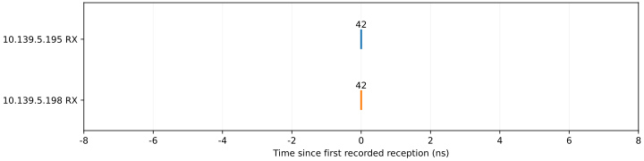

Single-event reception
======================

:doc:`All experiments <scenario_results>`.

Objective
---------

Check that one generated test event reaches both receivers with matching event codes and timestamps.

Setup
-----

.. list-table::
   :header-rows: 1

   * - Device
     - IP address
     - PV prefix
   * - Generator
     - 10.139.5.196
     - EVT:DEV2:20:
   * - Receiver A
     - 10.139.5.195
     - EVT:DEV2:10:
   * - Receiver B
     - 10.139.5.198
     - EVT:DEV2:40:

The chassis used firmware and IOC release 20261017 with a 125 MHz clock.
Receiver timestamps have 8 ns resolution; absolute UTC accuracy was not checked. Codes 42 and 43 were used only for logging; no pulse output was assigned.

.. list-table::
   :header-rows: 1

   * - Table entry
     - Configured offset (ns)
   * - 42
     - 0
   * - 255 (stop; not transmitted)
     - 1,000

Procedure
---------

1. Read receiver status and save the controls and event maps. Require valid links and timestamps, with no FIFO overflow.
2. Check that the test codes are unused. Select them in spare logging slots 3 and 4 on both receivers.
3. Load the listed table into sequencer bank 1. Keep timer and external-input trigger masks disabled.
4. Select Single mode, arm and issue one software trigger.
   Check the hardware run counter to confirm execution.
5. Record receiver logs for 10 seconds. Match the event codes, counts and order.
6. Disarm the bank and restore the controls and maps. Read them again to confirm restoration.

Results
-------

Both receivers recorded 1 of 1 expected events. The code order matched the table. The starting settings were restored and verified.

.. list-table::
   :header-rows: 1

   * - Measurement
     - Recorded result
   * - Receiver difference, B minus A
     - mean 0 ns; standard deviation 0 ns; range 0 to 0 ns
   * - Hardware transmit time
     - Not measured
   * - Transmit-to-receive delay
     - Not measured
   * - Physical output response
     - Not measured; test codes selected logging only

   Each mark is a hardware reception timestamp. Zero is the first recorded reception, not the transmit time.

.. list-table::
   :header-rows: 1

   * - Cycle
     - Event
     - 10.139.5.195 receipt (UTC)
     - 10.139.5.198 receipt (UTC)
     - B − A (ns)
   * - 1
     - 42
     - 2026-11-04 01:49:07.509648224
     - 2026-11-04 01:49:07.509648224
     - 0

Recording: ``20261104T014907Z-4f26f2``. The table was recalculated from the saved receiver rows.
:download:`Event CSV <../_static/timing-check/scenarios/scenario-1-events.csv>` contains the same timestamps.

.. raw:: html

   

Command log

Apply

.. code-block:: bash

   pvput -w 3 EVT:DEV2:10:EVR:LOG:evt3 42
   pvput -w 3 EVT:DEV2:40:EVR:LOG:evt3 42
   pvput -w 3 EVT:DEV2:20:EVG:SEQ:1:disarm 1
   pvput -w 3 EVT:DEV2:20:EVG:SEQ:1:HWrise 0
   pvput -w 3 EVT:DEV2:20:EVG:SEQ:1:HWfall 0
   pvput -w 3 EVT:DEV2:20:EVG:SEQ:1:Tmr 0
   pvput -w 3 EVT:DEV2:20:EVG:SEQ:1:tMode 0
   pvput -w 3 EVT:DEV2:20:EVG:SEQ:1:slo 1000000000
   pvput -w 3 EVT:DEV2:20:EVG:SEQ:1:codes '[42,255]'
   pvput -w 3 EVT:DEV2:20:EVG:SEQ:1:times '[0.0,1000.0]'
   pvput -w 3 EVT:DEV2:20:EVG:SEQ:1:store 1

Trigger

.. code-block:: bash

   pvput -w 3 EVT:DEV2:20:EVG:SEQ:1:arm 1
   pvput -w 3 EVT:DEV2:20:EVG:SEQ:1:trig 1

Disarm

.. code-block:: bash

   pvput -w 3 EVT:DEV2:20:EVG:SEQ:1:disarm 1

Restore

.. code-block:: bash

   pvput -w 3 EVT:DEV2:20:EVG:SEQ:1:disarm 1
   pvput -w 3 EVT:DEV2:20:EVG:SEQ:1:HWrise 0
   pvput -w 3 EVT:DEV2:20:EVG:SEQ:1:HWfall 0
   pvput -w 3 EVT:DEV2:20:EVG:SEQ:1:Tmr 0
   pvput -w 3 EVT:DEV2:20:EVG:SEQ:1:tMode 0
   pvput -w 3 EVT:DEV2:20:EVG:SEQ:1:slo 1000000000.0
   pvput -w 3 EVT:DEV2:20:EVG:SEQ:1:codes '[0]'
   pvput -w 3 EVT:DEV2:20:EVG:SEQ:1:times '[0.0]'
   pvput -w 3 EVT:DEV2:20:EVG:SEQ:1:store 1
   pvput -w 3 EVT:DEV2:10:EVR:LOG:evt3 0
   pvput -w 3 EVT:DEV2:40:EVR:LOG:evt3 0

.. raw:: html

   

Findings
--------

The event reached both receivers with equal reported timestamps. This trial verifies reception, not transmission latency.
These results support timestamp agreement at 8 ns resolution. They do not establish the physical send-to-receive delay.
